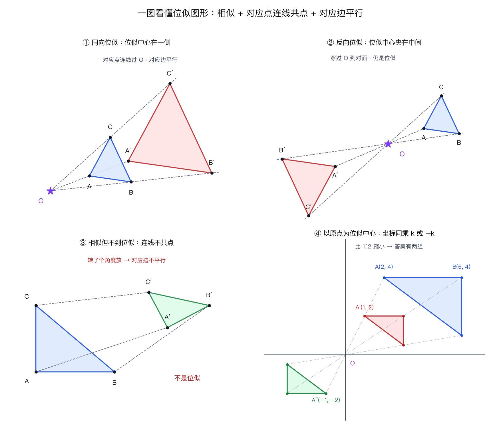
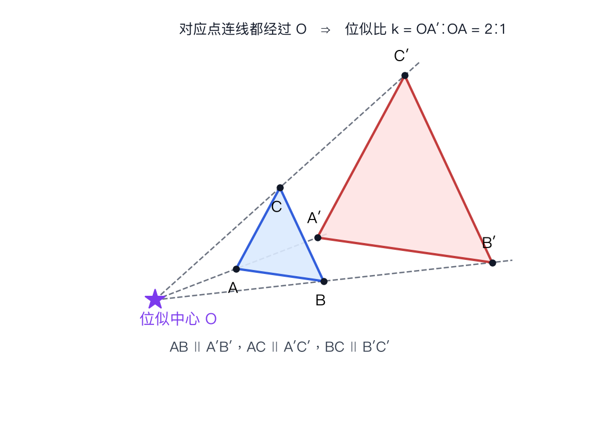
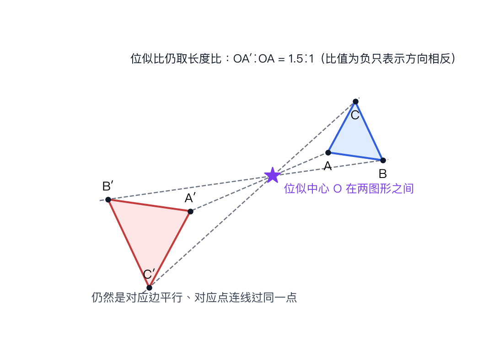
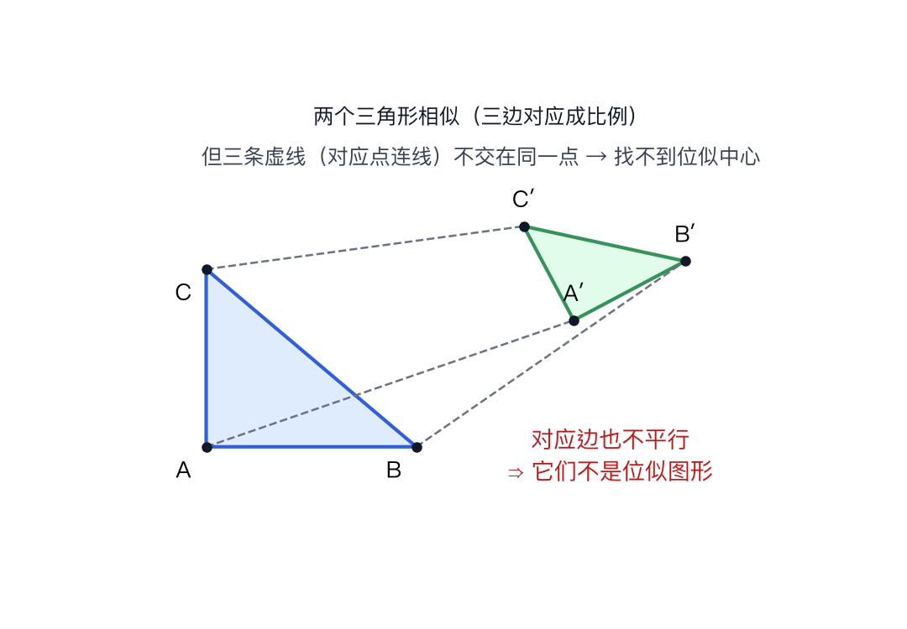
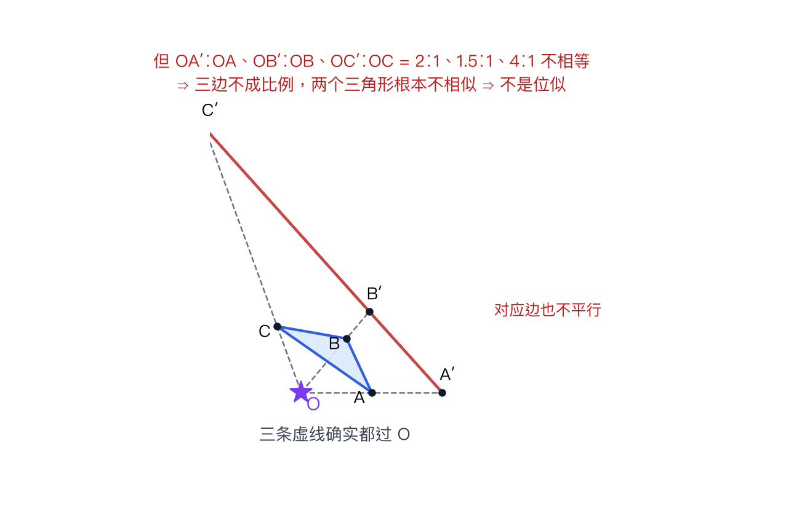
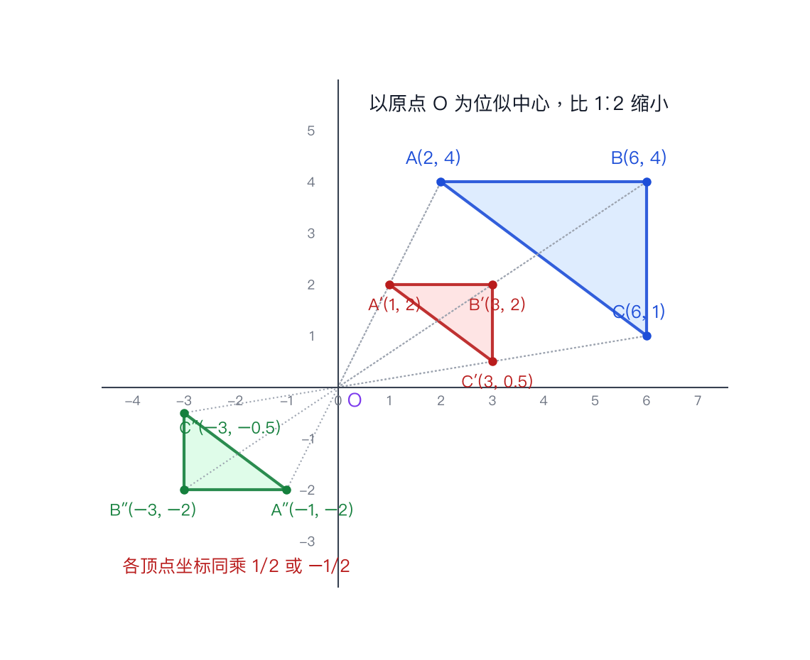

# 什么是位似图形

## 题目

初三数学：什么是位似图形？它和相似图形有什么区别？

- 来源：口头提问
- 难度：⭐ 基础（人教版九年级下册 第二十七章 相似 27.3）
- 考查知识点：位似图形的定义、位似中心、位似比、在坐标系中画位似图形

## 解题思路

- 一句话：**位似 = 相似 + "对应点连线都过同一个点"**。位似是相似的一种特殊情况，不是新的另一种关系。
- 判断两个图形是不是位似，只看两件事：① 它们相似吗？② 每组对应点的连线是不是交在同一点？两个都满足才是位似。
- 那个"共同的交点"就是位似中心；相似比在这时改叫**位似比**，记作 $k$。

## 解答过程

### 一图看懂

### 第一步：课本定义

如果两个图形**不仅相似**，而且**对应顶点的连线相交于一点**，**对应边互相平行**（或在同一条直线上），那么这样的两个图形叫做**位似图形**（homothetic figures），这个交点叫做**位似中心**，此时的相似比也叫**位似比**。

三个条件缺一不可：

| 条件 | 内容 | 少了它会怎样 |
| --- | --- | --- |
| ① 相似 | 形状相同，大小可以不同 | 只是"连线过一点"，不是位似 |
| ② 对应点连线共点 | 每组对应点连成的直线都经过同一个点 | 相似但"歪着放"，不是位似 |
| ③ 对应边平行 | 对应的边互相平行或在同一直线上 | 同上，条件②③其实互相印证 |

### 第二步：看图，位似长什么样

**情形一：位似中心在两个图形的同一侧（同向位似）**

从点 $O$ 出发引三条射线， $\triangle ABC$ 的三个顶点各在三条射线上， $A'$、 $B'$、 $C'$ 在同三条射线上、离 $O$ 更远的位置。所以三条虚线（对应点连线）全部经过 $O$，而且 $AB \parallel A'B'$、 $AC \parallel A'C'$、 $BC \parallel B'C'$。这就是位似，位似比 $k = OA' : OA = 2 : 1$。

**情形二：位似中心夹在两个图形中间（反向位似）**

对应点连线仍然经过同一个点 $O$，只是 $A'$ 落在 $AO$ 延长线的另一侧（穿过 $O$ 到了对面），所以图形看起来"上下颠倒"。它**仍然是位似图形**，位似比照样取长度比 $OA' : OA = 1.5 : 1$。

结论：**位似中心可以在图形外面（同侧、两图之间）、也可以在图形内部，甚至就在某个顶点上**，位置不影响它是不是位似图形。

**情形三：相似但不是位似（反例，最容易考）**

这两个三角形三边对应成比例，肯定相似；但第二个被"转了个角度"放，对应边不再平行，三条对应点连线也不交于同一点，找不到位似中心，所以**它们相似却不到位似**。

**光有"三条连线交于一点"够不够？不够——还得先相似**

从 $O$ 引三条射线，在射线上随手取两组点： $OA' = 2OA$、 $OB' = 1.5OB$、 $OC' = 4OC$。三条对应点连线当然全都过 $O$，但因为三个倍数不一样，大三角形被"沿一条射线拉长了一段"，形状变了（算出来三边比是 $1.83$、 $3.5$、 $3.08$，不成比例），两个三角形连相似都不算，更谈不上位似。

所以正确的"大白话版"是：**先看像不像（相似），再看是不是从一个点"放大/缩小"出来的（连线共点）**。两件事合起来才是位似，只提其中一件都会判断错。

反过来，如果题目已经告诉你"两个图形相似"，那再加"对应顶点连线交于一点"就足够定位似了（这时对应边平行会自动成立，是位似推出的性质，不用另外验）。

### 第三步：位似的性质（会用到计算的三条）

设位似比为 $k$（取正数）：

- 对应点到位似中心的距离之比 = $k$，即 $OA' : OA = k$
- 对应线段之比 = 周长之比 = $k$
- 面积之比 = $k^2$（这一条最容易忘：位似比 2∶1，面积比是 4∶1）

### 第四步：怎么画一个位似图形（课本基本画法）

题目：画出 $\triangle ABC$ 关于位似中心 $O$、位似比 $2:1$ 的位似图形。

1. 任取一点 $O$ 作为位似中心（题目没给就自己定一个，别放在图形上以免线重叠看不清）；
2. 连 $OA$、 $OB$、 $OC$ 并延长；
3. 在延长线上依次取 $A'$、 $B'$、 $C'$，使 $OA' = 2OA$、 $OB' = 2OB$、 $OC' = 2OC$；
4. 顺次连接 $A'$、 $B'$、 $C'$。

注意：第 3 步也可以在 $O$ 的**另一侧**取点（反向位似），所以"以 $O$ 为位似中心、比 $2:1$"的图形其实有**两个**，题目没说方向时两个都要画。

### 第五步：在坐标系里看位似（北京中考常考）

以**原点 $O$** 为位似中心，位似比为 $k$ 时，每个顶点的横、纵坐标同时变成原来的 $k$ 倍或 $-k$ 倍：

$$(x,\ y)\ \longrightarrow\ (kx,\ ky)\quad \text{或}\quad (-kx,\ -ky)$$

图中 $\triangle ABC$ 的顶点是 $A(2,4)$、 $B(6,4)$、 $C(6,1)$，以原点为位似中心、比 $1:2$ 缩小，得到两个结果：

- 同侧： $A'(1,2)$、 $B'(3,2)$、 $C'(3,0.5)$
- 反向： $A''(-1,-2)$、 $B''(-3,-2)$、 $C''(-3,-0.5)$

## 相关知识点

- 位似一定是相似，相似不一定位似：位似 $\Rightarrow$ 相似，反过来不成立
- 位似图形的对应边平行（或在同一直线上），这是判断"是不是位似"最快的肉眼办法
- 位似中心到两图形对应点的距离之比 = 位似比，所以位似比可以直接用坐标或线段长度来量
- 相似图形全部性质对位似都成立：周长比 = 相似比、面积比 = 相似比的平方、对应高/中线/角平分线比 = 相似比
- 位似属于图形的"全等—平移/对称/旋转、相似—位似"这条线：平移、旋转、轴对称改变位置不改变大小；位似改变大小不改变形状

## 易错点提醒

- **漏掉反向的那个图形**：坐标系里"以原点为位似中心，比 $2:1$"要写 $(2x,2y)$ 和 $(-2x,-2y)$ 两组，只写一组是标准扣分点
- **把相似比和面积比混了**：位似比 $2:1$ → 面积比 $4:1$，不是 $2:1$
- **位似比写成负数**：说"位似比"时一般指长度比，取正值；负号只表示对应点在位似中心的两侧
- **看到两个图形大小不同就说是位似**：必须"形状相同（相似）+ 对应点连线共点"，被旋转过的相似图形不是位似
- **只记"连线交于一点"这一条**：漏了"相似"，就会把"沿一条射线拉长"的不相似图形也认成位似（见第 06 张图）；反过来只记"相似"也不行（见第 03 张图）。两条必须一起用
- **判断对应点连线共点时用了错配的对应点**： $A$ 必须连 $A'$（对应顶点），不能随手连最近的那个点
- **画图时只延长不按比例**： $OA'$ 要用圆规或直尺准确量成 $k$ 倍，随手画会被判"作图不规范"

## 自测（下次抽查就从这里出）

1. 两个图形对应顶点的连线都交于一点，它们一定位似吗？
2. 以原点为位似中心，把 $A(3,-4)$ 所在图形按位似比 $2:1$ 放大， $A$ 的对应点坐标是什么？
3. 两个位似图形的面积比是 $9:1$，它们的位似比是多少？

答案

1. 不一定。连线共点只保证"从一个点散开"，还得两个图形相似才行——第 06 张图里三条线都过 $O$，但三个倍数不同，形状都变了。反过来，题目若已说明"两个相似三角形"，再加连线共点就够定位似。
2. $(6,-8)$ 或 $(-6,8)$，两组都要写。
3. $3:1$（面积比是位似比的平方， $9:1 = 3^2 : 1^2$）。

## 复盘

- 错因：概念不清（位似与相似的关系、坐标系中位似有两种位置）
- 掌握状态：未掌握
- 复习记录：
  - （20261024 首次归档，尚未抽查）
  - （20261024 追问："只看三条连线交于一点就行"→ 说明漏了"相似"这一半，补第 06 张反例图；仍算未掌握，下次抽查出判断题）
