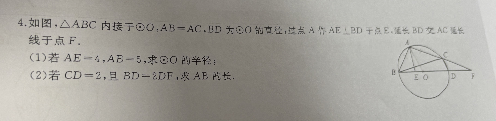
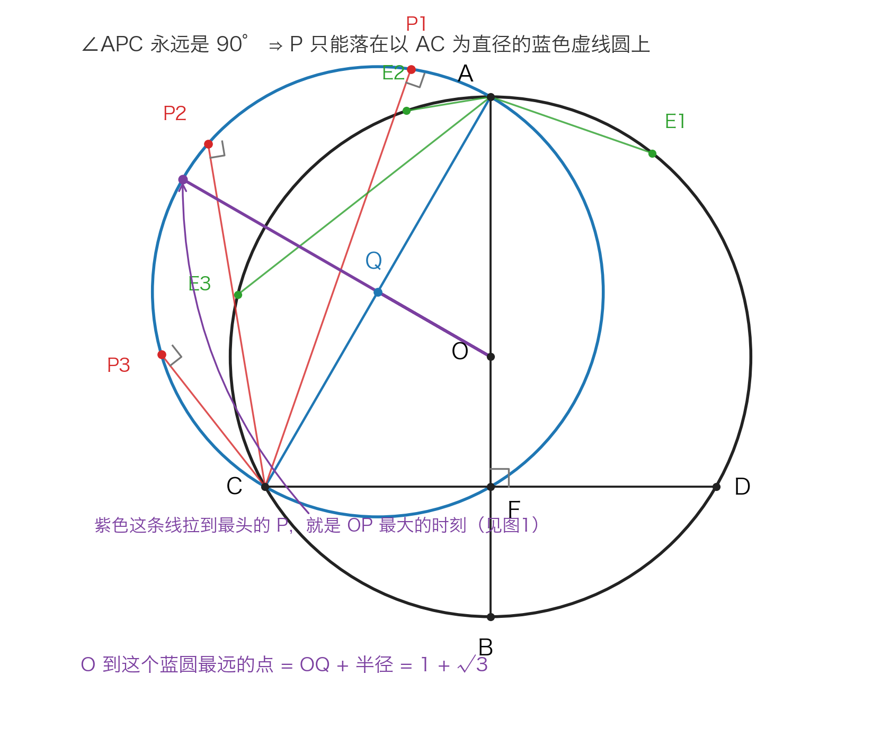
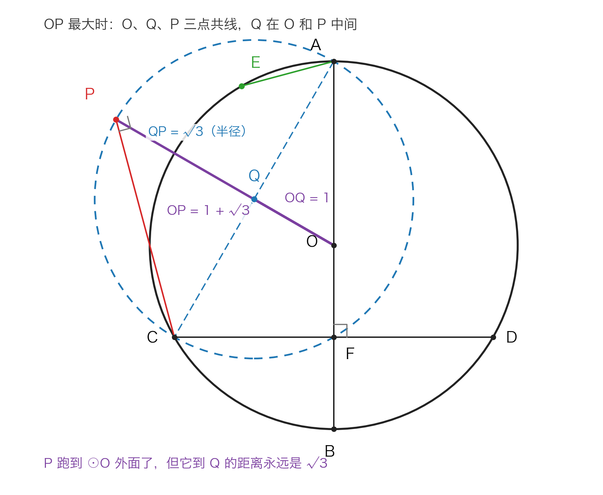

# 圆中动点 P 到圆心 O 的距离最大值（OP = √3 + 1）

## 题目

如图，⊙ $O$ 的直径 $AB \perp$ 弦 $CD$ 于点 $F$， $OA = 2$， $OF = 1$，点 $E$ 为 ⊙ $O$ 上一动点， $CP \perp$ 直线 $AE$ 于点 $P$，连接 $OP$。点 $E$ 在 ⊙ $O$ 上运动的过程中，线段 $OP$ 长的最大值为 ____。

- 来源：学校（错题本拍照）
- 难度：⭐⭐⭐ 中考压轴填空（圆的最值 + 隐圆轨迹）
- 考查知识点：垂径定理、勾股定理、直角三角形斜边中线、**隐圆（到定点距离不变的点的轨迹）**、三角形三边关系求最值

## 一句话抓住这道题

$E$ 在动， $P$ 也在动，看上去没法下手。但有一件事**永远不变**： $\angle APC = 90^\circ$。
"对着一段定线段 $AC$ 张成直角的点"，全都落在以 $AC$ 为直径的圆上 —— 所以 $P$ 其实是在一个**固定的圆**上跑。
于是"求 $OP$ 最大值"就变成了"**圆外一点 $O$ 到另一个圆上的点，最远能有多远**"。

## 解题思路

- 关键点 1：先算出 $AF$ 和 $CF$。 $OF = 1$ 且 $F$ 在 $O$ 下方（靠 $B$ 一侧），所以 $AF = AO + OF = 3$； $CF = \sqrt{OC^2 - OF^2} = \sqrt{4 - 1} = \sqrt{3}$。
- 关键点 2： $AC = \sqrt{AF^2 + CF^2} = \sqrt{9 + 3} = 2\sqrt{3}$。取 $AC$ 中点 $Q$，则 $AQ = CQ = \sqrt{3}$，且 $OQ \perp AC$， $OQ = \sqrt{OA^2 - AQ^2} = \sqrt{4 - 3} = 1$。
- 关键点 3： $\angle APC = 90^\circ$， $QP$ 是直角三角形 $APC$ 斜边 $AC$ 上的中线，所以 $QP = \dfrac{1}{2}AC = \sqrt{3}$ —— **这是永远不变的量**， $P$ 在以 $Q$ 为圆心、 $\sqrt{3}$ 为半径的圆上。
- 关键点 4： $OP \le OQ + QP = 1 + \sqrt{3}$，当且仅当 $O$、 $Q$、 $P$ 三点共线且 $Q$ 在中间时取等号。

## 解答过程

**第 1 步：把 $AC$ 求出来**

因为 $AB \perp CD$ 于 $F$，所以 $\angle AFC = 90^\circ$。
在 Rt $\triangle OCF$ 中， $OC = OA = 2$， $OF = 1$，得 $CF = \sqrt{2^2 - 1^2} = \sqrt{3}$。
在 Rt $\triangle ACF$ 中， $AF = AO + OF = 3$，得 $AC = \sqrt{(\sqrt{3})^2 + 3^2} = 2\sqrt{3}$。

**第 2 步：找一个"不动"的点 $Q$**

取 $AC$ 的中点 $Q$，连 $OQ$。因为 $OA = OC$（都是半径），等腰三角形三线合一，所以 $OQ \perp AC$，且 $AQ = \sqrt{3}$。
在 Rt $\triangle AOQ$ 中： $OQ = \sqrt{OA^2 - AQ^2} = \sqrt{4 - 3} = 1$。
注意 $Q$ 是 $AC$ 的中点， $A$、 $C$ 都是定点，所以 ** $Q$ 是定点， $OQ = 1$ 也是定长**。

**第 3 步：证明 $P$ 到一个定点的距离是定长（隐圆）**

因为 $CP \perp$ 直线 $AE$，所以 $\angle APC = 90^\circ$，即 $\triangle APC$ 是以 $AC$ 为斜边的直角三角形。
直角三角形斜边上的中线等于斜边的一半，而 $Q$ 正是斜边 $AC$ 的中点，所以

$$QP = \frac{1}{2}AC = \sqrt{3} \quad (\text{与 } E \text{ 的位置无关})$$

一句话：**不管 $E$ 怎么跑， $P$ 始终在以 $Q$ 为圆心、 $\sqrt{3}$ 为半径的圆上。**

**第 4 步：把"最值"落到三点共线上**

在 $\triangle OPQ$ 中（ $O$、 $P$、 $Q$ 三点），两边之和大于第三边：

$$OP \le OQ + QP = 1 + \sqrt{3}$$

等号成立的条件是 $O$、 $Q$、 $P$ 三点共线，并且 $Q$ 夹在 $O$ 和 $P$ 中间（也就是 $P$ 站在"背对 $O$ 的那一侧"）。

**第 5 步：最大值时的图形长什么样（你问的这一问）**

把图放进坐标系看最清楚： $O(0,0)$， $A(0,2)$， $F(0,-1)$， $C(-\sqrt{3}, -1)$， $Q\left(-\dfrac{\sqrt{3}}{2}, \dfrac{1}{2}\right)$。

沿 $O \to Q$ 方向再走一个半径 $\sqrt{3}$，就落到最大值时的 $P$：

- $P$ 的坐标： $\left(-\dfrac{3 + \sqrt{3}}{2},\ \dfrac{1 + \sqrt{3}}{2}\right) \approx (-2.37,\ 1.37)$
- $OP = \sqrt{3} + 1 \approx 2.73$（比半径 2 大，**说明 $P$ 跑到 ⊙ $O$ 外面去了**，这很正常， $P$ 本来就不在 ⊙ $O$ 上）
- 对应的 $E$ 正好是 $\left(-1, \sqrt{3}\right) \approx (-1, 1.73)$，验证： $(-1)^2 + (\sqrt{3})^2 = 4 = 2^2$，确实在 ⊙ $O$ 上；它落在 $A$ 与 $P$ 之间（ $AE \approx 1.035$， $AP \approx 2.449$）
- 此时 $O$、 $Q$、 $P$ 在一条直线上，顺序是 $P - Q - O$；直线 $AE$ 就是从 $A$ 出发、往左上指向 $(-1, \sqrt{3})$ 的那条线

大白话说：** $P$ 离 $O$ 最远的那一刻，就是" $P$ 被 $Q$ 顶到最外面"的那一刻** —— $OQ$ 这段 1 走到底，再顺着同一条直线往外伸出半径 $\sqrt{3}$，一共 $1 + \sqrt{3}$。

## 相关知识点

- **垂径定理**：直径垂直于弦 ⇒ 平分弦和弦所对的两条弧。
- **直角三角形斜边中线 = 斜边一半**：这是识别"隐圆"的招牌工具。反过来也成立：若一点对定线段张成直角，则该点在以定线段为直径的圆上。
- **点与圆的最值**：点到圆上点的距离，最小值 $=|d - r|$，最大值 $= d + r$（ $d$ 是点到圆心的距离）。本题 $d = OQ = 1$， $r = \sqrt{3}$。
- **三角形三边关系**： $OP \le OQ + QP$，取等号 ⇔ 三点共线。

## 易错点提醒

- ** $AF$ 是 3 不是 1**： $F$ 在 $O$ 下方（靠 $B$ 一侧）， $AF = AO + OF = 3$。如果误当成 $AF = 2 - 1 = 1$，会算出 $AC = 2$、 $OQ = \sqrt{3}$、 $QP = 1$，最大值仍是 $\sqrt{3} + 1$（两数刚好对调），但中间每一步的图形都和真图不符，改成别的数字立刻全错。
- ** $P$ 不在 ⊙ $O$ 上**： $P$ 是垂足，它在以 $AC$ 为直径的**另一个圆**上。别把两个圆混成一个。
- **取等号的条件要检查能不能达到**： $P$ 要能跑到 $OQ$ 延长线与蓝圆的交点上。本题 $E$ 可以在 ⊙ $O$ 上任意跑，直线 $AE$ 能取到那个方向，所以能取等。
- **" $OP \le OQ + QP$" 不是答案，共线那一刻才是**：写最值题必须说明等号成立的条件，否则扣分。

## 复盘

- 错因：方法不熟（没看出 $P$ 的轨迹是一个隐圆，也不清楚最大值那一刻图形的样子）
- 掌握状态：未掌握
- 复习记录：
  - （20261121 首次归档：学生追问"OP 最大时图长什么样、P 在哪儿"，已补画精确坐标图并给出 P、E 的坐标）
