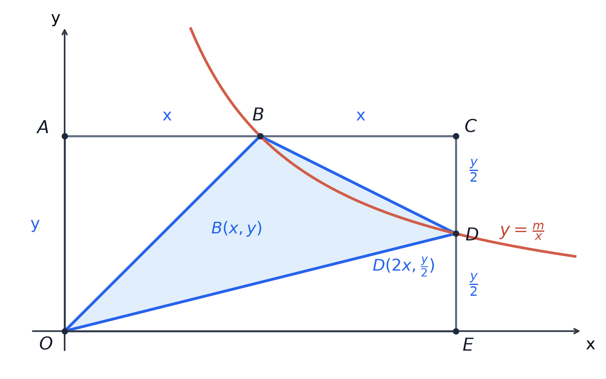
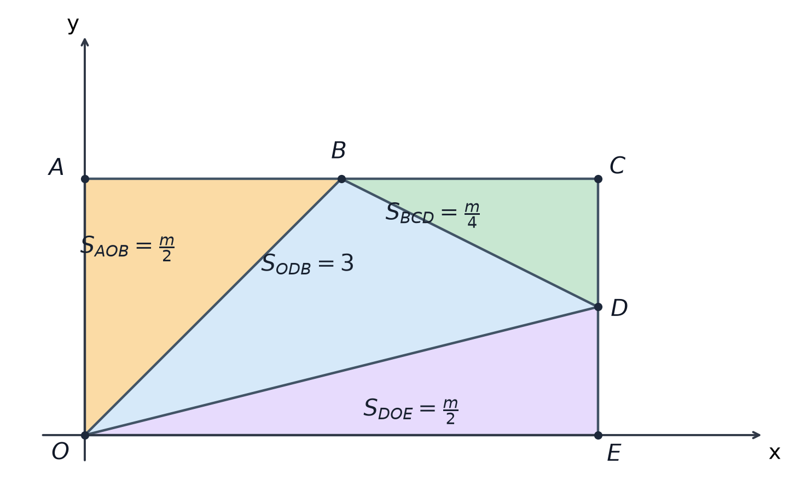

# 反比例函数与矩形面积：由中点找坐标，再用面积求系数

## 题目

如图，矩形 $OACE$ 的顶点 $A$、 $E$ 分别在 $y$ 轴、 $x$ 轴的正半轴上， $B$ 为 $AC$ 的中点。反比例函数 $y=\dfrac{m}{x}$（ $m>0$）的图象经过点 $B$，且与 $EC$ 交于点 $D$。连接 $OD$、 $OB$、 $DB$。若 $\triangle ODB$ 的面积为 $3$，判断下列结论：

① $\triangle AOB$ 与 $\triangle DOE$ 的面积一定相等；

② $\triangle BDC$ 的面积为 $1$；

③ $m=4$；

④ $D$ 为 $CE$ 的中点。

选项：A. ①②③；B. ①②④；C. ②③④；D. ①②③④。

> 图为便于理解选取的一个**满足题目条件的具体形状**（可取 $B(2,2)$），推理时仍用一般的 $x$、 $y$；图中的长度、点的位置关系都符合题意。

- 来源：题目截图提问（未注明学校或课外班；暂归档在“学校”目录）
- 难度：⭐⭐ 中考综合（反比例函数 + 中点 + 三角形面积）
- 考查知识点：反比例函数 $xy=m$、矩形对边平行、中点坐标关系、三角形面积、割补法
- 答案：**D（①②③④均正确）**

## 一句话抓住这道题

**先用“ $B$ 是中点”推出 $C$ 的横坐标是 $B$ 的两倍，再用“ $B,D$ 在同一条反比例函数上”推出 $D$ 的纵坐标是 $B$ 的一半，最后把矩形分成四个三角形。**

不要一开始就盯着阴影三角形 $\triangle ODB$ 找“底”和“高”：它的三条边都是斜着的，直接算不方便；**大矩形减去三个角**更简单。

## 解题思路

1. 设 $B(x,y)$（ $x>0$， $y>0$），借助中点关系写出 $A,C,E$ 的坐标。
2. 反比例函数图象上的每一个点都满足 **横坐标 × 纵坐标 = $m$**。利用 $B$ 和 $D$ 求出 $D$ 的坐标，先判断结论④。
3. 把矩形分成 $\triangle AOB$、 $\triangle BCD$、 $\triangle DOE$、 $\triangle ODB$ 四部分，逐个求面积。
4. 由已知 $S_{\triangle ODB}=3$ 求出 $xy=m$，再判断①②③。

## 解答过程

### 第 1 步：为什么设 $B(x,y)$，就能知道 $C(2x,y)$？

设 $B(x,y)$。因为 $A$ 在 $y$ 轴上，且矩形上边 $AC$ 水平，所以：

- $A(0,y)$；
- $AB=x$（从横坐标 $0$ 走到 $x$）；
- 因为 $B$ 是 $AC$ 的中点，所以 $AB=BC=x$；
- 从 $A$ 到 $C$ 一共走了两个 $x$，所以 $C(2x,y)$；
- $E$ 在 $C$ 的正下方、 $x$ 轴上，所以 $E(2x,0)$。

现在已知：

| 点 | 坐标 | 为什么 |
| --- | --- | --- |
| $O$ | $(0,0)$ | 原点 |
| $A$ | $(0,y)$ | 在 $y$ 轴，且与 $B,C$ 等高 |
| $B$ | $(x,y)$ | 自己设的 |
| $C$ | $(2x,y)$ | $AB=BC=x$ |
| $E$ | $(2x,0)$ | 在 $x$ 轴，且在 $C$ 的正下方 |

**为什么不直接设矩形宽为 $a$、高为 $b$？** 也能做，只是还要把 $B$ 写成 $(\frac a2,b)$。直接设 $B(x,y)$ 可以少写一次分数。

### 第 2 步：为什么 $D$ 恰好是 $CE$ 的中点？

先看横坐标： $D$ 位于竖直的 $CE$ 上，所以 $D$ 的横坐标与 $C,E$ 相同，是 $2x$。

设 $D(2x,t)$。因为 $B$、 $D$ 都在 $y=\dfrac{m}{x}$ 上，它们的横、纵坐标相乘都等于同一个 $m$：

$$
\begin{aligned}
B(x,y)&:\quad xy=m,\\
D(2x,t)&:\quad 2xt=m.
\end{aligned}
$$

把两式相等：

$$
xy=2xt.
$$

由于 $x>0$，两边除以 $x$，再除以 $2$：

$$
t=\frac y2.
$$

因此：

$$
\boxed{D\left(2x,\frac y2\right)}
$$

而 $C$ 的纵坐标是 $y$， $E$ 的纵坐标是 $0$，所以：

$$
CD=y-\frac y2=\frac y2,\qquad DE=\frac y2-0=\frac y2.
$$

于是 $CD=DE$，即 **④正确**。

> **这里要理解“为什么”**：同一条反比例函数上，横坐标变为原来的 $2$ 倍，纵坐标必须变为原来的 $\frac12$，乘积才会保持为 $m$。这不是因为“看图像像中点”，而是算出来的。

### 第 3 步：把大矩形分成四块，先别急着计算

图中四块**刚好拼成整个矩形，没有重叠也没有遗漏**：

$$
S_{\text{矩形}}=S_{\triangle AOB}+S_{\triangle BCD}+S_{\triangle DOE}+S_{\triangle ODB}.
$$

已知的线段为：

$$
AB=BC=x,\quad AO=CE=y,\quad OE=AC=2x,\quad CD=DE=\frac y2.
$$

逐块计算。始终记住初中面积公式：

$$
S_{\text{三角形}}=\frac12\times\text{底}\times\text{高}.
$$

**左上角 $\triangle AOB$**

取水平的 $AB$ 为底（长 $x$），竖直的 $AO$ 为高（长 $y$）：

$$
S_{\triangle AOB}=\frac12xy.
$$

**右上角 $\triangle BCD$**

取水平的 $BC$ 为底（长 $x$），竖直的 $CD$ 为高（长 $\frac y2$）：

$$
S_{\triangle BCD}=\frac12\times x\times\frac y2=\frac14xy.
$$

**右下角 $\triangle DOE$**

取水平的 $OE$ 为底（长 $2x$），竖直的 $DE$ 为高（长 $\frac y2$）：

$$
S_{\triangle DOE}=\frac12\times2x\times\frac y2=\frac12xy.
$$

现在比较左上与右下：

$$
S_{\triangle AOB}=\frac12xy=S_{\triangle DOE}.
$$

所以 **①正确**。注意不是两个三角形“看起来一样大”，而是因为**底×高相同**。

### 第 4 步：为什么 $\triangle ODB$ 面积为 $3$ 就能求出 $m$？

矩形宽为 $2x$、高为 $y$，所以：

$$
S_{\text{矩形}}=2xy.
$$

把刚才算出的三个角从矩形中扣除：

$$
\begin{aligned}
S_{\triangle ODB}
&=2xy-\frac12xy-\frac14xy-\frac12xy\\
&=\left(\frac84-\frac24-\frac14-\frac24\right)xy\\
&=\frac34xy.
\end{aligned}
$$

题目给 $S_{\triangle ODB}=3$，因此：

$$
\frac34xy=3.
$$

两边乘以 $\frac43$：

$$
\boxed{xy=4}.
$$

又因为 $B(x,y)$ 在反比例函数图象上， $xy=m$，所以：

$$
\boxed{m=4}.
$$

所以 **③正确**。

### 第 5 步：最后求 $\triangle BDC$ 的面积

第 3 步早已得到：

$$
S_{\triangle BDC}=\frac14xy.
$$

由第 4 步 $xy=4$：

$$
S_{\triangle BDC}=\frac14\times4=\boxed{1}.
$$

所以 **②正确**。四项都对，选择 **D**。

## 更快的想法：用“占整个矩形的几分之几”

熟练以后不必每次写很长的代数式。矩形面积是 $2xy$，所以：

| 区域 | 面积 | 占矩形面积 |
| --- | --- | --- |
| $\triangle AOB$ | $\frac12xy$ | $\frac14$ |
| $\triangle BCD$ | $\frac14xy$ | $\frac18$ |
| $\triangle DOE$ | $\frac12xy$ | $\frac14$ |
| $\triangle ODB$ | $\frac34xy$ | $\frac38$ |

因为中间的 $\triangle ODB$ 占整个矩形的 $\frac38$，它的面积为 $3$，所以矩形面积：

$$
S_{\text{矩形}}=3\div\frac38=8.
$$

于是：

- $2xy=8$，所以 $m=xy=4$；
- $\triangle BCD$ 占矩形 $\frac18$，所以面积 $8\times\frac18=1$；
- 左上和右下各占 $\frac14$，因此面积相等。

这种**先找面积比例**的方法，在北京中考选择、填空中尤其省时间。

## 相关知识点

1. **反比例函数的面积意义**：对 $y=\dfrac{m}{x}$ 上第一象限任一点 $(x,y)$，都有 $xy=m$。由它向两坐标轴作垂线，围成的长方形面积是 $m$；与坐标轴组成的直角三角形面积是 $\frac m2$。
2. **中点不仅能平分线段，还能帮我们确定坐标**：本题 $AB=BC$，所以横坐标从 $0$ 到 $x$ 再到 $2x$。
3. **面积割补法**：求一个不好直接找高的三角形，可以找一个规则大图形，减去几个易算的小图形。
4. **底、高必须对应且垂直**： $\triangle BCD$ 的 $BC$ 与 $CD$ 垂直； $\triangle DOE$ 的 $OE$ 与 $DE$ 垂直。不能因为图中画了 $OB$、 $OD$ 就直接拿它们相乘。

## 易错点提醒

- **不要直接认定 $D$ 为中点**：题目只说 $B$ 是 $AC$ 中点， $D$ 是中点需要靠同一条反比例函数的 $xy=m$ **推出来**。
- **别写 $D(2x,y)$**：横坐标从 $x$ 变为 $2x$，纵坐标必须从 $y$ 变为 $\frac y2$。
- **不要把 $m$ 和某一个三角形的面积混为一谈**： $m=xy$； $\triangle AOB$ 面积是 $\frac m2$； $\triangle BCD$ 面积是 $\frac m4$；中间 $\triangle ODB$ 面积是 $\frac{3m}{4}$。
- **计算 $\triangle DOE$ 时，底是 $OE=2x$，不是 $x$**；计算 $\triangle BCD$ 时，底是 $BC=x$，不是 $2x$。
- **矩形只减三个角**：四个区域恰好覆盖大矩形。如果既减了 $\triangle BCD$ 又减了一个包含它的更大三角形，就会重复减。
- **图上尺寸不能代替推理**：即使画得不标准， $D$ 为中点也是确定的；只看“好像一半”不能得分。

## 复习自测（先自己做，再看答案）

**题 1（原题数值变式）**：矩形与中点、反比例函数条件都不变，但 $S_{\triangle ODB}=6$。求 $m$ 与 $S_{\triangle BCD}$。

**题 2（反向出题）**：矩形与中点条件不变，反比例函数为 $y=\dfrac{12}{x}$。求 $S_{\triangle ODB}$ 与 $S_{\triangle DOE}$。

**题 3（识别陷阱）**：如果改成 $AB:BC=1:2$，其余图形关系不变， $D$ 还一定是 $CE$ 的中点吗？说明理由。

展开自测答案

- **题 1**： $S_{\triangle ODB}=\frac34m$，所以 $6=\frac34m$，得 $m=8$； $S_{\triangle BCD}=\frac14m=2$。
- **题 2**： $S_{\triangle ODB}=\frac34\times12=9$； $S_{\triangle DOE}=\frac12\times12=6$。
- **题 3**：**不一定，实际上 $D$ 不是中点。** 设 $B(x,y)$，因 $AB:BC=1:2$，有 $C(3x,y)$，所以 $D$ 的横坐标为 $3x$。又因 $B,D$ 在同一反比例函数上， $xy=3x\cdot y_D$，所以 $y_D=\frac y3$。即 $DE=\frac y3$、 $CD=\frac{2y}{3}$，不相等。

## 复盘

- 错因：方法不熟（原参考答案直接跳过“为何 $D$ 是中点”“为何三角形面积相等”，且面积拆分不够直观）
- 掌握状态：未掌握
- 复习记录：
  - 20261122 首次归档：补全点坐标推导、矩形四块面积图、逐项判断及三道变式练习；待实际抽查孩子掌握情况。
