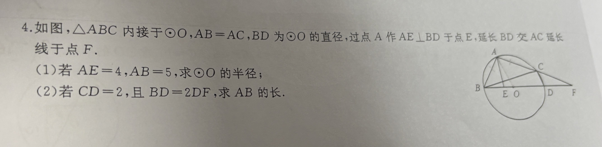

# 内接等腰三角形 + 直径：造直角、用中位线（记题待做）

## 题目

4. 如图， $\triangle ABC$ 内接于 $\odot O$ ， $AB=AC$ ， $BD$ 为 $\odot O$ 的直径，过点 $A$ 作 $AE\perp BD$ 于点 $E$ ，延长 $BD$ 交 $AC$ 延长线于点 $F$ 。

(1) 若 $AE=4$ ， $AB=5$ ，求 $\odot O$ 的半径；

(2) 若 $CD=2$ ，且 $BD=2DF$ ，求 $AB$ 的长。

- 来源：课外班·老刘数学讲义拍照
- 难度：⭐⭐⭐ 超中考
- 考查知识点：圆周角定理推论（直径所对的圆周角是直角）、三角形中位线定理、等腰三角形与圆的综合

## 解题思路

只记题，暂不解答。口头提示：

- 先用「直径所对的圆周角是直角」： $BD$ 是直径 $\implies \angle BCD=90^\circ$
- 再利用三角形中位线长度，把 $CD$ 的长转移进关系里

## 解答过程

（待做）

## 相关知识点

- 直径所对的圆周角是直角；反过来，90° 的圆周角所对的弦是直径
- 三角形的中位线平行于第三边，且等于第三边的一半
- 等弦对等弧、等弧对等圆周角（配合 $AB=AC$ 使用）

## 易错点提醒

- （待做后补充）

## 复盘

- 错因：无（尚未作答）
- 掌握状态：未掌握
- 复习记录：
  - （待抽查）