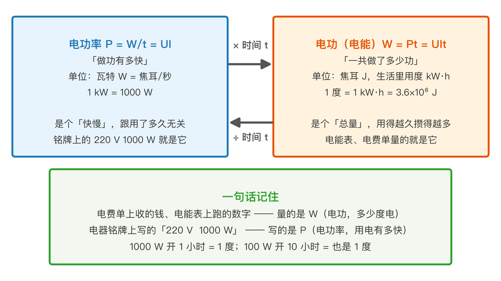
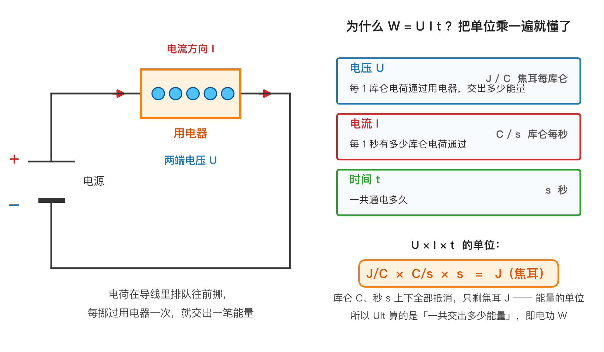
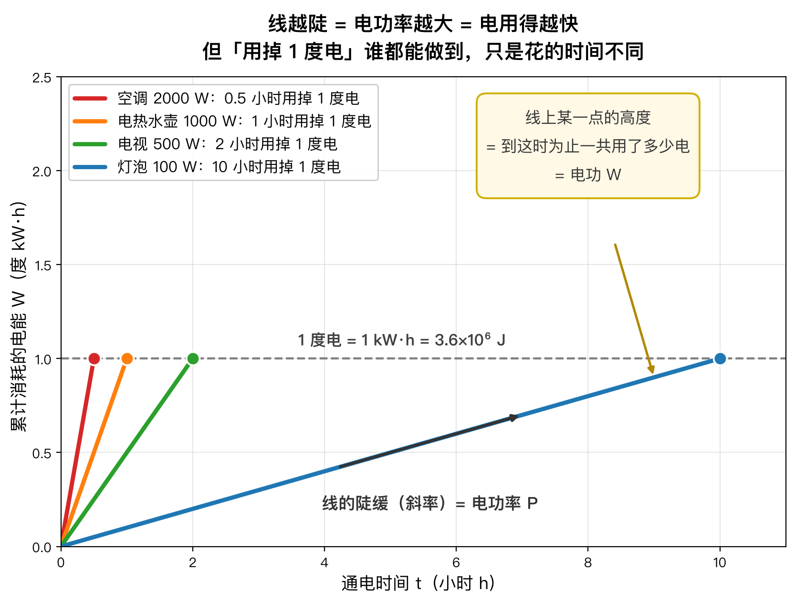

# 电能、电功、电功率：P = UI 和 UIt 到底是什么关系

## 问题

学初三「电能和电功率」时的三个疑问：

1. $P = UI$ ，这里的 $P$ 是什么？
2. $UIt$ 又是什么？
3. 有「电功」这个名词吗？

这三个东西的物理意义到底是什么，分别指什么，该怎么理解？

- 来源：口头提问（课内概念梳理，人教版九年级第十八章《电功率》）
- 难度：⭐ 基础（概念辨析，但是后面所有电功率计算的地基）
- 考查知识点：电功（电能） $W = UIt$ 、电功率 $P = UI = W/t$ 、千瓦时与焦耳换算、额定功率与实际功率、纯电阻与非纯电阻

---

## 先给结论：这是两个量，不是三个

| 式子 | 名字 | 物理意义 | 单位 |
|---|---|---|---|
| $P = UI$ | **电功率** | 电流做功有多**快**（每秒消耗多少电能） | 瓦特 W，千瓦 kW |
| $UIt$ | **电功 W**（= 消耗的电能） | 通电 $t$ 秒**一共**消耗了多少电能 | 焦耳 J，度 kW·h |

「电功」这个名词**有**。人教版九年级第十八章第一节的标题就叫《电能 电功》。而且**电功和消耗的电能是同一个量**，共用字母 $W$ ，单位都是焦耳。

所以 $P$ 和 $W$ 的关系，就是初二学过的**速度和路程**的关系：

> 速度 $v$ 是「跑得多快」，路程 $s$ 是「一共跑了多远」， $s = vt$ 。
> 电功率 $P$ 是「用电多快」，电功 $W$ 是「一共用了多少电」， $W = Pt$ 。

** $P$ 是个快慢，跟你用了多久没关系； $W$ 是个总量，用得越久攒得越多。** 这是全部问题的钥匙。

---

## 一、为什么 UIt 就是电能？把单位乘一遍就懂了

这是「物理意义」真正的答案。关键在两个单位的隐藏含义。

**电压 $U$** ：单位伏特 V，而 $1 \text{ V} = 1 \text{ J/C}$ （焦耳每库仑）。翻译成人话：**每 1 库仑电荷路过这个用电器，就交出 $U$ 焦耳的能量**。 $U$ 越大，每个电荷交得越多。

**电流 $I$** ：单位安培 A，而 $1 \text{ A} = 1 \text{ C/s}$ （库仑每秒）。翻译成人话：**每秒有 $I$ 库仑电荷路过**。 $I$ 越大，每秒路过的人越多。

把两者乘起来：

$$P = UI = \frac{\text{J}}{\text{C}} \times \frac{\text{C}}{\text{s}} = \frac{\text{J}}{\text{s}} = \text{W（瓦特）}$$

库仑 C 上下抵消了，剩下「每秒多少焦耳」——这不就是「每秒消耗多少电能」吗？所以 ** $P = UI$ 算出来的是快慢**。

再乘上时间 $t$ （秒）：

$$W = UIt = \frac{\text{J}}{\text{s}} \times \text{s} = \text{J（焦耳）}$$

秒也抵消了，只剩焦耳，能量的单位。所以 ** $UIt$ 算出来的是总量**，也就是电功。

**用画面想**：一队电荷在导线里排队往前挪，每挪过用电器一次就交出一笔能量。

- 每个电荷交多少 → 由 $U$ 决定
- 每秒过多少个电荷 → 由 $I$ 决定
- 每秒交出的总能量 = 每个交多少 × 每秒过多少个 = $UI$ = $P$
- 通电 $t$ 秒一共交出 = $UIt$ = $W$

所以 $P = UI$ 和 $W = UIt$ **不是两个独立公式，是同一个式子乘不乘 $t$ 的区别**。

---

## 二、「电功」和「电能」为什么是一回事

教材原话：电流做功的过程，就是电能转化为其他形式能的过程；**电流做了多少功，就有多少电能转化为其他形式的能**。

电炉把电能变成内能，电灯变成光和内能，电风扇变成机械能。用电器消耗掉多少电能，就说电流做了多少功——这两个数永远相等，所以共用一个 $W$ 。

- 说「**电能**」，是从能量角度讲：电路消耗了多少电能。
- 说「**电功**」，是从做功角度讲：电流做了多少功。

同一件事的两种说法，做题时不用区分。

---

## 三、看图像：陡缓是 P，高度是 W

把「累计消耗的电能 $W$ 」画在纵轴、「通电时间 $t$ 」画在横轴，每个用电器都是一条过原点的直线（因为 $W = Pt$ ， $P$ 不变）。

- **线的陡缓（斜率）= 电功率 $P$** 。空调那条最陡，因为它用电最快。
- **线上某一点的高度 = 到这时为止一共用了多少电 = 电功 $W$** 。

四条线都停在「1 度电」那条虚线上，但停的时间不一样：空调 0.5 小时、电热水壶 1 小时、电视 2 小时、灯泡 10 小时。

**1000 W 的电热水壶开 1 小时 = 1 度电；100 W 的灯泡开 10 小时 = 也是 1 度电。** 快慢差了 10 倍，交的电费一样多。这就是 $P$ 和 $W$ 的区别。

度的换算：

$$1 \text{ 度} = 1 \text{ kW·h} = 1000 \text{ W} \times 3600 \text{ s} = 3.6 \times 10^6 \text{ J}$$

---

## 四、生活里怎么对上号

| 你看到的东西 | 它是 P 还是 W |
|---|---|
| 电器铭牌「220 V 1000 W」 | **P** ，额定功率，说它用电有多快 |
| 电能表（电度表）上跑的数字 | **W** ，一共用了多少电 |
| 电费单上的「度」 | **W** ，1 度 = 1 kW·h |
| 「这个灯泡一小时用 0.1 度电」 | **W** （已经乘过时间了） |

电能表两次读数之差 = 这段时间消耗的电能 $W$ ；再除以时间才是 $P$ 。

---

## 易错点提醒

1. **千瓦（kW）是功率单位，千瓦时（kW·h）是电功单位。** 说「这个电器是 1000 千瓦时的」是错的，就像说「我跑了 60 公里每小时的路程」。
2. ** $W = UIt$ 里的 $U$ 、 $I$ 、 $t$ 必须对应同一段电路、同一段时间。** 不能拿电源总电压去配某条支路的电流。
3. ** $P = UI$ 对任何用电器都成立**；但 $P = I^2 R$ 和 $P = U^2 / R$ **只在纯电阻**（电能全部变成内能，如电炉、电热水壶、白炽灯）时才成立。电动机、给手机充电这类不能用后两个。
4. ** $P = UI$ 里的 $U$ 是实际电压**，算出来的是实际功率。只有实际电压等于额定电压时， $P$ 才等于铭牌上的额定功率。
5. 串并联里比功率：串联电流相同，用 $P = I^2 R$ ，**电阻大的功率大**；并联电压相同，用 $P = U^2 / R$ ，**电阻小的功率大**。别记反。

---

## 一句话记住

** $P = UI$ 是「每秒花多少电」（快慢）， $UIt$ 是「这段时间一共花了多少电」（总量），后者的正式名字叫电功，也就是消耗的电能。**

---

## 复习自测

1. 铭牌「220 V 1000 W」的电热水壶，正常工作 30 分钟消耗多少度电？多少焦耳？
   答： $W = Pt = 1 \text{ kW} \times 0.5 \text{ h} = 0.5$ 度 $= 1.8 \times 10^6 \text{ J}$ 。
2. 为什么不能说「1000 W 比 100 W 费电」？
   答：费电多少看 $W$ ，还要乘时间。1000 W 用 0.1 小时和 100 W 用 1 小时都是 0.1 度。
3. 电动机线圈电阻 $R$ ，两端电压 $U$ ，电流 $I$ 。它消耗的电功率能用 $U^2 / R$ 算吗？
   答：不能。电动机不是纯电阻，电能大部分变成机械能，只能用 $P = UI$ 。

## 复盘

- 错因：无（概念提问，非错题）
- 掌握状态：复习中
- 复习记录：
  - （待抽查）