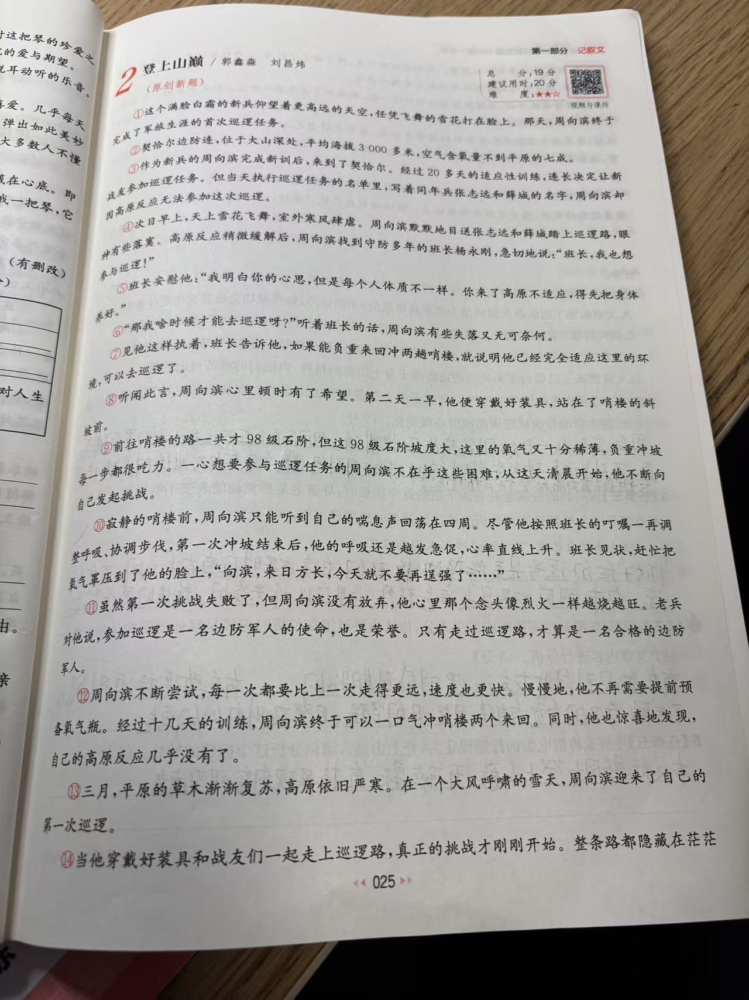
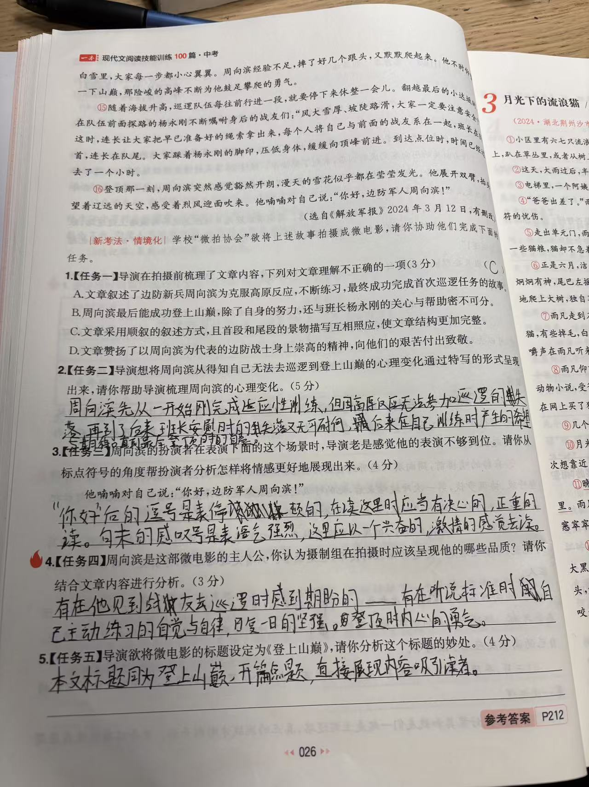

# 《登上山巅》现代文阅读解析（微电影情境任务）

材料出自《一本·现代文阅读技能训练 100 篇·中考》P025–026，原文选自《解放军报》2024 年 3 月 12 日，有删改。全卷 19 分，孩子估分 12～15 分。

| 题 | 满分 | 估分 | 失分主因 |
|---|---|---|---|
| 1 | 3 | 3 | 无 |
| 2 | 5 | 4 | 漏「失败后坚定不放弃」转折节点 |
| 3 | 4 | 2～3 | 读法停在情绪状态，情感没进具体内容 |
| 4 | 3 | 2～3 | 「期盼」不是品质词，勇气的依据配错 |
| 5 | 4 | 1～2 | 标题四维度模板没套上 |

## 一、原文

①这个满脸白霜的新兵仰望着更高远的天空，任凭飞舞的雪花打在脸上。那天，周向滨终于完成了军旅生涯的首次巡逻任务。

②契哈尔边防连，位于大山深处，平均海拔 3000 多米，空气含氧量不到平原的七成。

③作为新兵的周向滨完成新训后，来到了契哈尔。经过 20 多天的适应性训练，连长决定让新战友参加巡逻任务。但当天执行巡逻任务的名单里，写着同年兵张志远和薛城的名字，周向滨却因高原反应无法参加这次巡逻。

④次日早上，天上雪花飞舞，室外寒风肆虐。周向滨默默地目送张志远和薛城踏上巡逻路，眼神有些落寞。高原反应稍微缓解后，周向滨找到守防多年的班长杨永刚，急切地说：「班长，我也想参与巡逻！」

⑤班长安慰他：「我明白你的心思，但是每个人体质不一样。你来了高原不适应，得先把身体养好。」

⑥「那我啥时候才能去巡逻呀？」听着班长的话，周向滨有些失落又无可奈何。

⑦见他这样执着，班长告诉他，如果能负重来回冲两趟哨楼，就说明他已经完全适应这里的环境，可以去巡逻了。

⑧听闻此言，周向滨心里顿时有了希望。第二天一早，他便穿戴好装具，站在了哨楼的斜坡前。

⑨前往哨楼的路一共才 98 级石阶，但这 98 级石阶坡度大，这里的氧气又十分稀薄，负重冲坡每一步都很吃力。一心想要参与巡逻任务的周向滨不在乎这些困难，从这天清晨开始，他不断向自己发起挑战。

⑩寂静的哨楼前，周向滨只能听到自己的喘息声回荡在四周。尽管他按照班长的叮嘱一再调整呼吸、协调步伐，第一次冲坡结束后，他的呼吸还是越发急促，心率直线上升。班长见状，赶忙把氧气罩压到了他的脸上，「向滨，来日方长，今天就不要再逞强了……」

⑪虽然第一次挑战失败了，但周向滨没有放弃，他心里那个念头像烈火一样越烧越旺。老兵对他说，参加巡逻是一名边防军人的使命，也是荣誉。只有走过巡逻路，才算是一名合格的边防军人。

⑫周向滨不断尝试，每一次都要比上一次走得更远，速度也更快。慢慢地，他不再需要提前预备氧气瓶。经过十几天的训练，周向滨终于可以一口气冲哨楼两个来回。同时，他也惊喜地发现，自己的高原反应几乎没有了。

⑬三月，平原的草木渐渐复苏，高原依旧严寒。在一个大风呼啸的雪天，周向滨迎来了自己的第一次巡逻。

⑭当他穿戴好装具和战友们一起走上巡逻路，真正的挑战才刚刚开始。整条路都隐藏在茫茫白雪里，大家每一步都小心翼翼。周向滨经验不足，摔了好几个跟头，又默默爬起来。……那险峻的高峰不断为他鼓足攀爬的勇气。

⑮随着海拔升高，巡逻队伍每往前行进一段，就要停下来休整一会儿。……在队伍前面探路的杨永刚不断嘱咐身后的战友们：「风大雪厚、坡陡路滑，大家一定要注意安全……」这时，连长让大家把早已准备好的绳索拿出来，每个人将自己与前面的战友系在一起，班长在队首，连长在队尾。大家踩着杨永刚的脚印，压低身体，缓缓向顶峰前进。到达点位时，时间已经过去了一个小时。

⑯登顶那一刻，周向滨突然感觉豁然开朗，漫天的雪花似乎都在莹莹发光。他展开双臂，抬头望着辽远的天空，感受着烈风迎面吹来。他喃喃对自己说：「你好，边防军人周向滨！」

（原文据书页照片转写，被装订遮挡处从原书删改，以省略号标出。）

## 二、题目、孩子答案与判分

新考法·情境化：学校「微拍协会」欲将上述故事拍摄成微电影，请你协助他们完成下面的任务。

### 第 1 题（3 分）内容理解选择

【题目】导演在拍摄前梳理了文章内容，下列对文章理解不正确的一项是：A. 文章叙述了边防新兵周向滨为克服高原反应，不断练习，最终成功完成首次巡逻任务的故事。B. 周向滨最后能成功登上山巅，除了自身的努力，还与班长杨永刚的关心与帮助密不可分。C. 文章采用顺叙的叙述方式，且首段和尾段的景物描写互相照应，使文章结构更加完整。D. 文章赞扬了以周向滨为代表的边防战士身上崇高的精神，向他们的艰苦付出致敬。

【孩子答案】C

【判分】3/3，正确。

【错因】无。补充理解：C 错在「顺叙」——①段先写「完成了军旅生涯的首次巡逻任务」这个结果，再回头从新兵来到契哈尔写起，是倒叙；C 的后半句「首尾景物照应」是对的（雪花打在脸上／雪花莹莹发光），错只在叙述顺序的判断。

### 第 2 题（5 分）心理变化梳理

【题目】导演想将周向滨从得知自己无法去巡逻到登上山巅的心理变化通过特写的形式呈现出来，请你帮助导演梳理周向滨的心理变化。

【孩子答案】周向滨先从一开始刚完成适应性训练，但因高原反应无法参加巡逻的失落，再到了后来班长安慰时的失落又无可奈何，最后来在自己训练时产生了希望与期待。直到最后登顶时的喜悦。

【判分】4/5。

【错因】节点遗漏。链条写成「失落→失落又无可奈何→希望与期待→喜悦」，漏了第一次冲坡失败后「坚定、不放弃」这个最关键的转折节点（⑪段「没有放弃」「念头像烈火一样越烧越旺」）——没有它，心理线就缺了「希望靠什么撑过失败」的一环。另有两处校准：「希望」产生于听到班长给出「负重冲两趟哨楼」条件的那一刻（⑧段），不是「在自己训练时」；结尾情绪写「激动、自豪（豁然开朗）」比「喜悦」准，「喜悦」太泛，托不住「你好，边防军人周向滨！」这句自我确认的分量。

### 第 3 题（4 分）标点与表演

【题目】周向滨的扮演者在表演下面的这个场景时，导演老是感觉他的表演不够到位。请你从标点符号的角度帮扮演者分析怎样将情感更好地展现出来。场景：他喃喃对自己说：「你好，边防军人周向滨！」

【孩子答案】「你好」后的逗号是表停顿的，在读这里时应当有决心的、正重的读。句末的感叹号是表语气强烈，这里应以一个兴奋的、激情的感觉去读。

【判分】2～3/4（书上采分点全在感叹号：读法处理 2 分＋情感内容 2 分）。

【错因】两层差距。其一，读法停在情绪状态（「兴奋的、激情的感觉」），没落到声音动作上——书上的采分点是「重读句尾的名字『周向滨』、语调上扬」；其二，情感停在通用词（「语气强烈」「兴奋」），没进这句的具体内容：登顶完成巡逻后的自豪，以及自称「边防军人」所带的身份确认与继续保家卫国的信念。逗号那半分析本身没错，但按书上采分不占分（真实阅卷可能酌情给）。

### 第 4 题（3 分）人物品质分析

【题目】周向滨是这部微电影的主人公，你认为摄制组在拍摄时应该呈现他的哪些品质？请你结合文章内容进行分析。

【孩子答案】有在他见到战友去巡逻时感到期盼的——有在听说标准时自己主动练习的自觉与自律，日复一日的坚持。登顶时内心的勇气。

【判分】2～3/3。

【错因】措辞与依据两处不牢。「期盼」是情绪词不是品质词，换成「使命感和荣誉感」，同一条情节（目送战友、急切请战）立刻变成满分分析；「勇气」最好的依据不是「登顶」（登顶对应自豪与豁然开朗），而是⑭段「摔了好几个跟头，又默默爬起来」或反复冲坡。自觉自律、坚持两条方向正确。

### 第 5 题（4 分）标题妙处

【题目】导演欲将微电影的标题设定为《登上山巅》，请你分析这个标题的妙处。

【孩子答案】本文标题同为《登上山巅》，开篇点题，直接展现内容吸引读者。

【判分】1～2/4。

【错因】模板缺失。标题妙处的四个核心采分点漏了三个：概括内容／作为线索、双层含义（物理山巅／精神山巅）、揭示主题；只「吸引读者」沾到一点。「开篇点题」是用错的术语——开篇点题是开头段的手法，与标题的作用无关，且答案也没说出主题是什么；「本文标题同为《登上山巅》」是事实，不是妙处。

## 三、逐题解题思路与参考答案

### 第 1 题

【解题思路】内容理解选择题逐项回原文核对，重点盯两类高频陷阱：叙述顺序术语（顺叙／倒叙／插叙）和结构术语（照应／铺垫／线索）。看首段：①段写的是「完成首次巡逻」的结果，②③段才从头叙述，结果前置＝倒叙，故 C 的「顺叙」错。

【参考答案】C。

### 第 2 题

【解题思路】心理变化梳理＝逐段扫情绪词和带情绪的动作，转折段（失败、成功、登顶）每段各藏一个节点；连成链后回原文过一遍，检查有没有漏掉的转折。本文情绪词表：

| 段落 | 原文依据 | 节点 |
|---|---|---|
| ④ | 默默目送战友出发、眼神落寞；急切请求参加巡逻 | 落寞、期盼 |
| ⑥ | 「有些失落又无可奈何」 | 失落又无可奈何 |
| ⑧ | 「心里顿时有了希望」 | 重燃希望 |
| ⑪ | 第一次冲坡失败却不放弃，「念头像烈火一样越烧越旺」 | 坚定、执着 |
| ⑫⑯ | 「惊喜」发现高反没了；登顶「豁然开朗」、喃喃自语 | 激动自豪、豁然开朗 |

【参考答案】落寞期盼（目送战友出发、急切请战）→失落又无可奈何（班长安慰后）→重燃希望（听到班长给出负重冲坡两趟的条件）→坚定执着（第一次冲坡失败不放弃，念头如烈火越烧越旺）→激动自豪、豁然开朗（登顶喃喃自称「边防军人周向滨」）。

### 第 3 题

【解题思路】标点＋表演情境题，三步模板：什么标点→它在这句里标记出怎样的语气和情感（感叹、宣告类句子再挖一层：即时情绪＋情绪背后的态度或信念）→翻译成具体读法（重读哪个词、语调上扬还是下沉、节奏快慢）。标点与情感各有分工：标点决定情感的「方式」（感叹号＝强烈、宣告式、语气在句尾积聚爆发，所以重读和上扬落在句尾的名字上）；句子措辞和原文决定情感的「内容」（自称「边防军人」呼应⑪段「只有走过巡逻路，才算是一名合格的边防军人」，故感叹号是确认与宣告）。

【参考答案·书上采分版】可以重读句尾的名字「周向滨」，而且语调要上扬（2 分）。因为句末的叹号不仅强调了周向滨成功登上山顶、完成巡逻任务后的自豪之情，也表现了他相信自己能够以军人的身份继续保家卫国的坚定信念（2 分）。

【参考答案·卷面书写版（三步法）】句中的逗号表示停顿，读时在此放慢、停一顿，读出他唤自己时攒劲、郑重的样子；句末的感叹号表示感叹、宣告语气，情感强烈，而他喊出的是「边防军人周向滨」——刚走完巡逻路、登上山巅的他，用这句自言自语确认并宣告自己已是合格的边防军人。因此表演时应在逗号处停顿蓄力，随后重读句尾的名字「周向滨」并使语调上扬，以低沉却笃定的声音，读出成功登顶、完成巡逻任务后的自豪之情，以及以军人身份继续保家卫国的坚定信念。

### 第 4 题

【解题思路】品质概括题＝品质词（trait 名词）＋原文最贴的一句。先逐段扫「他做了什么」，再反推「他是什么样的人」：急切请战→使命感；失败不放弃、十几天训练→坚韧；主动冲坡、摔倒默默爬起→自律与顽强。

【参考答案】①有使命感和荣誉感，热爱边防事业：因高原反应被留下时，他目送战友踏上巡逻路、眼神落寞，高反稍缓就急切地向班长请求「我也想参与巡逻」，把巡逻看作边防军人的使命和荣誉。②不怕困难、坚韧执着：98 级石阶坡度大、氧气稀薄，负重冲坡每一步都吃力，第一次冲坡失败他也不气馁，十几天里一次比一次走得远、走得快，终于一口气冲哨楼两个来回。③自觉自律、默默顽强：他主动给自己发起挑战，天不亮就穿戴好装具站在哨楼斜坡前；巡逻路上经验不足、摔了好几个跟头，又默默爬起来，不叫苦退缩。

### 第 5 题

【解题思路】标题妙处题，四维度模板：概括内容／线索、含义（表层深层、双关）、揭示主题、对读者或观众的效果。逐条铺陈，意思对即采分。

【参考答案】①概括主要内容、作为线索：全篇围绕「登上」展开——冲坡训练是登哨楼之顶，雪天巡逻是登雪山之巅，标题高度浓缩了周向滨从苦练到完成首次巡逻的故事。②一语双关：表层指他跟随巡逻队登上巡逻路的物理山巅；深层指他战胜高原反应、不断挑战自我，登上了成长为一名合格边防军人的精神山巅。③揭示（点明）主题：赞扬边防军人不怕困难、坚韧坚持、敢于挑战自我的崇高精神，表达对边防使命与荣誉的敬意。④吸引观众：标题简洁有力、带着向上的动势，能激发观看兴趣；又与片尾登顶那一刻「你好，边防军人周向滨！」相呼应，看完回标题，余味更足。

## 四、易错点清单与方法沉淀

易错点清单：

1. 内容理解选择里叙述顺序术语是高频陷阱：首段先写结果再回头叙述是倒叙，不是顺叙（第 1 题）。
2. 心理变化题漏转折节点：失败、成功、登顶这类转折段每段藏一个节点，写完链条必须回原文过一遍（第 2 题）。
3. 情绪词与品质词混用：「期盼、喜悦」是情绪，「使命感、坚韧、自律」才是品质；品质题要用 trait 名词（第 2、4 题）。
4. 品质与依据错配：先问「这个品质最出自哪一段」，如勇气对应摔倒爬起、自豪对应登顶（第 4 题）。
5. 标点表演题把情绪状态当读法：「兴奋地读」不是声音动作，要落到重读位置、语调扬抑、节奏快慢（第 3 题）。
6. 感叹、宣告类句子的情感要挖两层：即时情绪（自豪）＋情绪背后的态度信念（身份确认、使命）（第 3 题）。
7. 标题妙处题不套四维度模板、术语误用：「开篇点题」是开头段的手法，不是标题的作用（第 5 题）。

答题模板：

- 心理变化链：逐段扫情绪词→标出转折段→连成链→回原文核对漏没漏转折。
- 标点三步：什么标点→它在这句里标记出怎样的语气和情感（感叹、宣告句多挖一层信念）→翻译成读法（重读哪个词、语调扬抑、节奏快慢）。
- 品质题：品质词在前＋紧跟原文最贴的一句。
- 标题四维度：内容／线索、含义（表层深层、双关）、主题、读者或观众效果。

## 五、原卷照片

