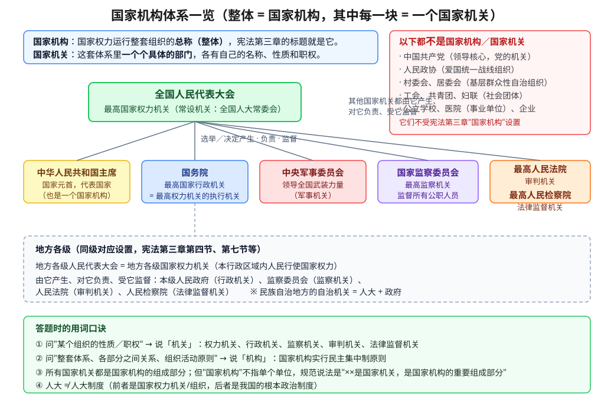

# 国家机构和国家机关的区别

## 题目

国家机构和国家机关有什么区别？为什么新闻里一会儿说"国家机构"，一会儿说"国家机关"，考试里怎么区分？

- 来源：口头提问
- 难度：⭐ 基础（概念辨析，但是中考高频陷阱点）
- 考查知识点：国家机构与国家机关的关系（**出处：人教版／统编版《道德与法治》八年级下册第三单元第六课「我国国家机构」；宪法第三章「国家机构」**，详见下面「课本出处」一节）

## 一张图先看整体

## 解题思路

- 关键点 1：**「国家机构」是整套体系的总称，「国家机关」是体系里的一个个部门**——两者是"整体"和"部分"的关系，不是并列的两套东西。
- 关键点 2：**用哪个词，取决于你想说什么**。说某个组织的"性质、职权"时用"机关"；说"整套体系""各部分之间的关系""组织活动原则"时用"机构"。
- 关键点 3：真正的丢分点不在这两个词，而在**哪些组织根本不属于国家机构**（党、政协、村委会、工会、学校、企业都不是）。

## 解答过程

### 第一步：记住课本上的两个"官方出处"

宪法第三章的章名叫**「国家机构」**，里面一节一节列出了：全国人民代表大会、中华人民共和国主席、国务院、中央军事委员会、地方各级人大和地方政府、民族自治地方的自治机关、监察委员会、人民法院和人民检察院。

也就是说，**"国家机构"就是这一整章列出来的所有组织的统称**，它是一个"集合"的名字，不指单个单位。

而**"国家机关"是集合里的每一个成员**，每个成员都有自己的"性质"和"职权"，比如国务院是国家行政机关、人民法院是审判机关。

所以：所有国家机关都是国家机构的组成部分；但反过来，我们不能说"国务院是一个国家机构"，规范的说法是"国务院是国家行政机关，是我国国家机构的重要组成部分"。（这个空子在真实考试里极少直接考，但理解了它就懂了两个词的分工。）

### 第二步：用词分工——什么时候说"机关"，什么时候说"机构"

问的是"它是干什么的、它有什么权"，就说**机关**：

| 组织 | 它的性质（说"机关"） |
|---|---|
| 全国人民代表大会 | 最高国家权力机关 |
| 地方各级人民代表大会 | 地方各级国家权力机关 |
| 中华人民共和国主席 | 国家元首，代表中华人民共和国行使宪法赋予的职权 |
| 国务院（即中央人民政府） | 最高国家行政机关，是最高国家权力机关的执行机关 |
| 地方各级人民政府 | 地方各级国家行政机关 |
| 中央军事委员会 | 领导全国武装力量的军事机关 |
| 监察委员会 | 国家的监察机关 |
| 人民法院 | 国家的审判机关 |
| 人民检察院 | 国家的法律监督机关 |

问的是"这一整套是怎么组织起来的、彼此之间是什么关系"，就说**机构**：

- 我国宪法第三章的标题是"国家机构"；
- 我国国家机构实行**民主集中制**原则；
- 国家行政机关、监察机关、审判机关、检察机关都由**人民代表大会产生，对它负责，受它监督**。

一句话口诀：**"机关"管身份，"机构"管体系。**

### 第三步：把不属于国家机构的名单背下来（这才是高频考点）

看到这些组织，直接判"不属于国家机构/国家机关"：

- **中国共产党**（及各部委、地方党委）——党的机关，不是国家机关。党是中国特色社会主义事业的领导核心，但党的领导是通过国家机构来实现的，不能把党委和政府在答题时混为"国家机关"。
- **人民政协**——爱国统一战线组织，不是国家机关。它的职能是政治协商、民主监督、参政议政（注意：它的"民主监督"不是国家权力意义上的监督）。
- **村民委员会、居民委员会**——基层群众性自治组织，不是国家机关。最基层的国家行政机关是**乡镇人民政府**。
- **工会、共青团、妇联**——社会团体（群团组织）。
- **公立学校、公立医院**——事业单位；**公司、企业**——市场主体。
- **纪委**——党的纪律检查机关；**监察委员会**——才是国家监察机关（二者合署办公，但性质不同，选择题常拿这个设坑）。

### 第四步：顺手把三组"近义陷阱"一起解决

1. **人民代表大会 ≠ 全国人民代表大会**：前者是我国的国家权力机关（含地方各级），只有"全国人大"才配"最高"两字。
2. **人民代表大会 ≠ 人民代表大会制度**：前者是**组织/机关**，后者是我国的**根本政治制度**（一个制度、一个组织，问什么答什么）。
3. **人民政府 ≠ 人民法院 ≠ 人民检察院**：分别是行政机关、审判机关、法律监督机关。"检察院是行政机关""法院是法律监督机关"都是错的。

### 第五步（追问补充）：我国到底有多少个国家机构？

追问："举例说明一下，我们国家有多少机构？"——这里要先分清两种"多少"：**种类**（按性质分几类）和**个数**（全国一共多少个单位）。中考只考"种类 + 到哪一级设立"，**具体个数不是考点**，但用个数举例能帮你把"体系"两个字真正理解。

**① 种类：宪法第三章分了 8 节，教材把它归为 5 框 6 类机关**

- 宪法第三章「国家机构」共 8 节：全国人民代表大会／中华人民共和国主席／国务院／中央军事委员会／地方各级人民代表大会和地方各级人民政府／民族自治地方的自治机关／监察委员会／人民法院和人民检察院。
- 按性质归纳，通常说 6 类：**国家权力机关**（各级人大）、**国家元首**（国家主席）、**国家行政机关**（各级政府）、**国家监察机关**（各级监委）、**国家审判机关**（各级法院）、**国家法律监督机关**（各级检察院），另有**军事机关**（中央军事委员会及军队各级）。
- 八年级下册第六课就是按 5 个框题讲的：国家权力机关／中华人民共和国主席／国家行政机关／国家监察机关／国家司法机关（法院＋检察院）。

中央这一层具体就是 7 个机构：全国人民代表大会（及其常委会）、中华人民共和国主席、国务院、中央军事委员会、国家监察委员会、最高人民法院、最高人民检察院。

**② 中央一层的"下属编制"举例（说明机关内部机构 ≠ 另一个国家机关）**

国务院下面有 **26 个组成部门**（2023 年机构改革后，不含国务院办公厅）：外交部、国防部、国家发改委、教育部、科技部、工信部、国家民委、公安部、国家安全部、民政部、司法部、财政部、人社部、自然资源部、生态环境部、住建部、交通运输部、水利部、农业农村部、商务部、文旅部、国家卫健委、退役军人事务部、应急管理部、中国人民银行、审计署。另有直属特设机构 1 个（国务院国资委）、直属机构 14 个（如海关总署、税务总局、市场监管总局、国家体育总局等）、部委管理的国家局 17 个（如国家能源局、国家粮食和物资储备局、国家数据局）。

考点在于：**这些部委都隶属于国务院这一个国家机关，是最高国家行政机关的内部组成部门，不能答成"6 类机关之外的国家机关"**。同理，教育部下面的司、海淀区教育局下面的科室，都是行政机关的内部机构。

**③ 个数：按"层级 × 行政区划"估算（数据为约数，行政区划会调整）**

| 层级 | 行政区个数（约） | 设哪些国家机关 |
|---|---|---|
| 中央 | 1 | 人大＋主席＋国务院＋中央军委＋国家监委＋最高法＋最高检 |
| 省级 | 31（22 省＋5 自治区＋4 直辖市，不含港澳台） | 人大＋政府＋监委＋高院＋省检察院，共 5 类 |
| 地级 | 333（293 地级市＋30 自治州＋7 地区＋3 盟） | 人大＋政府＋监委＋中院＋市检察院 |
| 县级 | 2846（977 市辖区＋397 县级市＋1301 县＋117 自治县＋旗等） | 人大＋政府＋监委＋基层法院＋基层检察院 |
| 乡级 | 3.86 万左右（镇、乡、民族乡、街道等） | **乡镇设人大＋人民政府**，不设监委、法院、检察院；**街道不设人大和政府**，街道办事处只是区政府的派出机关 |

按这个表算下来（不含港澳台的特别行政区机关）：各级人大约 3.3 万个（1＋31＋333＋2846＋约 2.96 万乡镇人大）、各级人民政府约 3.3 万个、各级监察委员会约 3200 个（县级以上才设）、法院约 3560 个（最高 1＋高级 32＋中级 409＋基层 3117，含军事法院等专门法院）、检察院数量与法院相当（基层 3000 多个，另有省级 32、市级分院和铁路运输等专门检察院）。**全部加起来大约七八万个国家机关**——这就是"国家机构"指一整套体系、而不是某一个单位的直观含义。

（以上是帮助理解的估算，官方数字随行政区划和机构改革每年微调，**中考不要求记具体数字，只要求记住"哪一级设什么、谁由谁产生"**。）

**④ 四个由"数量"引出的高频考点**

- **乡镇不设监委、法院、检察院**（《监察法》第七条：省、市、县级设监委，乡镇不设，由县级监委向乡镇**派出监察机构或监察专员**）。乡镇只设**人民代表大会**和**人民政府**。
- **人民法庭、检察室、公安派出所、街道办事处都是"派出"机构**，不是独立的国家机关：人民法庭是基层法院的组成部分，街道办事处是区（不设区的市）人民政府的派出机关。判断题爱在这里设坑。**注意**：乡镇设人民代表大会（本级人大），但**街道不设人大**，由区人大常委会设街道工作委员会代管。
- **自己算一遍海淀**：北京市海淀区的国家机关一共 5 个——海淀区人大（权力机关）、海淀区人民政府（行政机关，下面有教委、卫健委、公安分局等 40 多个组成部门，但对外只算 1 个行政机关）、海淀区监察委员会（监察机关）、海淀区人民法院（审判机关）、海淀区人民检察院（法律监督机关）。海淀没有"海淀区中央军委"，军事机关只在中央和军队系统设置。
- **地区、盟不设本级人大**：全国 333 个地级行政区里，293 个地级市和 30 个自治州设人大、政府等 5 类机关；而 7 个"地区"、3 个"盟"是省（自治区）政府的派出机关辖区，本身不设一级人大（由省级人大常委会设工作机构代管），所以地级人大数量比 333 略少。这是"派出机关 vs 一级政权"的典型例子。

## 课本出处（哪个书本上的内容）

这套内容**不在九年级**，而在**八年级下册**（人教版／统编版《道德与法治》），另外小学也有一本：

- **主出处：八年级下册**。现行（皮皮 2025 年春季学的应是这一版）是**第三单元「人民当家作主」第六课「我国国家机构」**，课本第 79—97 页，分 5 个框题：国家权力机关（P79）／中华人民共和国主席（P84）／国家行政机关（P86）／国家监察机关（P91）／国家司法机关（P95）。第六课开头那段导语就给了"国家机构"的定义：国家机构是为实现国家职能而建立起来的**国家机关的统称**。
- **配合出处：同一册的第一单元「坚持宪法至上」**（第一课"治国安邦的总章程"讲宪法**组织**国家机构、规范权力运行；第二课"加强宪法监督"讲监督权力行使），以及第五课"根本政治制度"讲人民代表大会制度与"一府一委两院"的关系、民主集中制。
- **原始出处：《中华人民共和国宪法》第三章「国家机构」**（共 8 节），教材的所有表述都从这里来。
- **小学也学过**：统编版《道德与法治》**六年级上册第三单元「我们的国家机构」**（第 5 课"国家机构有哪些"、第 6 课"人大代表为人民"、第 7 课"权力受到制约和监督"），这是最早接触"国家机构"这个词的地方。
- **九年级（2026 秋新版九上）没有专门的国家机构单元**，只在 3.2（党领导立法、保证执法、支持司法、带头守法）和 6.2（民主政治发展、全面依法治国）里点到为止。

⚠️ **教材版本提醒（重要）**：据公开信息，**2026 年春季起八年级下册也要换成新教材**，新版把国家机构单独拎成一个单元——**「第四单元 走近国家机构」**，拆成 6 课（第七课 国家权力机关、第八课 中华人民共和国主席、第九课 国家行政机关、**第十课 中央军事委员会（新增）**、第十一课 国家监察机关、第十二课 国家司法机关），并把原第三单元改为「认识国家制度」（政治制度、基本经济制度各一课）。**皮皮这一届 2025 年春学的是旧版**，手里那本八下仍是"第三单元第六课"；但 2027 年北京中考开卷能带哪几本、按哪个版本出题，**要向学校或区考试中心确认**。翻书时以自己手里那本目录为准。

## 相关知识点

- 我国国家机构实行**民主集中制**原则（宪法第三条）。
- **全国人民代表大会**是最高国家权力机关，行使最高立法权、决定权、任免权、监督权；它的常设机关是全国人大常委会。
- **中华人民共和国主席**由全国人大选举产生，根据全国人大及其常委会的决定公布法律、发布命令等，是国家元首、对外代表中华人民共和国（"国家主席"这一国家机构由国家主席、副主席组成，它不是某个人的职务头衔）。
- **国务院**即中央人民政府，是最高国家权力机关的执行机关、最高国家行政机关。
- **监察委员会**由本级人大产生，对本级人大及其常委会和上一级监察委员会负责，受其监督，对所有行使公权力的公职人员实行监察全覆盖。
- **人民法院**依照法律规定独立行使审判权，**人民检察院**依照法律规定独立行使检察权，不受行政机关、社会团体和个人的干涉。
- 宪法是根本法：**一切国家机关和武装力量、各政党和各社会团体、各企业事业组织都必须遵守宪法和法律**，任何组织或者个人都不得有超越宪法法律的特权。

## 易错点提醒

- 把"人民政协""村委会""党委"当成国家机关——多选题里最常用它们做干扰项。
- 说"人民代表大会是我国最高国家权力机关"——漏了"全国"两字。
- 说"国务院是我国最高国家权力机关"——国务院是最高国家**行政**机关（最高权力机关的执行机关）。
- 说"人民检察院是审判机关"或"人民法院是法律监督机关"——两边说反了。
- 判断题里出现"国家机关可以超越法律行使权力"之类表述，一律错；同时记住规范说法是"国家机关依法行使权力、法定职责必须为、法无授权不可为"。
- 材料分析题只写机关名字不写性质、不写"由人大产生、对它负责、受它监督"，容易少拿关系分。
- 道法开卷考试翻书技巧：这套内容**只在八年级下册**（不在九年级），现行版在**第三单元第六课「我国国家机构」**，按框题定位（国家权力机关 P79／中华人民共和国主席 P84／国家行政机关 P86／国家监察机关 P91／国家司法机关 P95）比通读快得多。注意 2026 年春季起八下换新教材，同一内容改到**「第四单元 走近国家机构」**并新增中央军事委员会一课——**翻自己手里那本的目录确认页码**，详见上面「课本出处」。
- 别把"国家机构"和"国家机关"当两个不同范围的东西去背：教材原话是"国家机构是为实现国家职能而建立起来的**国家机关的统称**"，考试真正区分的是**机关的性质**和**哪些组织不属于国家机关**。

## 中考常见题（含答案与解析）

### 一、选择题

**1.（属于判断）** 下列各组组织，全部属于我国国家机构的是（ ）

A. 全国人民代表大会、人民政协、国家监察委员会
B. 中华人民共和国主席、国务院、最高人民法院
C. 中国共产党中央委员会、村民委员会、居民委员会
D. 总工会、公立中学、人民检察院

答案与解析

**选 B。** A 项人民政协是爱国统一战线组织，不是国家机关；C 项党委是党的机关，村委会、居委会是基层群众性自治组织；D 项工会是社会团体，公立中学是事业单位。B 项三项分别属于国家元首（国家机构）、最高国家行政机关、国家审判机关。

**2.（概念辨析）** 关于"国家机构"与"国家机关"，下列说法正确的是（ ）

① 国家机构由国家机关组成，二者是整体与部分的关系
② 国务院是最高国家行政机关，也是我国国家机构的重要组成部分
③ "人民法院是一个国家机构"这一说法比"人民法院是国家审判机关"更规范
④ 国家机构和国家机关只是说法不同，范围完全一样，可以互相替换

A. ①②  B. ①③  C. ②④  D. ③④

答案与解析

**选 A（①②）。** ③说反了：说明单个组织的性质时应说"审判机关"；④错在两者不是同一概念，"国家机构"是整套体系的总称，"国家机关"是其中的具体部门。

**3.（机关与性质对应）** 下列国家机关与其性质对应正确的是（ ）

A. 人民政府——审判机关
B. 人民检察院——法律监督机关
C. 监察委员会——最高国家行政机关
D. 人民代表大会——行政机关

答案与解析

**选 B。** 人民政府（各级）是国家行政机关，人民法院是审判机关，监察委员会是监察机关，人民代表大会是国家权力机关。

**4.（最高国家权力机关）** 我国的最高国家权力机关是（ ）

A. 人民代表大会  B. 全国人民代表大会  C. 人民代表大会常务委员会  D. 国务院

答案与解析

**选 B。** 人民代表大会是我国的国家权力机关（包括地方各级人大），只有全国人民代表大会才是**最高**国家权力机关；全国人大常委会是它的常设机关。

**5.（民主集中制）** 十三届全国人大三次会议表决通过《中华人民共和国民法典》，国家主席签署主席令予以公布。这说明（ ）

① 全国人民代表大会行使最高立法权
② 国家主席根据全国人大的决定行使宪法赋予的职权
③ 国家主席的地位高于全国人民代表大会
④ 我国国家机构实行民主集中制原则

A. ①②③  B. ①②④  C. ①③④  D. ②③④

答案与解析

**选 B（①②④）。** ③错：国家主席由全国人大选举产生，对全国人大负责，其公布法律等职权要根据全国人大及其常委会的决定行使，不存在"地位高于"的关系。全国人大是我国最高国家权力机关。

**6.（层级设置）** 北京市海淀区依法设立的国家机关中，不包括下列哪一项？（ ）

A. 海淀区人民代表大会  B. 海淀区人民政府  C. 海淀区监察委员会  D. 海淀区纪律检查委员会

答案与解析

**选 D。** 区纪委（全称"中共海淀区纪律检查委员会"）是**党的纪律检查机关**，不是国家机关；与它合署办公的海淀区监察委员会才是国家监察机关。A、B、C 加上海淀区人民法院（审判机关）、海淀区人民检察院（法律监督机关），构成一个区一级的 5 类国家机关。**注意推广规律**：省、市、县三级都设"人大＋政府＋监委＋法院＋检察院"5 类，而**乡镇（街道）一级只设人民代表大会和人民政府**，不设监委、法院、检察院（乡镇由县级监委派出监察机构或监察专员，街道办是区政府的派出机关，人民法庭是基层法院的派出机构，都不是新的独立国家机关）。

### 二、判断题（对的画√，错的画×并说明理由）

1. 人民代表大会是我国的最高国家权力机关。（ ）
2. "中华人民共和国主席"是一个国家机构，而不是某个人的职务头衔。（ ）
3. 各级监察委员会是国家的监察机关，由本级人民代表大会产生，对它负责，受它监督。（ ）
4. 人民法院、人民检察院和人民政府一样，都是国家的行政机关。（ ）
5. 村民委员会是我国最基层的国家机关。（ ）
6. 中国共产党是执政党，因此党的机关也属于国家机关。（ ）

答案与解析

1. **×**。漏了"全国"。人民代表大会是国家权力机关；最高国家权力机关是全国人民代表大会。
2. **√**。国家主席是宪法第三章第二节规定的国家机构（由国家主席、副主席组成），是国家元首、对外代表中华人民共和国，不是个人权力的称号。
3. **√**。监察委员会是国家监察机关，由本级人大产生，对本级人大及其常委会和上一级监察委员会负责，受其监督。
4. **×**。人民法院是审判机关，人民检察院是法律监督机关，只有人民政府是行政机关。
5. **×**。村委会、居委会是基层群众性自治组织，不是国家机关；最基层的国家行政机关是乡镇人民政府。
6. **×**。党的机关不是国家机关。党的领导是中国特色社会主义最本质的特征，但党必须在宪法和法律范围内活动，答题时党委与政府不能混作国家机关。

### 三、材料分析题

**材料** 2020 年 5 月 28 日，十三届全国人民代表大会第三次会议表决通过《中华人民共和国民法典》，国家主席签署主席令予以公布，自 2021 年 1 月 1 日起施行。此后，国务院部署各部门对照民法典清理、修订行政法规和规范性文件，做好贯彻实施工作；最高人民法院制定适用民法典的司法解释；全国人大常委会对民法典实施情况开展检查。

**问题**

(1) 材料中出现了哪些国家机关？请写出它们各自的性质。
(2) 全国人民代表大会与国家主席、国务院、最高人民法院之间分别是什么关系？这体现了我国国家机构的哪一组织活动原则？
(3) 有人认为："民法典是全国人大通过的，它只约束老百姓，不约束国家机关。"请对这一观点进行评析。

参考答案要点

**(1)** 全国人民代表大会——最高国家权力机关；中华人民共和国主席——国家元首，代表中华人民共和国行使宪法赋予的职权；国务院（中央人民政府）——最高国家行政机关，是最高国家权力机关的执行机关；地方各级人民政府——地方各级国家行政机关；最高人民法院——国家审判机关；全国人大常委会——全国人大的常设机关。

**(2)** 国家主席、国务院、最高人民法院等都由全国人民代表大会**产生**，对它**负责**，受它**监督**；国家主席要根据全国人大及其常委会的决定公布法律；国务院作为执行机关负责贯彻执行全国人大通过的法律和决议。这体现我国国家机构实行**民主集中制**原则（宪法第三条）。

**(3)** 这一观点是错误的。①民法典调整平等主体之间的人身关系和财产关系，公民、法人都要遵守，这是对的；②但宪法规定，一切国家机关和武装力量、各政党和各社会团体、各企业事业组织都必须遵守宪法和法律，任何组织或个人都不得有超越宪法法律的特权，国家机关同样受法律约束；③国家机关还要"法定职责必须为、法无授权不可为"，国务院清理修订行政法规、最高人民法院制定司法解释，正是国家机关依法履职、在法律范围内行使权力的表现；④所以法律既约束公民行为，也规范和保障国家机关权力的行使，全面依法治国要求的是对所有主体的平等约束。

## 复盘

- 错因：无（概念提问，非错题）
- 掌握状态：未掌握
- 复习记录：
  - （20261102 首次归档：需自测上面「易错点提醒」中"政协/村委会/党委不是国家机关""国务院是行政机关不是权力机关""法院是审判机关、检察院是法律监督机关"三处，抽查时优先出这类干扰项）
  - （20261102 追问补充：好追问——"我们国家有多少国家机构？"已整理进解答第五步。抽查时优先考"层级设置规律"：省/市/县 5 类（人大＋政府＋监委＋法院＋检察院），乡镇只有 2 类（人大＋政府）；街道办、人民法庭、派出所都是派出机构而非独立国家机关）
