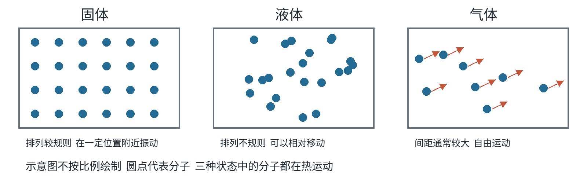
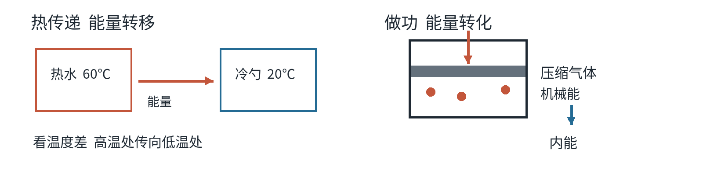
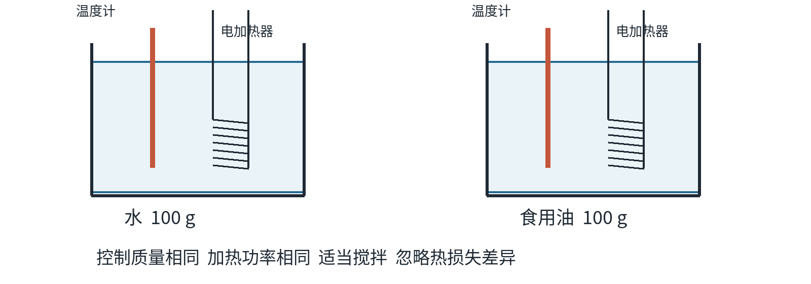
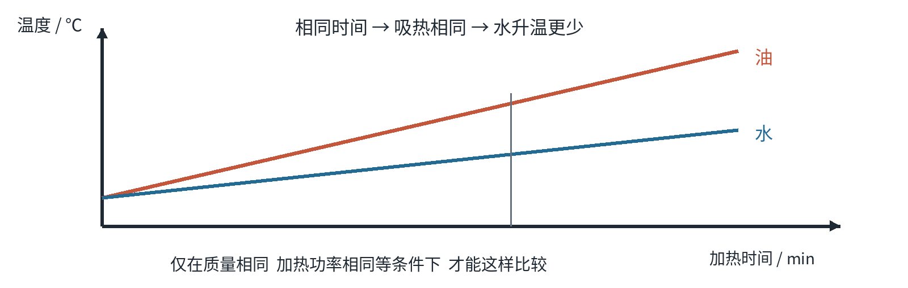
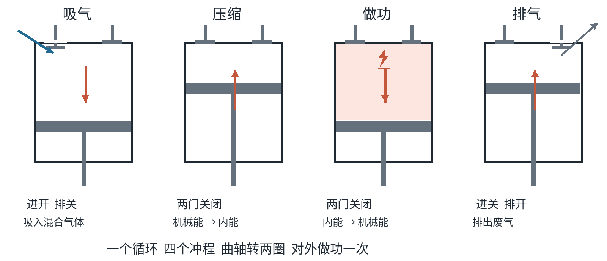
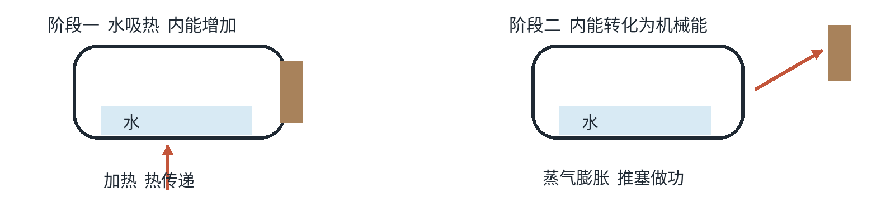
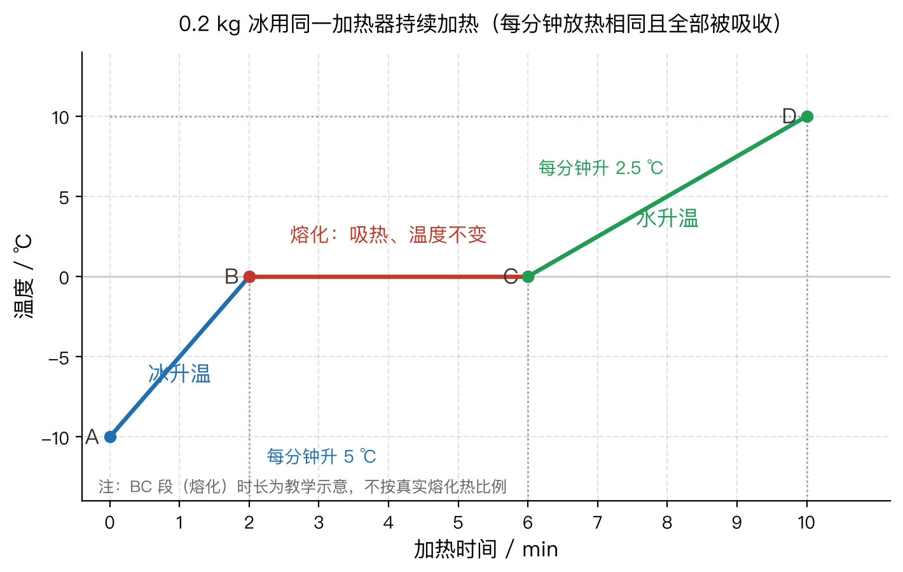
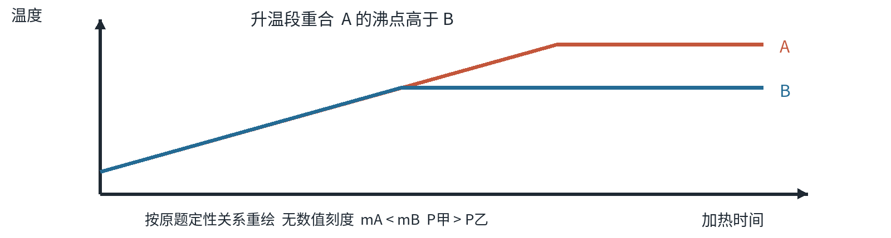
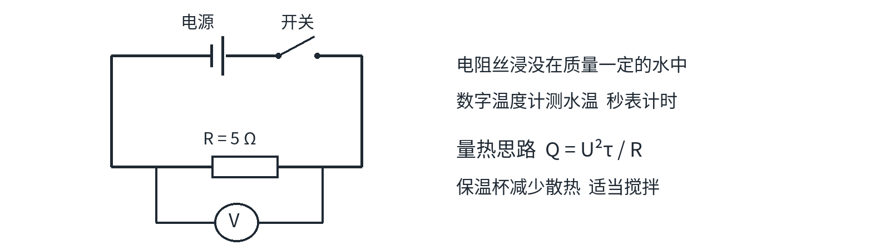

# 内能 · 内能的利用 学霸笔记（最终版）

## 题目
（本文件是章节专题笔记，非单题归档；配图见 `images/20261019-内能专题/`）

- 来源：人教版九年级物理第十三章、第十四章专题整理；整合本仓库 20261019 图文笔记与外部学霸笔记资源（见文末「来源与版本提醒」）
- 难度：⭐ 基础 至 ⭐⭐ 中考综合（个别综合计算标 ⭐⭐⭐）
- 考查知识点：分子动理论、内能与温度热量、比热容与热量计算、比热容实验、四冲程热机、热值与效率、能量转化和守恒
- 掌握状态：未掌握
- 复习记录：
  - （20261019 建立最终版笔记，尚未抽查）
  - （20261019 补充：易错点由 20 条扩到 53 条，新增第 10—11 节易错专项 46 题，尚未抽查）

---

## 0 一页速览：这两章到底考什么

背之前先看清骨架，八块内容：①—④ 是概念，⑤⑦ 是计算，⑥⑧ 是热机与能量观，每一块中考都直接出题。

| 编号 | 板块 | 一句话核心 | 中考怎么考 |
| --- | --- | --- | --- |
| ① | 分子动理论 | 物质由分子原子构成；分子不停做无规则运动；分子间同时有引力和斥力 | 单选：判断哪个现象能说明分子运动 |
| ② | 内能 | 物体内部所有分子热运动动能 + 分子势能的总和，一切物体都有 | 多选/单选：温度、热量、内能谁决定谁 |
| ③ | 改变内能两种方式 | 热传递是能量转移，做功是能量转化，效果相同 | 单选：给情境判断是哪一种 |
| ④ | 比热容 | 物质吸放热本领，只与种类和状态有关 | 单选 + 实验题，最高频 |
| ⑤ | 热量计算 | $Q = cm\Delta t$ | 计算题第一问 |
| ⑥ | 热机四冲程 | 压缩：机械能变内能；做功：内能变机械能 | 单选：看图判冲程、算做功次数 |
| ⑦ | 热值与效率 | $Q = mq$，效率 = 有效利用 ÷ 总共放出 | 计算题主干 |
| ⑧ | 能量转化和守恒 | 能量不会消灭也不会创生，只转化或转移，总量不变；但散掉的收不回来 | 单选：判断转化方向、说节能意义 |

一句话串起来：**燃料燃烧（化学能 → 内能）→ 热传递给水（内能转移）→ 或推动活塞（内能 → 机械能）→ 总有一部分能量散掉，所以效率永远小于 100%。**

这两章的失分不在「不会」，而在「说错一句话」。所以第 9 节把易错点整理成 53 条红笔清单，第 10—11 节配了 46 道自编易错专项（判断 30 + 选择 12 + 计算简答 4），第 12—13 节才是北京真题。复习顺序建议：先过 1—8 节知识，再刷 10—11 节，最后用真题验收。

---

## 1 分子动理论

### 三条基本观点（必背）

1. 物质由大量分子、原子构成，分子很小，通常以 $10^{-10}\ m$ 为单位量度。
2. 一切物体的分子都在不停地做无规则运动；温度越高，运动越剧烈。这种无规则运动叫**分子热运动**。
3. 分子间同时存在引力和斥力，且都随距离变化（距离变小作用变强，距离变大作用变弱）。

### 扩散现象

不同物质互相接触时彼此进入对方的现象叫扩散。气体、液体、固体都能发生。

| 例子 | 说明什么 |
| --- | --- |
| 闻到花香、樟脑丸气味 | 气体扩散 |
| 墨水在静水中散开 | 液体扩散 |
| 金片与铅片紧压五年互相渗入 | 固体扩散（说明固体分子也在动） |
| 腌咸菜、茶叶蛋入味 | 扩散，且加热后更快 → 温度越高扩散越快 |

### 🚫 三个「不算扩散」

- **灰尘、粉笔灰、烟雾飞舞**：那是小颗粒整体在动，肉眼可见，不是分子。分子用肉眼和普通显微镜都看不见。
- **搅拌糖水、倒水时水混合**：那是外力造成的流动（对流），不是分子自己运动的结果。
- **海绵一捏就瘪、气球一压就扁**：那是物体内部的孔隙被压小，属于物体形变，不能说明「分子间有间隙」。要说明间隙，用的是酒精与水混合后总体积变小这类实验。

> 追问：为什么「尘土飞扬」看着像分子运动却不能算？
> 因为判据是**尺度**。分子直径约 $10^{-10}\ m$，一粒灰尘比它大几亿倍，灰尘是被风吹动的，属于机械运动；把灰尘换成一个分子，它根本不会被风吹得这么「整齐」。

### 分子引力与斥力

- 引力的证据：两铅柱底面平整干净、紧压后能吊住重物；两块干净玻璃板叠在一起不易推开。
- 斥力的证据：固体、液体很难被压缩。
- 为什么两块砖贴在一起不粘？砖面看着平，实际凹凸不平，绝大多数地方分子间距还太大，引力几乎起不了作用。「破镜难重圆」同理。

---

## 2 内能、温度、热量：三兄弟必须分清

### 内能

构成物体的所有分子，热运动的动能与分子势能的总和，叫物体的内能。单位：焦耳（J）。

- **一切物体在任何情况下都有内能**：0 ℃ 的冰、静止的石头、天上飞的鸟都有。所以「运动的物体才有内能」「0 ℃ 物体没有内能」都是错的。
- 影响内能大小的因素：温度、质量、材料、状态（物态）。同质量 0 ℃ 的水比 0 ℃ 的冰内能大（熔化要吸热，温度却没变）。
- 内能与机械能是两回事：机械能看物体**整体**的运动、被举高、被拉长；内能看物体**内部**大量分子的运动和相互作用。把一杯水举高，重力势能增加，但内能不一定变。

### 三种改变内能的方式（其实只有两种）

| 方式 | 实质 | 条件 | 举例 |
| --- | --- | --- | --- |
| 热传递 | 内能**转移**（从高温处到低温处） | 存在**温度差** | 热水袋暖手、太阳晒热石凳、冰块放进饮料 |
| 做功 | 内能与其他形式的能**转化** | 有力对物体做功或物体对外做功 | 搓手、压缩空气、钻木取火（机械能 → 内能）；气体推动活塞（内能 → 机械能） |

两者在改变内能的效果上是**等效**的：光看「水温升高了 20 ℃」，无法判断是火烧的还是搅拌出来的。

### 三组最容易判错的关系（背下来）

1. **吸热，温度不一定升高**：冰熔化、水沸腾时持续吸热，温度不变，内能增加。
2. **温度升高，不一定是吸热**：压缩空气、搓手也能升温。
3. **热传递的方向由温度决定，不由内能多少决定**：一小杯 90 ℃ 的水能把热量传给一大盆 30 ℃ 的水，虽然那盆水的内能多得多。

> 口诀：**温度高，内能不一定大；吸热多，温度不一定升；内能变了，温度可能不变。**

### 三个词的搭配雷达（搭配一错，选项直接排除）

| 词 | 能这样说 | 不能这样说 | 单位 |
| --- | --- | --- | --- |
| 温度 | 是 20 ℃、升高了、降低了 | 吸收温度、含有温度、传递温度 | ℃ |
| 内能 | 具有、增加、减少、转化为机械能 | 物体「传递内能」（热传递传的是热量） | J |
| 热量 | 吸收了、放出了、有多少 | 含有、具有、增加、升高 | J |

根子在这里：温度和内能说的是物体**这个时候怎么样**（状态），热量说的是**热传递这段时间里过了多少能量**（过程）。所以「物体温度高，所以它含的热量多」一句里错了两处：热量不能说「含有」，温度高也不决定热量多少。

### 看到关键词就判方式

| 卷面上出现这些词 | 判为 |
| --- | --- |
| 压缩、摩擦、弯折、锻打、敲打、钻、锯、打气筒发热、锯条发烫 | 做功（机械能 → 内能） |
| 加热、烧、晒、焐、取暖、哈气、烫、遇冷、放进冰箱 | 热传递（内能转移） |
| 气体膨胀推动、蒸气顶开塞子、燃气推动活塞 | 做功（内能 → 机械能） |

> 追问：打气筒打气时筒壁发热，到底是哪一种？
> 两种都有。一是活塞压缩空气，对空气做功，空气内能增大、温度升高，再把热传给筒壁；二是活塞与筒壁摩擦生热。所以看到「筒壁发热只可能是摩擦造成的」这种**只认一条**的说法，要警惕——中考探究题就爱在这里设坑。

### 🚫 关于「热量」的说法红线

热量只在热传递过程中存在，只能说「吸收热量」「放出热量」，**绝不能说「物体含有多少热量」「物体具有热量」**。热量是过程量，内能才是物体本身有的。

---

## 3 比热容

### 定义与物理意义

单位质量的某种物质，温度升高 1 ℃ 所吸收的热量，叫做这种物质的比热容，符号 $c$，单位 J/(kg·℃)。

$c_{水} = 4.2 \times 10^{3}\ J/(kg·℃)$ 表示：**1 kg 水温度升高 1 ℃ 吸收 4200 J 热量**（降低 1 ℃ 放出同样多）。不是「1 kg 水含有 4200 J 热量」。

比热容是**物质本身的特性**：

- 与物质种类、状态有关（水和冰不同）。
- 与质量、体积、温度高低、吸放热多少、形状位置**都无关**。把一杯水倒掉一半，剩下那半杯水比热容不变。

### 三条比较规律（固定条件才有结论）

| 控制不变 | 比热容大的意味着 |
| --- | --- |
| 质量相同、升高温度相同 | 吸收热量**越多** |
| 质量相同、吸收热量相同 | 升高温度**越少**（温度变得慢） |
| 质量相同、降低温度相同 | 放出热量**越多** |

### 常见物质比热容（记水、冰、砂石、铝、铜的相对大小）

| 物质 | $c\ /\ J·(kg·℃)^{-1}$ |
| --- | --- |
| 水 | $4.2 \times 10^{3}$ |
| 冰 | $2.1 \times 10^{3}$ |
| 煤油、酒精 | $2.1 \times 10^{3}$、 $2.4 \times 10^{3}$ |
| 沙、石 | 约 $0.92 \times 10^{3}$ |
| 铝 | $0.88 \times 10^{3}$ |
| 铁、钢 | $0.46 \times 10^{3}$ |
| 铜 | $0.39 \times 10^{3}$ |

### 热量计算公式

- 吸热： $Q_{吸} = cm(t - t_{0})$（ $t$ 末温， $t_{0}$ 初温）
- 放热： $Q_{放} = cm(t_{0} - t)$
- 统一记： $Q = cm\Delta t$， $\Delta t$ 取温度**变化量的大小**

单位必须配套： $Q$ 用 J， $m$ 用 kg， $c$ 用 J/(kg·℃)，温度用 ℃。克要先换成千克。

**适用条件**：只用于物态不变、单纯升温或降温的过程。冰熔化、水沸腾阶段**不能**套这个公式。

### 计算示例（非真题）

2 kg 水从 20 ℃ 升高到 70 ℃，吸收多少热量？

$\Delta t = 70 - 20 = 50$ ℃
$Q_{吸} = 4.2 \times 10^{3} \times 2 \times 50 = 4.2 \times 10^{5}\ J$

审题必圈四件事：① 质量单位是不是 kg；② 是「升高到」还是「升高了」；③ 有没有物态变化；④ 有没有热损失（「不计热损失」才能画等号）。

### 解释生活现象的答题模板

题目问「为什么汽车用水冷却发动机」，别只写「水的比热容大」，那只能给一半分。完整句式是：

> 因为水的比热容较**大**，在**质量相同、升高温度相同**的条件下，水能**吸收较多的热量**，所以冷却效果好。

| 现象 | 比较条件 | 结论 |
| --- | --- | --- |
| 用水做冷却剂（汽车发动机） | 同质量、升高相同温度 | 水吸热多 |
| 暖气用水输送热量 | 同质量、降低相同温度 | 水放热多 |
| 沿海昼夜温差小于内陆 | 同质量、吸放相同热量 | 水温度变化小，砂石变化大 |
| 中午沙子烫脚、海水还凉 | 同上 | 砂石升温快 |

---

## 4 比热容实验：比较不同物质的吸热能力

### 器材与做法

烧杯、天平、秒表、温度计、**两个规格相同**的加热器（或相同火焰的酒精灯）、质量相等的水和食用油。加热时用搅拌棒适当搅拌，使液体温度均匀。

### 两种比较方法（控制变量法）

| 方法 | 控制 | 观察 | 判断 |
| --- | --- | --- | --- |
| 方法一（相同时间比升温） | 质量相同、加热时间相同 | 谁升温多 | 升温**少**的比热容**大** |
| 方法二（相同升温比时间） | 质量相同、升高温度相同 | 谁加热时间长 | 时间**长**的吸热多，比热容**大** |

图像上，横轴是加热时间、纵轴是温度时，**图线越陡（升温越快）的那条，比热容越小**（前提：质量相同、加热器相同）。

### 实验题四个必答理由

1. 为什么要控制**质量**相同而不是体积相同？因为 $Q$ 与质量有关，体积相同而密度不同，质量就不同，没法比。
2. 为什么用**加热时间长短**来反映吸热多少？这叫**转换法**——吸热多少看不见，但相同加热器工作时间越长放热越多。
3. 「相同时间吸热相同」成立的前提是什么？加热器规格相同、实际功率相同，并且忽略两者热损失的差异。
4. 初温要不要相同？通常也控制相同，便于直接比较末温；但真正决定比热容大小的是**温度变化量**，不是末温。

### 结论的标准写法

> 相同质量的水和食用油，升高相同的温度时，水需要的加热时间更长，说明水吸收的热量更多，因此水的比热容比食用油大。

结论必须**先摆条件**（质量相同、升高温度相同），再说现象，最后落到比热容大小。只写「水吸热能力强」不给满分。

### 另四处扣分点（都是答对了原理却写错细节）

1. **找错题的高频答案**：题干里出现「取**体积**相同的水和食用油」，这就是那处错，要改成**质量相同**（两者密度不同，体积相同则质量不同，条件没控住）。
2. **器材别漏**：天平（称质量）、秒表（记时间）、搅拌棒（使受热均匀）、两只规格相同的加热器。写「两个相同的酒精灯」也行，但要点明「火焰相同」。
3. **读数规范**：温度计玻璃泡要全部浸入液体、不碰杯底杯壁；读数时不能把温度计拿出液面；加热时要适当搅拌。
4. **结论不能跳步**：要写「加热时间长 → 吸收热量多 → 比热容大」，中间那一步不能省；直接说「时间长所以比热容大」会因条件不全被扣分。

> 还有一个长得很像的兄弟实验——**比较不同燃料的热值**。它换的是燃料、看的是水温升高多少，转换法对象和这个实验正好相反，两题混做最容易写反。对照表放在第 6 节。

---

## 5 热机与四冲程汽油机

### 能量路线

燃料燃烧：化学能 → 内能。热机：把内能转化为机械能的机器。汽油机、柴油机都属于**内燃机**（燃料在机器内部燃烧）。

### 一个工作循环 = 四个冲程 = 曲轴转 2 圈 = 对外做功 1 次

| 冲程 | 进气门 | 排气门 | 活塞 | 能量变化 |
| --- | --- | --- | --- | --- |
| 吸气 | 开 | 关 | 向下 | — |
| 压缩 | 关 | 关 | 向上 | 机械能 → 内能（对气体做功，气体内能增大、温度升高） |
| 做功 | 关 | 关 | 向下 | 内能 → 机械能（燃气推动活塞，燃气内能减少） |
| 排气 | 关 | 开 | 向上 | — |

### 识图口诀：先看气门，再看活塞

1. 有一个气门打开 → 不是吸气就是排气：活塞向下是吸气，活塞向上是排气。
2. 两个气门都关 → 不是压缩就是做功：活塞向上是压缩，活塞**向下是做功**。

所以「活塞向下运动」这一条本身**判断不出**是哪个冲程，必须先看气门。

### 汽油机与柴油机

| 项目 | 汽油机 | 柴油机 |
| --- | --- | --- |
| 吸入气缸的物质 | 汽油和空气的混合物 | 只有空气 |
| 点火方式 | 火花塞点燃 | 压缩空气升温后喷油，自行着火（压燃） |
| 气缸顶部部件 | 火花塞 | 喷油嘴 |

### 转速计算（必考）

> 例（非真题）：单缸四冲程汽油机曲轴转速 3000 r/min，每秒对外做功多少次？

每秒转数 $= 3000 \div 60 = 50$ 圈；每 2 圈对外做功 1 次，所以每秒做功 $50 \div 2 = 25$ 次。

**先除以 60 换成「每秒」，再除以 2**，顺序错了就全错。若问「1 s 完成多少个工作循环」，答案和做功次数相同（一个循环做功一次）。

### 数字关系一张表（三种问法都从第一行推）

**一个工作循环 = 4 个冲程 = 曲轴（飞轮）转 2 圈 = 对外做功 1 次**

| 已知 | 问什么 | 怎么算 |
| --- | --- | --- |
| 转速 1200 r/min | 每秒做功几次 | $1200 \div 60 = 20$ 圈/秒， $20 \div 2 = 10$ 次 |
| 每秒做功 10 次 | 每秒几个冲程 | 10 个循环 × 4 = **40 个冲程** |
| 曲轴转 100 圈 | 对外做功几次 | $100 \div 2 = 50$ 次 |

记两条就够：**冲程数 = 圈数 × 2**，**做功次数 = 圈数 ÷ 2**。最典型的错是问「冲程」却按「做功」去算，或者忘了先把 r/min 换成 r/s，直接拿 1200 除以 2。

### 能量收支（知道有这回事）

燃料燃烧放出的能量里，废气带走的最多，其次是气缸散热、机械摩擦，真正做有用功的往往只占三成多。所以提高效率的主要方向是：让燃料燃烧更充分、减少散热、减少摩擦（加润滑油）。

常见效率高低（数值以课本附表为准）：蒸汽机最低，汽油机约 20%~30%，柴油机约 30%~45%。**柴油机比汽油机效率高**，别记反；但「效率高」只说明浪费的比例小，跟功率大小、热值高低都没关系。

---

## 6 热值与效率

### 热值

燃料**完全燃烧**放出的热量与其质量之比，叫这种燃料的热值，符号 $q$，单位 J/kg；气体燃料按体积给时用 J/m³。

- $Q_{放} = m q$（固体、液体燃料）
- $Q_{放} = V q$（气体燃料）

热值是**燃料本身的特性**，只与燃料种类有关，与这次烧了多少、烧得充不充分无关。煤烧得不充分冒黑烟，它的热值不变，变的是这次实际放出的热量和效率。

| 燃料 | $q\ /\ J·kg^{-1}$ |
| --- | --- |
| 酒精 | $3.0 \times 10^{7}$ |
| 焦炭 | $3.0 \times 10^{7}$ |
| 烟煤 | 约 $2.9 \times 10^{7}$ |
| 无烟煤 | $3.4 \times 10^{7}$ |
| 柴油 | $4.3 \times 10^{7}$ |
| 汽油、煤油 | $4.6 \times 10^{7}$ |
| 氢气 | $1.4 \times 10^{8}$ |

上表按固体、液体燃料给 J/kg；气体燃料（如煤气约 $3.9 \times 10^{7}\ J/m^{3}$）按体积给，单位换成 J/m³，公式跟着换成 $Q = Vq$。**具体数值以课本附表为准，考试时题目都会写在卷上，不用死背。**

> 追问：火箭为什么常用液态氢做燃料？
> 因为氢的热值大：相同质量的燃料，氢完全燃烧放出的热量最多，能少带燃料多带载荷。

### 比较不同燃料的热值（课本实验，和第 4 节那个极易写反）

课本上用酒精和碎纸片烧同一杯水。两个实验装置长得像，考的是「换掉的是谁、看什么来判断」：

| | 比较不同物质的吸热能力（第 4 节） | 比较不同燃料燃烧放出的热量（本节） |
| --- | --- | --- |
| 换掉的是什么 | 被加热**液体的种类**（水 / 食用油） | **燃料的种类**（酒精 / 碎纸片） |
| 必须控制相同 | 两种液体的**质量**、加热器规格相同 | 两种燃料的**质量**相同；被加热的是**同一种液体、质量也相同** |
| 用什么反映结论（转换法） | **加热时间**长短 → 吸热多少 | **水温升高的多少** → 燃料放热多少 |
| 结论怎么写 | 相同时间升温少的，比热容大 | 水温升得高的那种燃料，热值大 |
| 最典型的错法 | 取「体积」相同 | 说「燃烧**相同时间**」——不同燃料烧得快慢不一样，时间相同不代表烧掉的质量相同 |

正确说法是：**取相同质量的酒精和碎纸片，让它们完全烧尽（燃尽），比较同一杯同质量的水各自升高了多少温度。**

**测出来的热值总是比真实值偏小**，三条原因简答常考：① 燃料没有完全烧尽、燃烧不充分；② 热量散到空气里、被烧杯和铁架台吸走，水没拿到全部；③ 没搅拌、温度还没均匀就读数。

### 效率的三种写法

| 场景 | 分母（总共给的） | 分子（真正有用的） |
| --- | --- | --- |
| 热机效率 | 燃料完全燃烧放出 $Q_{放} = m q$ | 做的有用功 $W$ |
| 炉子/热水器烧水 | 燃料完全燃烧放出 $Q_{放}$ | 水吸收的热量 $Q_{吸} = cm\Delta t$ |
| 电动机提升重物 | 消耗的电能 | 克服重力做的功 $G h$ |

$$\eta = W_{有用} \div Q_{放}$$

写百分数时别忘乘 100%；分子永远是「有效利用的那部分」，不能把水吸热和容器吸热混着当分子。

### 效率高低到底在比什么（五句话，只有一两句站得住）

假设甲效率 40%、乙效率 25%，下面这些说法逐个过：

| 说法 | 站得住吗 | 为什么 |
| --- | --- | --- |
| 甲做的有用功一定比乙多 | ✗ | 还不知道两人各烧了多少燃料，总量不同比不了 |
| 甲比乙省燃料 | ✗（条件不全） | 必须说「**做相同的有用功时**，甲消耗燃料少」 |
| 甲把燃料放出内能转化为有用功的**比例**大 | ✓ | 效率本来就是比例 |
| 甲的功率比乙大 | ✗ | 效率是比例，功率是做功快慢，两码事 |
| 甲、乙都不可能到 100% | ✓ | 废气、散热、摩擦必然带走一部分 |

一句话记法：**效率只比「比例」，不比「多少」；凡是不带条件就说甲多乙少的，都是错的。**

### 综合计算示例（非真题）

0.02 kg 燃料完全燃烧（ $q = 3.0 \times 10^{7}$ J/kg），把 2 kg 水从 20 ℃ 加热到 70 ℃，求效率。

1. 水吸热： $Q_{吸} = 4.2 \times 10^{3} \times 2 \times 50 = 4.2 \times 10^{5}\ J$
2. 燃料放热： $Q_{放} = 0.02 \times 3.0 \times 10^{7} = 6.0 \times 10^{5}\ J$
3. 效率： $\eta = 4.2 \times 10^{5} \div 6.0 \times 10^{5} = 0.7$，即 70%

**解题固定三步**：先算有用（ $Q_{吸}$ 或 $W$），再算总给（ $Q_{放}$），最后相除。中间过程带单位，别只写数字。

### ⭐⭐⭐ 一个高频陷阱：水烧不到算出来的温度

按 $Q = cm\Delta t$ 反推末温，可能算出 1 标准大气压下水温 105 ℃。这时必须写：**水到 100 ℃ 就沸腾，继续吸热温度不再升高，所以实际末温是 100 ℃**。算出超过沸点的温度，一律按沸点收。

---

## 7 能量的转化和守恒

能量既不会消灭，也不会创生，它只会从一种形式转化为另一种形式，或者从一个物体转移到另一个物体，而**总量保持不变**。

### 常见转化对照（判断方向用）

| 过程 | 转化 |
| --- | --- |
| 摩擦生热、搓手、压缩空气 | 机械能 → 内能 |
| 气体膨胀推动活塞、蒸气顶开塞子 | 内能 → 机械能 |
| 燃料燃烧 | 化学能 → 内能 |
| 电池供电 | 化学能 → 电能 |
| 电灯发光 | 电能 → 内能和光能 |
| 电动机工作 | 电能 → 机械能 |
| 发电机发电 | 机械能 → 电能 |
| 太阳能热水器 | 太阳能 → 内能 |
| 光合作用 | 太阳能 → 化学能 |

### 能量守恒 ≠ 不用节约能源

虽然总量不变，但散失到空气中的内能无法自动收集回来重新用来做功——能量的转化和转移是**有方向**的。所以「能量取之不尽」是错的，节约能源、提高效率仍然有意义。

另外：**效率高不等于功率大**。效率高说明浪费的比例小，功率大说明做功快，两者互不决定。

---

## 8 试管推塞子：一个情境考三问

加热带橡胶塞的装水试管，塞子被推出，管口出现「白气」。把过程拆成三段，每段各管各的：

| 阶段 | 改变内能的方式 | 内能怎么变 |
| --- | --- | --- |
| 试管变热、水变热 | 热传递（火焰 → 试管 → 水） | 水的内能增加 |
| 水变成水蒸气 | 汽化（吸热） | 水蒸气内能大 |
| 蒸气把塞子推出 | 做功（蒸气对塞子做功） | 蒸气自身内能**减少**、温度降低 |

「白气」是水蒸气遇冷**液化**成的小水滴，不是气态水——水蒸气本身是看不见的。塞子的动能来自水蒸气内能的转化，但**不是全部**内能都变成了塞子的机械能（还有散失、还有留在蒸气里的）。

> 北京卷 2023 年第 6 题、2025 年第 10 题都是这个情境，两题正确选项字母不同，别背答案，要背这张表。

---

## 9 易错红笔区（考前逐条打勾，共 53 条）

用法：每条都要能口头说出「为什么」，说不出就回到对应小节。A—C 是概念坑，D 是实验坑，E—F 是热机与计算坑。考前只翻这一页，也能把整章的坑过一遍。

### A 分子动理论与扩散（8 条）

1. ☐ 0 ℃ 的冰**有**内能；静止的物体**有**内能；任何物体的内能都不可能为零。
2. ☐ 扩散在固、液、气体中都能发生（金片与铅片紧压多年互相渗入，是固体扩散）。
3. ☐ 灰尘飞舞、烟雾飘动、泥水变浑、搅拌使液体混合，都**不是**扩散。
4. ☐ 扩散只能说明「分子在不停运动」和「分子间有间隙」，说明不了分子间有引力。
5. ☐ 分子间引力与斥力**同时**存在，说「只有斥力」「只有引力」都是错的。
6. ☐ 两块砖压紧也不粘，是因为多数接触处分子间距太大、作用力太弱，不是没有引力。
7. ☐ 海绵、面包、棉花易压缩是**孔隙**小，不能说明「分子容易被压缩」。
8. ☐ 温度越高分子运动越剧烈，但温度高低不能代表内能大小。

### B 温度、热量、内能（10 条）

9. ☐ 不能说「含有热量」「具有热量」，只能说吸收、放出热量。
10. ☐ 搭配错了同样要排除：「传递温度」「升高内能」「温度越高的物体热量越多」。
11. ☐ 内能增加不一定是吸热，可能是外界对它做功。
12. ☐ 吸热不一定升温：熔化、沸腾时吸热、温度不变、内能增加。
13. ☐ 0 ℃ 的冰化成 0 ℃ 的水：温度不变，**内能增加**。
14. ☐ 温度高的物体内能不一定大，还要看质量、状态、材料。
15. ☐ 热传递方向看**温度差**：热量能从「内能少的高温铁块」传给「内能多的一大盆温水」。
16. ☐ 同一物体（质量、状态不变）温度升高，内能**一定**增加。
17. ☐ 物体对外做功，内能不一定减少，还要看它同时有没有吸热。
18. ☐ 机械能和内能互不决定：高空飞行的飞机机械能大，内能不一定比停在机库里时大。

### C 比热容与热量计算（10 条）

19. ☐ 比热容只与物质**种类、状态**有关；一杯水倒掉一半，比热容不变。
20. ☐ 冰和水是同种物质的不同状态，比热容却不同（冰 $2.1 \times 10^{3}$，水 $4.2 \times 10^{3}$）。
21. ☐ $c_{水}$ 的意思是「1 kg 水升高 1 ℃ **吸收** 4200 J」，不是「含有 4200 J」。
22. ☐ 「吸收热量多的物质比热容大」错——必须先说**质量相同、升高温度相同**。
23. ☐ 看图线陡缓判断比热容，前提是**质量相同、加热器相同**；功率不同就不能只看图。
24. ☐ $Q = cm\Delta t$ 只用于物态不变的升温降温，不适用于熔化、沸腾阶段。
25. ☐ 「升高到 50 ℃」是末温，「升高了 50 ℃」才是 $\Delta t$。
26. ☐ 单位先换好：质量换成 kg（0.2 g = $2 \times 10^{-4}$ kg），时间换成 s。
27. ☐ 算出末温超过沸点（1 标准大气压下 100 ℃），一律按沸点收。
28. ☐ 解释生活现象要写全两个条件：「质量相同」+「升高（或降低）相同温度」。

### D 两个实验（10 条）

29. ☐ 吸热能力实验控制**质量**相同，不是体积相同。
30. ☐ 「找一处明显错误」题：看到「取体积相同的水和煤油」基本就是它。
31. ☐ 器材别漏天平、秒表、搅拌棒。
32. ☐ 用**加热时间**反映吸热多少是转换法；比较两种物质是控制变量法。
33. ☐ 「相同时间吸热相同」成立的前提：加热器规格（实际功率）相同，且忽略热损失差异。
34. ☐ 温度计玻璃泡浸入液体、不碰底和壁，读数时不拿出液面。
35. ☐ 结论链条不能跳步：加热时间长 → 吸热多 → 比热容大。
36. ☐ 热值实验换的是**燃料**、看的是**水温升高多少**；两个实验的转换法对象不能写反。
37. ☐ 热值实验必须「相同质量的燃料**完全烧尽**」，绝不能写「燃烧相同时间」。
38. ☐ 测得热值偏小的三条原因：燃烧不充分、热量散失与器材吸热、没搅匀就读数。

### E 热机（8 条）

39. ☐ 活塞向下不一定是做功冲程，**先看气门**。
40. ☐ 只有做功冲程是燃气推动活塞，其余三个冲程靠飞轮惯性完成。
41. ☐ 压缩冲程：机械能 → 内能，气体内能**增大**、温度升高。
42. ☐ 做功冲程：内能 → 机械能，燃气内能**减少**、温度降低。
43. ☐ 转速题先除以 60 再除以 2；冲程数 = 圈数 × 2，做功次数 = 圈数 ÷ 2。
44. ☐ 汽油机吸气冲程吸入「汽油 + 空气」混合物，柴油机只吸空气。
45. ☐ 一个循环 = 4 个冲程 = 曲轴转 2 圈 = 对外做功 1 次。
46. ☐ 能量损失中废气带走的最多；柴油机效率一般比汽油机高，别记反。

### F 热值、效率与能量观（7 条）

47. ☐ 热值只与燃料种类有关，燃烧不充分时热值不变；变的是这次实际放出的热量。
48. ☐ 放热多少才与燃料质量、燃烧是否充分有关，两者别混为一谈。
49. ☐ 气体燃料用 $Q = V q$，单位是 J/m³，别和 J/kg 混用。
50. ☐ 效率的分子是「有用那部分」，写成百分数要乘 100%。
51. ☐ 热值大 ≠ 效率高；功率大 ≠ 效率高；工作时间长 ≠ 效率高。
52. ☐ 「甲效率比乙高」只能推出：相同 $Q_{放}$ 时甲有用功多，或做相同有用功时甲耗燃料少。
53. ☐ 能量守恒，但转化和转移有方向，散掉的收不回来，仍要节约能源。

---

## 10 易错专项：判断 30 题 + 选择 12 题 + 计算简答 4 题

说明：以下全部为**自编（非真题）**，专挑「会做却会说错」的那句话写。先独立做完，再看第 11 节辨析。判断题对的打 √、错的打 ×，错的还要写出怎么改。

### A 判断题 30 道

| # | 说法 | √ / × | 应改成 |
| --- | --- | --- | --- |
| 1 | 0 ℃ 的冰没有内能 | | |
| 2 | 铁块很难被压缩，说明分子间只有斥力 | | |
| 3 | 分子间的引力和斥力是同时存在的 | | |
| 4 | 扫地时灰尘飞舞，说明分子在做无规则运动 | | |
| 5 | 金片和铅片紧压多年后彼此渗入，属于扩散现象 | | |
| 6 | 温度越高的物体，含有的热量越多 | | |
| 7 | 物体吸收热量，温度一定升高 | | |
| 8 | 同一物体（状态不变）温度升高，内能一定增加 | | |
| 9 | 物体内能增加，一定是吸收了热量 | | |
| 10 | 热量总是从内能多的物体传给内能少的物体 | | |
| 11 | 一杯水倒掉一半，剩下水的比热容变为原来的一半 | | |
| 12 | 冰熔化成水后，比热容不变 | | |
| 13 | 质量相同的不同物质，升高相同温度时比热容大的吸热多 | | |
| 14 | 升温少的物质，比热容一定大 | | |
| 15 | 探究吸热能力时应取体积相同的水和煤油 | | |
| 16 | 用加热时间长短反映吸收热量多少，属于转换法 | | |
| 17 | 这个实验只要温度计和秒表，不需要天平 | | |
| 18 | 汽油机中只有做功冲程是燃气推动活塞对外做功 | | |
| 19 | 压缩冲程把内能转化为机械能 | | |
| 20 | 飞轮转速 1200 r/min 时，1 s 对外做功 20 次 | | |
| 21 | 活塞向下运动的冲程一定是做功冲程 | | |
| 22 | 燃料燃烧得越充分，它的热值就越大 | | |
| 23 | 1 kg 某种燃料燃烧放出的热量，叫做这种燃料的热值 | | |
| 24 | 热机效率越高，它的功率就越大 | | |
| 25 | 做相同的有用功时，效率高的热机消耗燃料少 | | |
| 26 | 0 ℃ 的冰变成 0 ℃ 的水，温度不变，内能也不变 | | |
| 27 | 水蒸气把塞子推出的过程中，水蒸气自身内能减少 | | |
| 28 | 试管口的「白气」就是水蒸气 | | |
| 29 | 机械能大的物体，内能一定大 | | |
| 30 | 能量是守恒的，所以不必节约能源 | | |

### B 选择题 12 道（单选）

**1** 关于温度、内能和热量，下列说法正确的是

A 物体温度越高，含有的热量越多
B 物体内能增加，一定是吸收了热量
C 物体吸收热量，温度不一定升高
D 热量总是从内能多的物体传给内能少的物体

作答：______

**2** 下列关于内能的说法正确的是

A 0 ℃ 的冰内能为零
B 静止在桌面上的书没有内能
C 任何物体的内能都不可能为零
D 物体温度降低时，内能一定不变

作答：______

**3** 下列实例中，主要通过热传递改变物体内能的是

A 两手相互摩擦发热
B 冬天用嘴对手心哈气取暖
C 压缩空气使筒内棉花燃烧
D 锯木头时锯条发烫

作答：______

**4** 关于比热容，下列说法正确的是

A 一桶水的比热容比一杯水大
B 把水倒掉一半，剩下水的比热容不变
C 物体吸收的热量越多，比热容越大
D 水凝固成冰后比热容不变

作答：______

**5**（图像题）用同一加热器给 0.2 kg 的冰持续加热，温度随时间变化如图。下列说法**错误**的是

A 加热器每分钟放热相同，冰每分钟升高 5 ℃
B BC 段温度不变，说明这一阶段不需要吸热
C 比较两段倾斜图线可知，冰的比热容小于水的比热容
D CD 段升温比 AB 段慢，是因为水的比热容比冰大

作答：______

**6** 在「比较水和食用油吸热能力」的实验中，下列做法**错误**的是

A 取质量相同的水和食用油
B 使用两个规格相同的电加热器
C 取体积相同的水和食用油
D 用加热时间的长短反映吸收热量的多少

作答：______

**7** 用相同装置比较酒精和碎纸片的热值，下列说法正确的是

A 让两者燃烧相同时间就可以比较
B 应取相同质量的酒精和碎纸片，让它们完全烧尽
C 通过比较加热时间长短来反映燃料放出热量的多少
D 这样测出的热值一般比真实值偏大

作答：______

**8** 四冲程汽油机中，进气门和排气门都关闭、活塞向下运动，这一冲程是

A 吸气冲程  B 压缩冲程  C 做功冲程  D 排气冲程

作答：______

**9** 某单缸四冲程汽油机飞轮转速 1200 r/min，则 1 s 内

A 完成 20 个工作循环，对外做功 20 次
B 完成 10 个工作循环，对外做功 20 次
C 完成 40 个冲程，对外做功 10 次
D 完成 10 个冲程，对外做功 10 次

作答：______

**10** 甲柴油机的效率比乙汽油机高，这句话的意思是

A 做相同的有用功时，甲消耗的燃料少
B 甲做的有用功一定比乙多
C 甲的功率一定比乙大
D 甲所用燃料的热值一定比乙大

作答：______

**11** 把 200 g 水从 20 ℃ 加热到 80 ℃，水吸收的热量是

A $5.04 \times 10^{3}\ J$  B $5.04 \times 10^{4}\ J$  C $6.72 \times 10^{4}\ J$  D $8.4 \times 10^{4}\ J$

作答：______

**12** 1 标准大气压下，1 kg 80 ℃ 的水吸收 $1.26 \times 10^{5}\ J$ 热量后，温度是

A 100 ℃  B 110 ℃  C 30 ℃  D 90 ℃

作答：______

### C 计算与简答 4 道

**1** 完全燃烧 5 g 汽油（ $q = 4.6 \times 10^{7}\ J/kg$）放出多少热量？若这些热量有 30% 被水吸收，能使多少千克的水温度升高 20 ℃？

**2** 某汽油机做有用功 $1.38 \times 10^{6}\ J$，效率为 30%， $q_{汽油} = 4.6 \times 10^{7}\ J/kg$。需要燃烧多少**克**汽油？

**3** 1 标准大气压下把 2 kg、20 ℃ 的水加热：完全燃烧 0.03 kg 无烟煤（ $q = 3.4 \times 10^{7}\ J/kg$），放出热量的 80% 被水吸收，水的末温是多少？

**4** 简答：比较酒精和碎纸片的热值时，为什么不能说「让它们燃烧相同时间」？写出正确做法，并写出两条使测量结果偏小的原因。

---

## 11 易错专项答案与错因辨析

### A 判断题答案（30 题里只有 8 个 √）

| # | 答案 | 一句话依据 |
| --- | --- | --- |
| 1 | × | 一切物体都有内能，0 ℃ 也不例外 |
| 2 | × | 难压缩说明斥力明显，引力仍然同时存在 |
| 3 | √ | 分子动理论的基本说法 |
| 4 | × | 灰尘是肉眼看得见的颗粒整体在动，不是分子运动 |
| 5 | √ | 固体之间也能发生扩散 |
| 6 | × | 热量不能说「含有」；温度高也不决定内能，更不决定热量 |
| 7 | × | 熔化、沸腾时吸热而温度不变 |
| 8 | √ | 同一物体、状态不变，升温则内能增加 |
| 9 | × | 也可能是外界对物体做了功 |
| 10 | × | 方向由**温度**决定，与内能多少无关 |
| 11 | × | 比热容是物质特性，不随质量改变 |
| 12 | × | 冰 $2.1 \times 10^{3}$、水 $4.2 \times 10^{3}$，状态变了比热容就变 |
| 13 | √ | 三条比较规律里的第一条 |
| 14 | × | 没说质量相同、吸热相同，条件不全 |
| 15 | × | 必须取**质量**相同 |
| 16 | √ | 吸热多少看不见，用时间长短来反映 |
| 17 | × | 要用天平称质量，还要搅拌棒 |
| 18 | √ | 其余三个冲程靠飞轮惯性 |
| 19 | × | 压缩冲程是机械能 → 内能 |
| 20 | × | $1200 \div 60 = 20$ 圈/秒，再 ÷ 2 = **10 次** |
| 21 | × | 吸气冲程活塞也向下，必须先看气门 |
| 22 | × | 热值是燃料特性，与燃烧是否充分无关 |
| 23 | × | 少了「**完全**燃烧」四个字 |
| 24 | × | 效率是比例，功率是做功快慢，互不决定 |
| 25 | √ | 这正是「效率高」能推出的唯一稳妥结论 |
| 26 | × | 熔化要继续吸热，温度不变但内能增加 |
| 27 | √ | 蒸气对外做功，自身内能减少、温度降低 |
| 28 | × | 白气是液化成的小水滴，水蒸气本身看不见 |
| 29 | × | 机械能与内能是两笔账 |
| 30 | × | 能量转化和转移有方向，散掉的收不回来 |

### B 选择题答案

| 题号 | 答案 | 逐项排除 |
| --- | --- | --- |
| 1 | C | A「含有热量」错；B 漏了做功；D 方向看温度不看内能 |
| 2 | C | A、B 都否认了一切物体都有内能；D 降温时内能减少 |
| 3 | B | A、C、D 都是做功（摩擦、压缩、摩擦） |
| 4 | B | A、C 把比热容当成随质量或吸热变化；D 状态变了比热容也变 |
| 5 | B | 本题选**错误**的一项：BC 段是熔化，持续吸热、温度不变、内能增加 |
| 6 | C | 体积相同 + 密度不同 → 质量不同，变量没控住 |
| 7 | B | A 错在「相同时间」；C 应看水温升高多少；D 测量值偏**小** |
| 8 | C | 两门都关、活塞向下 = 做功；向上才是压缩 |
| 9 | C | 20 圈/秒 → 10 个循环 → 40 个冲程、做功 10 次 |
| 10 | A | B、C、D 都是无条件比较，效率只说明比例 |
| 11 | B | $Q = 4.2 \times 10^{3} \times 0.2 \times 60 = 5.04 \times 10^{4}\ J$；C 是错把末温 80 当温差 |
| 12 | A | 算出 $\Delta t = 30$ ℃ 得 110 ℃，但 1 标准大气压下水到 100 ℃ 就沸腾，按沸点收 |

### C 计算与简答参考答案

**1** 固定三步：换单位 → 算总放热 → 乘比例后回推质量。

$m = 5\ g = 0.005\ kg$， $Q_{放} = m q = 0.005 \times 4.6 \times 10^{7} = 2.3 \times 10^{5}\ J$
$Q_{吸} = 0.3 \times 2.3 \times 10^{5} = 6.9 \times 10^{4}\ J$
$m_{水} = Q_{吸} \div (c \Delta t) = 6.9 \times 10^{4} \div (4.2 \times 10^{3} \times 20) \approx 0.82\ kg$

易错：5 g 忘换 kg，结果差 1000 倍；把 $Q_{放}$ 直接当成 $Q_{吸}$。

**2** 这题是「已知有用功反推燃料」，乘除方向最容易错。

$Q_{放} = W \div \eta = 1.38 \times 10^{6} \div 0.3 = 4.6 \times 10^{6}\ J$
$m = Q_{放} \div q = 4.6 \times 10^{6} \div 4.6 \times 10^{7} = 0.1\ kg = 100\ g$

易错：把效率乘反（写成 $W \times \eta$）；最后忘了题目问的是**克**。

**3** 先按公式算，再检查有没有超沸点。

$Q_{放} = 0.03 \times 3.4 \times 10^{7} = 1.02 \times 10^{6}\ J$， $Q_{吸} = 0.8 \times 1.02 \times 10^{6} = 8.16 \times 10^{5}\ J$
$\Delta t = 8.16 \times 10^{5} \div (4.2 \times 10^{3} \times 2) \approx 97$ ℃，理论末温 $20 + 97 = 117$ ℃

但 1 标准大气压下水到 100 ℃ 开始沸腾，继续吸热温度不再升高，所以**实际末温是 100 ℃**，多出来的热量用于汽化。直接写 117 ℃ 是这道题唯一的坑。

**4** 「燃烧相同时间」不行：不同燃料烧得快慢不同，相同时间里烧掉的质量就不相同，等于没控制「燃料质量」这个变量。

正确做法：取**相同质量**的酒精和碎纸片，分别加热**质量相同的同一种液体（如水）**，让它们**完全烧尽**，比较液体升高的温度；升温多的那种燃料热值大。

偏小的原因（任写两条）：燃料没有完全烧尽；热量散到空气里、被烧杯和铁架台吸收；没有搅拌、温度未均匀就读数。

---

## 12 北京真题演练

练习说明：依据 2021—2025 年北京中考原卷整理，题干与选项作等义简述，保留原题年份、题号与选项顺序；配图为教学重绘。先独立作答，再看第 13 节解析。

### 1 2022 年北京中考第 13 题 多选 ⭐⭐

判断下列四项哪些成立。

A 水比砂石的比热容大，是沿海地区昼夜温差通常较小的一个原因
B 冬天两手互搓发热，属于热传递改变内能
C 金片和铅片长期紧压后相互渗入，属于扩散
D 汽油机做功时，燃气将内能转化成机械能

作答：__________ 判断依据：____________________

### 2 2023 年北京中考第 13 题 多选 ⭐⭐

A 正在运动的小球有机械能，但没有内能
B 铁块难以压缩，说明分子间只有斥力
C 汽油机压缩气体时，将机械能转化为内能
D 砂石比热容比水小，是内陆地区昼夜温差较大的一个原因

作答：__________ 判断依据：____________________

### 3 2023 年北京中考第 6 题 单选 ⭐⭐

加热带橡胶塞的装水试管，塞子被蒸气推出，管口可见白气。选出正确解释。

A 看到的白气就是气态水
B 蒸气推出塞子后，自身内能增加
C 加热水，是以做功方式增加水的内能
D 塞子的动能来自水蒸气内能的转化

作答：__________ 判断依据：____________________

### 4 2025 年北京中考第 10 题 单选 ⭐⭐

同样的试管实验中，哪项判断正确？

A 水变热属于做功改变内能
B 水的内能全部变成塞子的机械能
C 蒸气推塞时，自身内能减少
D 白气是水直接汽化得到的

作答：__________ 判断依据：____________________

### 5 2024 年北京中考第 9 题 单选 ⭐⭐

A 铁块不易压缩，证明分子之间不存在引力
B 燃料完全燃烧放热越多，热值就越大
C 汽油机做功冲程主要把内能变为机械能
D 物体吸热后，温度必定上升

作答：__________ 判断依据：____________________

### 6 2024 年北京中考第 11 题 单选 ⭐⭐⭐

两种液体 A、B 质量满足 $m_{A} < m_{B}$。甲、乙加热器额定电压相同、额定功率 $P_{甲} > P_{乙}$，均正常工作，分别加热 A、B，忽略热损失。温度随时间关系如图。

A 两液体沸点相同
B 甲加热器电阻比乙大
C 同一时间内，两液体吸收热量相等
D A 的比热容大于 B

作答：__________ 同一时间内 $Q$、 $m$、 $\Delta t$ 的比较：____________________

（提示：本题会用到电学 $P = U^{2}/R$；若电学还没学，先抓「功率越大，相同时间放热越多」这一条。）

### 7 2021 年北京中考第 23 题 实验设计 ⭐⭐⭐

用质量一定的水、5 Ω 电阻丝、保温杯、数字温度计，以及图示电路和秒表，设计实验验证：水吸收热量的多少与升高的温度有关。要求写出主要步骤，并设计数据记录表。

先想清楚再动笔：

① 不变的量有哪些？____________________
② 实际测什么，怎样算出水吸收的热量？____________________
③ 至少比较哪两组数据？____________________

| 测量量或计算量 | 第1组 | 第2组 | 第3组 |
| --- | --- | --- | --- |
| 自行填写并注明单位 | | | |
| | | | |
| | | | |

常见失分：只写「多加热一会儿」却不写测温度和时间；把 $Q = cm\Delta t$ 直接当证明（用待验证的关系去证明它自己，逻辑打转）。

---

## 13 真题答案与逐项解析

下面「第 N 题」指的是第 12 节北京真题演练里的编号（1—7），与第 11 节易错专项的编号无关。

### 第 1 题 ACD

A 对：水比热容大，同质量、吸放热可比时温度变化小。B 错：搓手是**做功**，机械能 → 内能。C 对：固体之间也能扩散。D 对：燃气推动活塞，内能 → 机械能。

### 第 2 题 CD

A 错：运动的物体照样有内能，机械能和内能互不排斥。B 错：「只有」错，引力和斥力同时存在。C 对：压缩冲程活塞对气体做功。D 对：同质量、吸放相同热量时砂石温度变化大。

### 第 3 题 D

加热阶段靠热传递，推出阶段靠气体做功；塞子的动能来自蒸气内能的一部分。白气是液化形成的小水滴，不是水蒸气本身；蒸气对外做功后内能减少，不是增加。

### 第 4 题 C

蒸气对塞子做功，按本题模型其内能减少。「全部」是需要警惕的绝对化表述：不可能所有内能都变成塞子机械能。白气是**液化**，不是汽化。

### 第 5 题 C

A 错：不易压缩说明斥力明显，不能排除引力。B 错：热值是单位质量完全燃烧的放热量，放热总量还受质量影响。D 错：冰熔化、水沸腾吸热而温度不变。

### 第 6 题 D（按条件逐步推）

1. 看图：沸腾前两条线升温一样快，A 的沸点更高 → A 错。
2. 电阻：额定电压相同，由 $R = U^{2}/P$， $P_{甲}$ 大所以 $R_{甲}$ 小 → B 错。
3. 热量：取相同时间 $\tau$， $Q = P\tau$，故 $Q_{A} > Q_{B}$ → C 错。
4. 比热容： $c = Q/(m\Delta t)$，A 吸热更多、质量更小、 $\Delta t$ 又相同，分母更小分子更大 → $c_{A} > c_{B}$，D 对。

**关键**：图线升温一样快，不代表比热容相同。比较之前必须先检查**质量**和**加热功率**这两项。

### 第 7 题 可行方案

1. 保温杯中装适量水，把电阻丝和温度探头浸入水中，适当搅拌，读初温 $t_{0}$；全程水不沸腾，忽略散热和器材吸热。
2. 闭合开关同时开始计时，记录电阻丝两端电压 $U$ 并保持不变；加热到时间 $\tau_{1}$，测水温 $t_{1}$。
3. 同一杯水、同一根电阻丝、同样电压，继续加热到累计时间 $\tau_{2}$、 $\tau_{3}$，分别记水温 $t_{2}$、 $t_{3}$；读数前搅拌使水温均匀。
4. 每组相对同一初温算 $\Delta t_{i} = t_{i} - t_{0}$，用 $Q_{i} = U^{2}\tau_{i}/R$ 算累计吸热量；比较不同 $\Delta t$ 对应的 $Q$ 是否随之变化。

| $U/\ V$ | $R/\ \Omega$ | $\tau/\ s$ | $t_{0}/\ ℃$ | $t_{末}/\ ℃$ | $\Delta t/\ ℃$ | $Q/\ J$ |
| --- | --- | --- | --- | --- | --- | --- |
| | 5 | | | | | |
| | 5 | | | | | |
| | 5 | | | | | |

$\tau$ 全部是从开始加热算起的**累计**时间。若改用每段加热时间，就必须配合同一段的温升，累计量和分段量不能混用。用电功定量测热，才避免了拿 $Q = cm\Delta t$ 自证。

---

## 14 考前十句（默写用）

1. 一切物体都有内能，0 ℃ 也不例外。
2. 温度越高，分子热运动越剧烈。
3. 分子间引力和斥力同时存在。
4. 热传递看温度差，不看谁内能多。
5. 热量只描述传递过程，不说「含有热量」。
6. 吸热不一定升温，内能增加不一定吸热。
7. 比热容是物质特性，比较它必须先说质量和吸热条件。
8. 压缩：机械能变内能；做功：内能变机械能。
9. 单缸四冲程机曲轴转两圈，对外做功一次。
10. 效率看有效利用的比例，能量损耗不等于能量消失。

---

## 15 复习安排与自查

| 轮次 | 做什么 | 达标标准 |
| --- | --- | --- |
| 第一轮（当天） | 读第 1—8 节，每张图用自己的话讲一遍 | 能不看文字、只凭图讲出这一节 |
| 第二轮（隔 1—2 天） | 独立做第 10 节易错专项 46 题，圈出没把握的词 | 判断题 30 题对 25 个以上 |
| 第三轮（隔 2—3 天） | 对照第 11 节，把错题按「概念 / 条件 / 图像 / 表达」归类，回到对应小节 | 能说出自己错在哪一类 |
| 第四轮（隔 3—5 天） | 独立做第 12 节 7 道北京真题，再看第 13 节解析 | 概念题 5 题全对，计算题步骤带单位 |
| 第五轮（考前） | 只看第 9 节红笔区 53 条和第 14 节十句 | 53 条全打勾，且每条能说出为什么 |

做题后标记错误类型（不要只抄答案）：
□ 扩散现象 □ 分子间作用力 □ 改变内能的方式 □ 内能与机械能 □ 温度热量内能辨析 □ 比热容理解与应用 □ 比热容实验 □ 热值实验 □ 热机冲程与转速 □ 热值与效率 □ 能量守恒 □ 单位换算与沸点陷阱

## 复盘

- 错因：无（新建笔记）
- 掌握状态：未掌握
- 复习记录：
  - （20261019 建立，待抽查）

---

## 来源与版本提醒

**内容来源**：本文件整合自仓库原 `20261019-内能与内能的利用-图文笔记与北京中考真题.md`（知识框架、9 张配图、真题与解析，内容已全部并入本文件，旧文件已于 20261019 删除，需找回可执行 `git checkout bf53c7a -- "学习资料/物理/20261019-内能与内能的利用-图文笔记与北京中考真题.md"`）；外部学霸笔记资源 21 条见 [20261019-内能两章-外部学霸笔记资源清单.md](20261019-内能两章-外部学霸笔记资源清单.md)，其中「口诀：温度高内能不一定大……」「三大核心规律」「8 大命题点」等表述参考了外部一轮复习讲义与彩色学霸笔记的整理方式。

**易错点与易错专项的来源**：第 9 节 53 条、第 10—11 节 46 题为本次补充。「三个词搭配雷达」「关键词判改变内能方式」「吸热能力实验 vs 热值实验对照表」「效率高低只比比例」这几张表，参考了一轮复习讲义与易错点汇总的整理口径；题目本身为**自编（非真题）**，数字与情境按北京中考常见问法设计。第 10 节第 5 题的图像由 `tmp/draw_20261019_ice_heat.py` 按 $c_{冰} = 2.1 \times 10^{3}$、 $c_{水} = 4.2 \times 10^{3}$ 精确算出坐标后绘制（熔化平台时长为示意，图上已注明）。

**真题出处与核对原卷**：本文件是专题精选，不是历年相关题的全集；标注「非真题」的例题是自编。

| 编号 | 原卷定位 | 考查内容 | 原卷链接 |
| --- | --- | --- | --- |
| 1 | 2022 北京中考 第 13 题 | 比热容 做功 扩散 热机 | https://kaosj.com/papers/2022-07-2022-zhongkao-paper-beijing-045ad814d1-paper/ |
| 2 | 2023 北京中考 第 13 题 | 内能 分子力 压缩冲程 | https://kaosj.com/papers/2023-07-2023-zhongkao-paper-beijing-591f170a18-paper/ |
| 3 | 2023 北京中考 第 6 题 | 蒸气推塞 内能转化 | 同上（[2] 同一份卷） |
| 4 | 2025 北京中考 第 10 题 | 分阶段分析 液化 | https://zy.21cnjy.com/23365221 |
| 5 | 2024 北京中考 第 9 题 | 分子力 热值 吸热与温度 | https://kaosj.com/papers/2024-07-2024-zhongkao-paper-beijing-415030bf7c-paper/ |
| 6 | 2024 北京中考 第 11 题 | 质量与功率不同的比热容比较 | 同上（[5] 同一份卷） |
| 7 | 2021 北京中考 第 23 题 | 水吸热与温升的实验设计 | https://cdn.gaokzx.com/zixunzhan/202403/e6ffbf57-80a2-4e92-8b3c-633aed1caf1e.pdf （第 23 题见 PDF 第 6 页） |

另附北京中考物理学习建议一篇：https://bjksb.bjeea.cn/uploads/soft/251016/186007.pdf

**教材版本**：本文件按老版人教版节次组织（13.1 分子热运动 → 13.2 内能 → 13.3 比热容；14.1 热机 → 14.2 热机的效率 → 14.3 能量的转化和守恒）。若课本是**人教版新教材**，第十三章节次改为 13.1 热量 比热容 → 13.2 分子动理论的初步知识 → 13.3 内能，第十四章以能量的转化与守恒开头；若用**北师大版（北京）**，内能与机械能合并在同一章。节次不同不影响本文件的知识点内容，只影响先后顺序，复习时按课本目录对应即可。

整理日期：2026 年 10 月 19 日
