# 隐圆模型 第二层 + 第三层 训练册（含答案版）

题序与《海淀初三_隐圆第二三层_学生训练册.pdf》完全一致（第 1—12 题为原创分层题，第 13 题为 2025 海淀一模第 27 题概述）。每题后附【答案】，给出各小问的结论与关键步骤；想看完整推理和"隐圆是怎么看出来的"，见同目录《海淀初三_隐圆第二三层_教师解析册_补充讲解.md》对应题号。

使用建议：先在训练册上自己做（第 1—6 题每题 6—8 分钟，第 7—12 题每题 10—15 分钟，第 13 题 15 分钟），画不出隐圆不动笔；做完再对这里的答案。

版式说明：题目下方配的是**原题图**（不画隐圆，先自己想）；【答案】后面才配**隐圆图**——橙色粗弧 = 动点实际走的范围，橙色细虚线 = 完整隐圆。

## 第 1 题｜矩形 + 垂足：一个"消失"的直角（第二层 · 中档）

矩形 ABCD 中，AB = 8，BC = 6。点 P 在对角线 BD 上运动；过 A 作 AE⊥直线 CP，垂足为 E。O 是 AC 的中点。

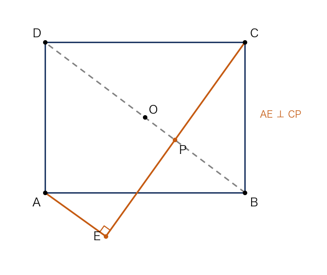

1. ① 证明 E 在一个固定的圆上，写出圆心与半径。
2. ② 分别判断 P = B、P = D、P 为 BD 中点时，E 在哪里。
3. ③ 说明 E 实际走的是哪一段圆弧。

【答案】

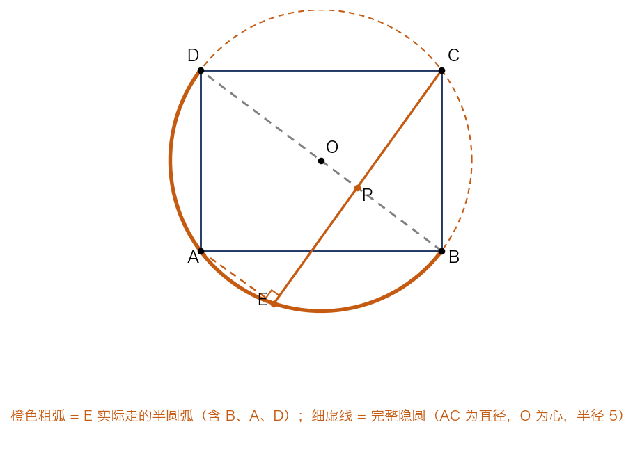

① C、E、P 共线且 AE⊥CP ⇒ ∠AEC = 90°；AC = √(8² + 6²) = 10，OE 是 Rt△AEC 斜边上的中线 = 5，与 P 无关。E 在以 O（AC 中点）为圆心、半径 5 的固定圆上。

② P = B 时 E = B；P = D 时 E = D；P 为 BD 中点（即 O）时 E = A。

③ 从 B 经过 A 到 D 的半圆弧（含端点 B、D）。BD 也是直径，所以这段弧恰为半个圆。

## 第 2 题｜等腰 + 45° 旋转：海淀一模同源变式（第二层 · 中高）

AB = AC，BC = 12，∠ABC = 15°，D 是 BC 的中点。将射线 BA 绕 B 顺时针旋转 45° 得射线 BM，过 C 作 CE⊥BM，垂足为 E。

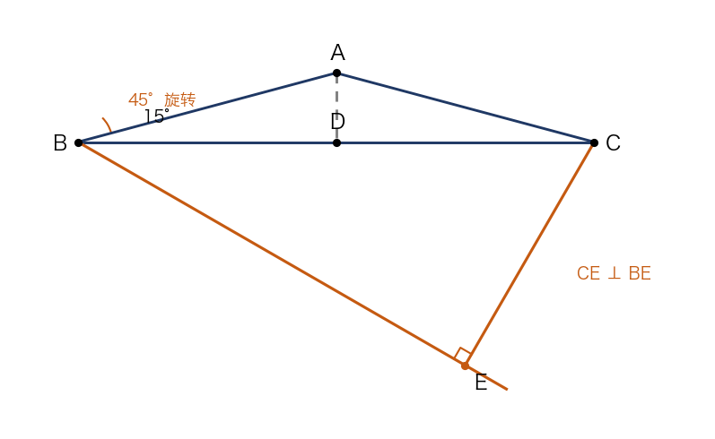

1. ① 不画圆，证明 DE 的长度固定，并求其值。
2. ② 求 ∠EDC 的度数。
3. ③ 求 CE 的长度。

【答案】

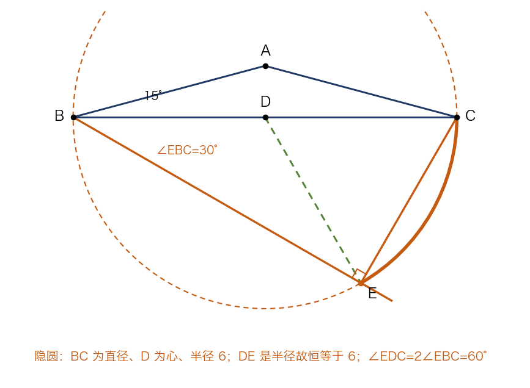

① Rt△BEC 中 ∠BEC = 90°，D 是斜边 BC 中点 ⇒ DE = BC 的一半 = 6（斜边中线定理），与旋转角无关，是定值。

② ∠EBC = 45° − 15° = 30°；E 在以 D 为心、6 为半径的圆上，∠EDC 是同弧 EC 的圆心角 = 2∠EBC = 60°。

③ DE = DC = 6 且夹角 ∠EDC = 60° ⇒ △DEC 等边 ⇒ CE = 6。

## 第 3 题｜折叠：变化的折痕、不变的距离（第二层 · 中档）

在直角三角形 ABC 中，∠ABC = 90°，AB = 6，BC = 8。一条经过 B 的直线 ℓ 是折痕，将点 A 折叠到点 P；折痕允许任意旋转。

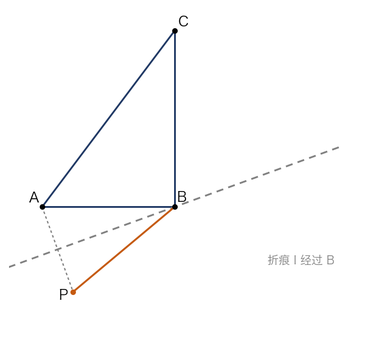

1. ① P 的轨迹是什么？写出圆心、半径。
2. ② AP 的最大值是多少？何时取得？
3. ③ 为什么不能只看原三角形内部来找 P？

【答案】

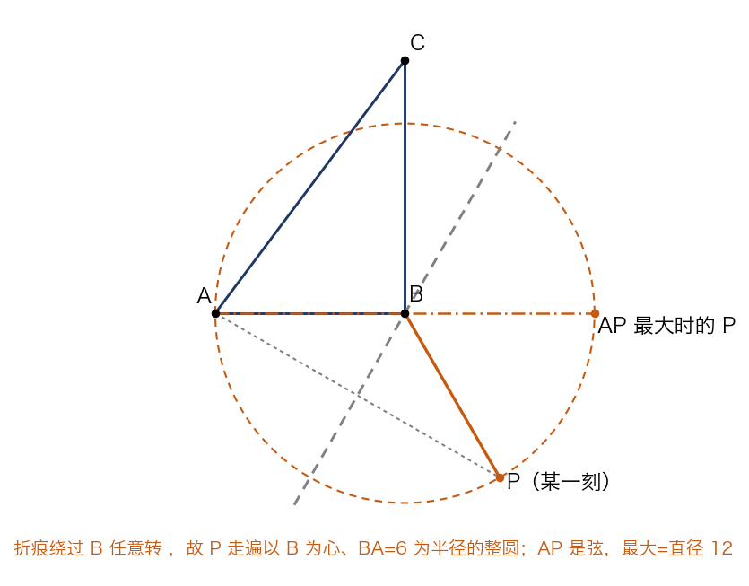

① 折叠不改长度 ⇒ BP = BA = 6 恒成立，折痕任意旋转 ⇒ 以 B 为圆心、6 为半径的整圆。

② AP 是圆的弦，最大 = 直径 = 12；当 A、B、P 共线且 B 为 AP 中点时取得。

③ 折痕是过 B 的任意直线，P 能落到三角形外（AP 最大时 P 在 AB 延长线上）；只看内部会把轨迹误判成一小段弧、并漏掉最大值。

## 第 4 题｜中点轨迹：圆上还有一个"更小的圆"（第二层 · 中高）

AB = 12，动点 P 在 AB 上方运动，始终满足 ∠APB = 90°。O 是 AB 中点，M 是 AP 中点。

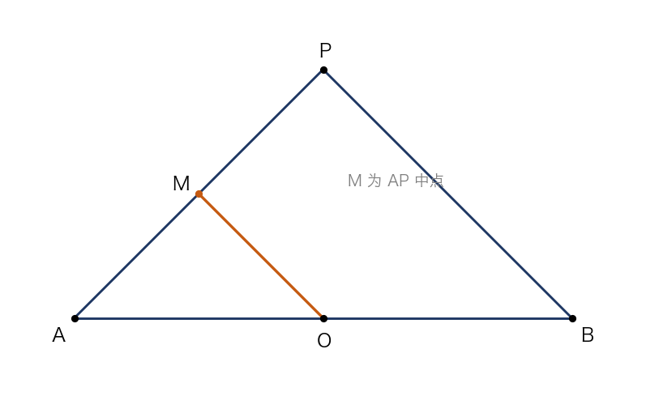

1. ① 不使用坐标，证明 AM⊥MO。
2. ② 证明 M 在一个固定的圆弧上，找出该圆的直径。
3. ③ 求新圆的半径。

【答案】

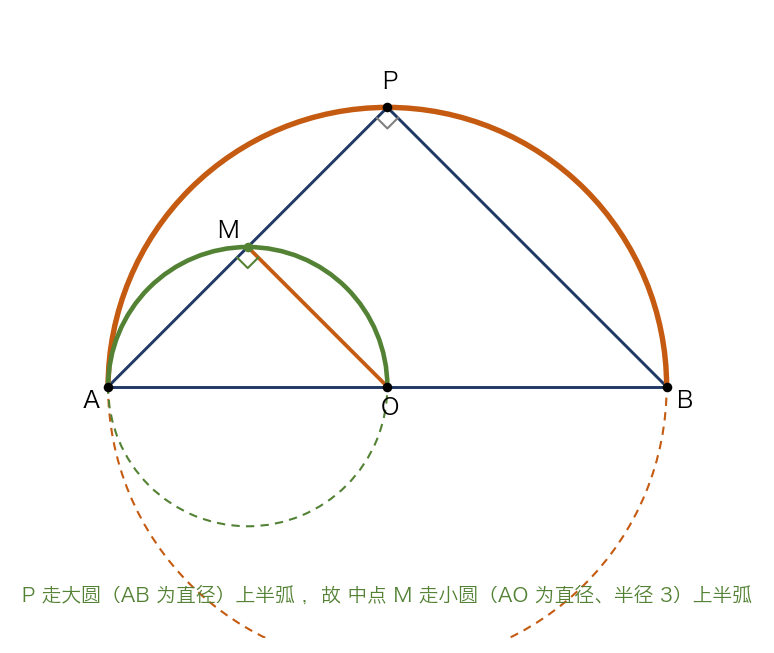

① MO 是 △APB 的中位线 ⇒ MO ∥ PB；又 AP⊥PB ⇒ AM⊥MO。

② ∠AMO = 90° 恒成立，A、O 为定点 ⇒ M 在以 AO 为直径的圆上；直径 = AO = 6。

③ 半径 = 3。（P 只走上半圆 ⇒ M 只走小圆的上半圆弧，端点 A、O 取不到。）

## 第 5 题｜两条直线转动：直角藏在交点处（第二层 · 中档）

固定线段 AB = 10。过 A 作一条可转动的直线 ℓ；过 B 作直线 m⊥ℓ，两线交于 P，规定 P 位于 AB 上方。

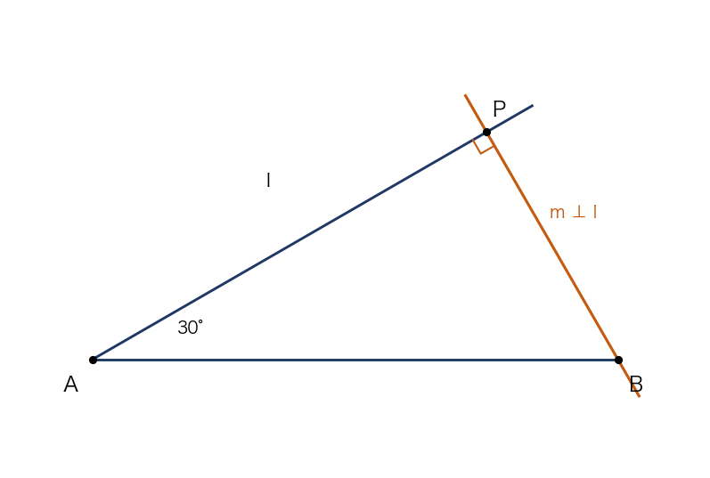

1. ① 判断 P 的轨迹；求圆心与半径。
2. ② 若 ∠PAB = 30°，求 PB。
3. ③ 为什么此题即使没给"圆"也应想到直径？

【答案】

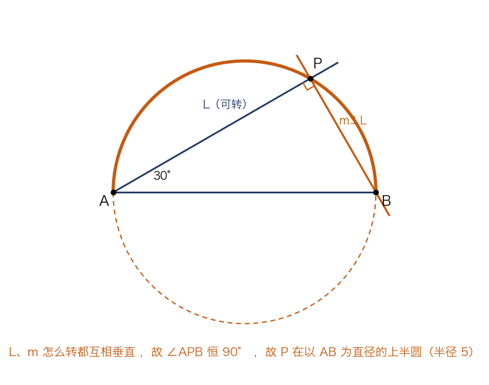

① ∠APB = 90° 恒成立 ⇒ 以 AB 为直径的圆的上半圆弧（端点 A、B 取不到）；圆心 = AB 中点，半径 = 5。

② Rt△APB 中 30° 角所对直角边 = 斜边一半 ⇒ PB = 5。

③ 条件"定线段 AB + 恒直角 ∠APB"已齐：对着定线段张直角的点到定线段中点距离恒为它的一半，必在以 AB 为直径的圆上；圆不用画出来，条件凑齐它就在。

## 第 6 题｜60° 固定角：圆心不再是弦中点（第二层 · 较难）

AB = 6，动点 P 位于直线 AB 上方，始终满足 ∠APB = 60°。M 是 AB 中点，T 为对应隐圆圆心。

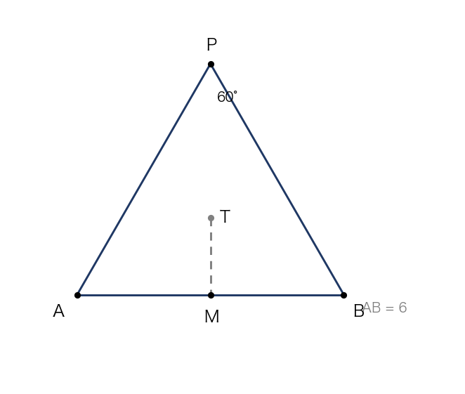

1. ① 求隐圆的半径 R。
2. ② 求 TM 的长度，并判断 T 位于 AB 哪一侧。
3. ③ 说明 P 为什么只在这个圆的一段弧上，而不是整圆。

【答案】

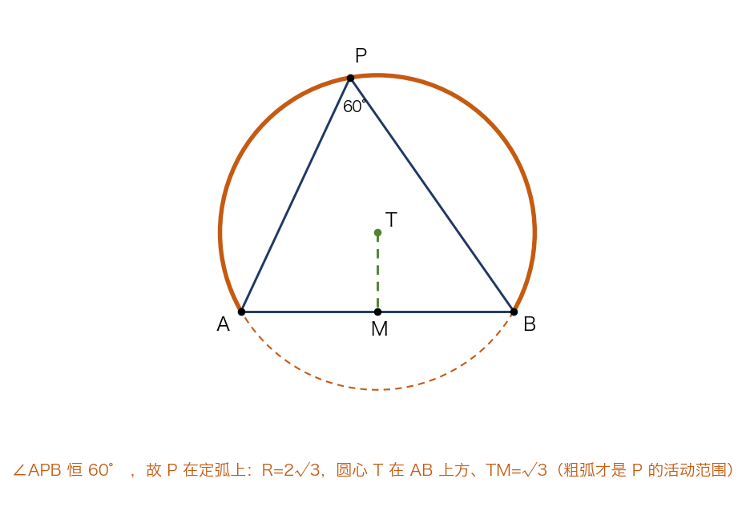

① 圆心角 ∠ATB = 2×60° = 120°；Rt△ATM 中 AM = 3、∠ATM = 60° ⇒ R = 3 ÷ sin60° = 2√3。

② TM = √(R² − 3²) = √3；T 在 AB 上方（与 P 同侧）。

③ 圆被 AB 分成两弧：上弧上的点对 AB 张 60°，下弧上的点张 180° − 60° = 120°（圆内接四边形对角互补）；题限 P 在 AB 上方且张角 60°，故只走上弧。

## 第 7 题｜折叠最值：先把动点变成整圆（第三层 · 中高）

直角三角形 ABC 中，∠ABC = 90°，AB = 6，BC = 8。将 A 沿经过 B 的任意折痕翻折到 P。

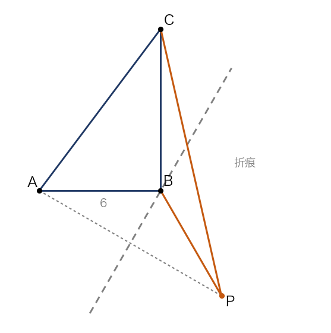

1. ① 用一句话证明 P 的轨迹是圆。
2. ② 求 CP 的最小值、最大值。
3. ③ 分别说明取得两个最值时 B、C、P 的位置关系。

【答案】

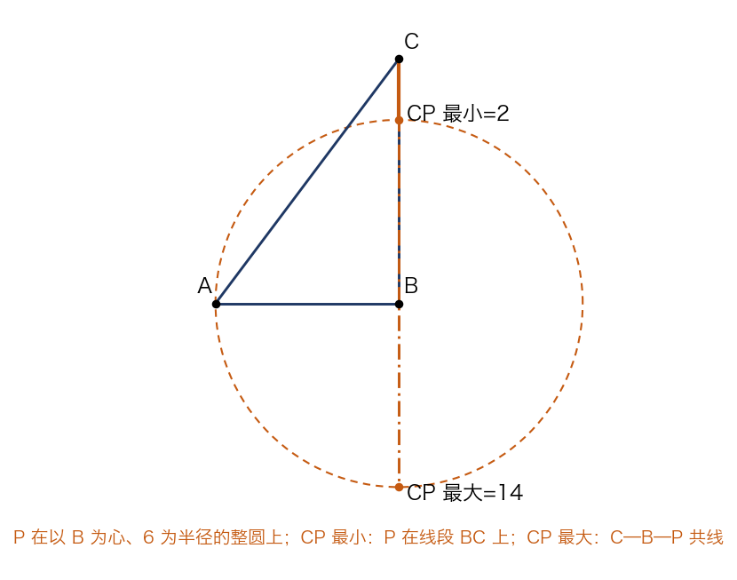

① 翻折保持 BP = BA = 6 不变，折痕任意旋转 ⇒ P 在以 B 为心、6 为半径的整圆上。

② |BC − BP| ≤ CP ≤ BC + BP ⇒ 最小 = 8 − 6 = 2，最大 = 8 + 6 = 14。

③ 最小：P 在线段 BC 上（顺序 B—P—C）；最大：C—B—P 共线，P 在 CB 的反向延长线上。

## 第 8 题｜限定圆弧：不能直接套"圆心距 ± 半径"（第三层 · 难）

坐标系中 A(0,0)，B(8,0)，O 为 AB 中点。P 满足 ∠APB = 90°，P 在 AB 上方且纵坐标 y≥3。另有 Q(4,−3)。

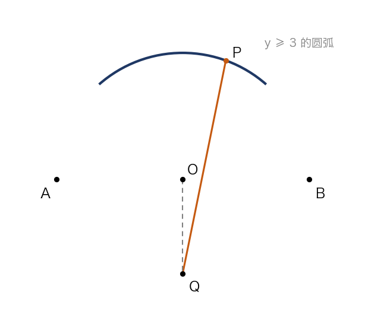

1. ① 先找出 P 所在圆的方程（或圆心、半径）。
2. ② 求 QP 的最小值和最大值（须证明都能取到）。
3. ③ 解释为什么不能把整个圆的最小值 1 作为本题答案。

【答案】

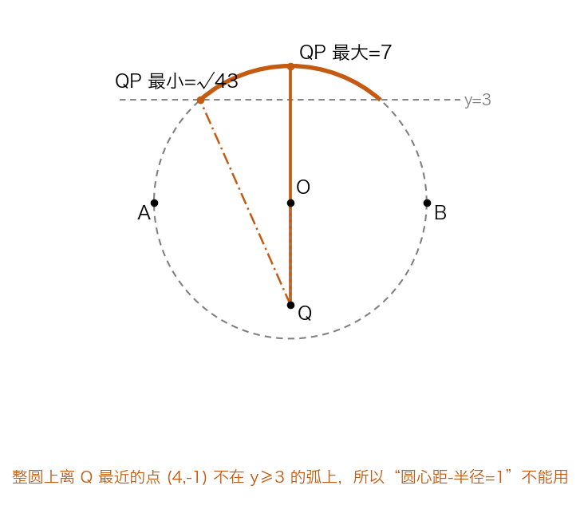

① 圆心 O(4,0)，半径 4；方程 (x−4)² + y² = 16。

② QP² = (x−4)² + (y+3)² = 16 − y² + y² + 6y + 9 = 25 + 6y；由 3 ≤ y ≤ 4 得 43 ≤ QP² ≤ 49，即最小 √43、最大 7。能取到：y = 3 时 P = (4 ± √7, 3) 在允许弧上（QP = √43）；y = 4 时 P = (4,4)（QP = 7）。

③ 整圆上离 Q 最近的点是 (4,−1)（QP = 5 − 4 = 1），但它纵坐标 −1 < 3，不在允许弧上，P 站不到那里。

## 第 9 题｜直线与隐圆交点数：分类讨论（第三层 · 难）

A(0,0)，B(8,0)。P 在第一象限，且 ∠APB = 90°。另要求 P 在直线 y = k 上。

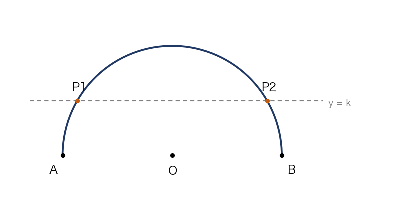

1. ① 写出 P 所在隐圆的圆心和半径。
2. ② 当 k 取何值时，合格的 P 有两个、一个、零个？
3. ③ 在题图上标出"一点相切"的极限位置。

【答案】

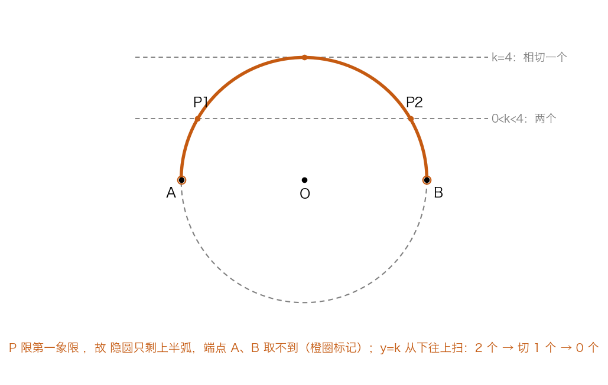

① 圆心 (4,0)，半径 4。

② 0 < k < 4：两个（x = 4 ± √(16 − k²)，两根都为正）；k = 4：一个（相切于 (4,4)）；k ≤ 0 或 k > 4：零个。

③ 极限位置为圆的最高点 (4,4)：直线 y = 4 与圆相切于此（见图）。

## 第 10 题｜双隐圆交点：两个直角同时出现（第三层 · 难）

A(0,0)，B(8,0)，C(8,6)。点 P 不与 A、B、C 重合，并满足 ∠APB = ∠BPC = 90°。

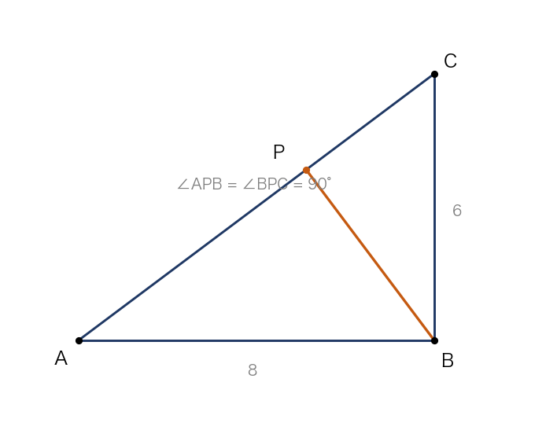

1. ① 解释 P 为什么同时属于两个以固定线段为直径的圆。
2. ② 证明 A、P、C 三点共线，BP⊥AC。
3. ③ 求 BP 的长和 P 的坐标。

【答案】

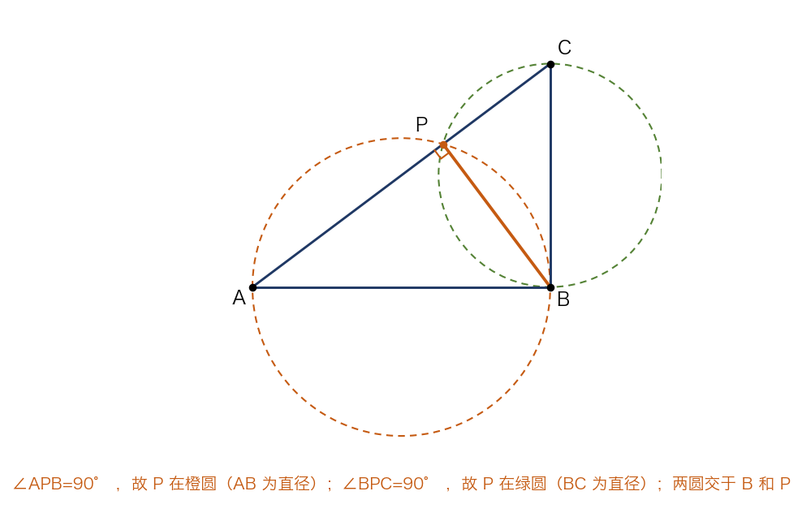

① 斜边中线：AB 中点 O1 到 P 恒为 4 ⇒ P 在圆 O1（AB 为直径）上；BC 中点 O2 到 P 恒为 3 ⇒ P 在圆 O2（BC 为直径）上。

② PA、PC 都过 P 且都垂直于 PB，过一点作已知直线的垂线只有一条 ⇒ PA、PC 同线 ⇒ A、P、C 共线，从而 BP⊥AC。

③ AC = 10；面积两算得 BP = 8×6÷10 = 24/5。△APB ∽ △ABC ⇒ AP = AB²÷AC = 32/5，AP÷AC = 16/25 ⇒ P = (128/25, 96/25)。

## 第 11 题｜固定 60° + 线段最值：非直径圆（第三层 · 难）

AB = 6，P 在 AB 上方，∠APB = 60°。O 是 AB 中点。

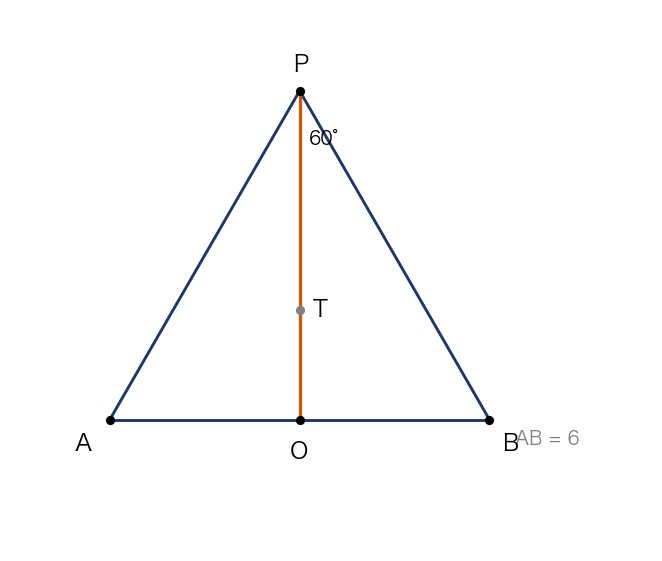

1. ① 求对应隐圆的半径及圆心 T 到 AB 的距离。
2. ② 求 OP 的最大值。
3. ③ 最大值取得时，△APB 是什么特殊三角形？

【答案】

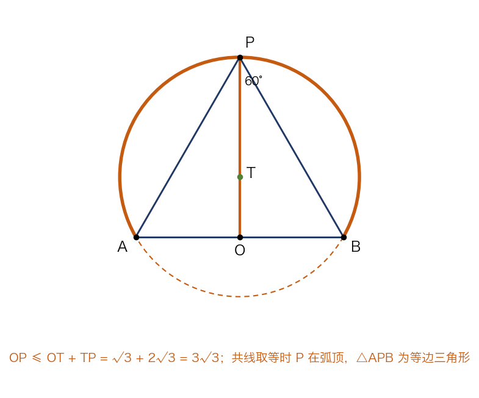

① R = 2√3；T 在 O 正上方，到 AB 的距离 = √3。

② OP ≤ OT + TP = √3 + 2√3 = 3√3；等号当 O、T、P 共线（P 为弧顶）时取得，该点在允许弧上，故最大值 3√3。

③ 等边三角形（PA = PB 且 ∠APB = 60°）。

## 第 12 题｜新定义型：折叠轨迹圆与另一个圆相交（第三层 · 压轴）

A(−4,0)，B(4,0)，O(0,0)。点 A 关于过 O 的任意折痕的对称点为 P。Q(0,t)，且 t≥0。

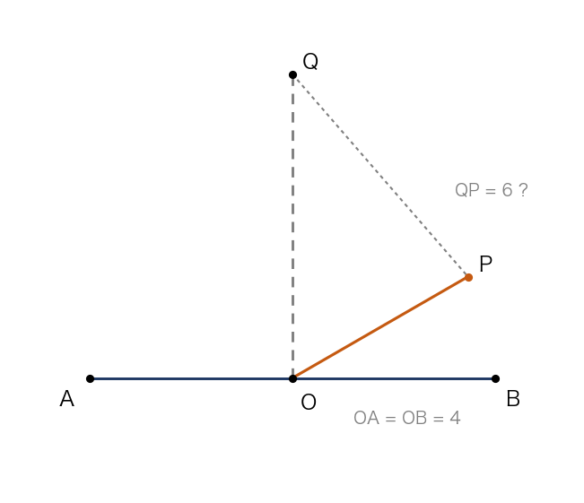

1. ① 写出 P 的完整运动轨迹。
2. ② 若要求 QP = 6，求 t 的所有可能值。
3. ③ 在什么 t 值下恰有一个 P？什么时候有两个 P？

【答案】

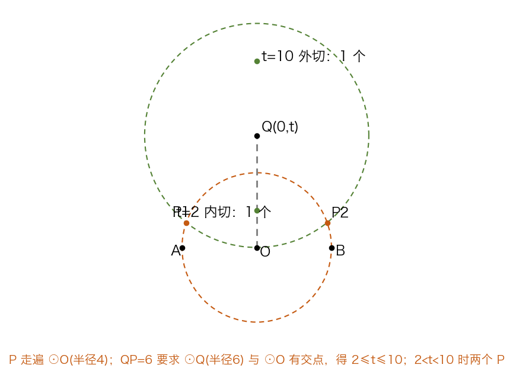

① 以 O 为圆心、4 为半径的整圆（OP = OA = 4，折痕任意旋转）。

② QP = 6 ⇔ ⊙Q(半径6) 与 ⊙O(半径4) 有公共点 ⇔ |6 − 4| ≤ t ≤ 6 + 4，即 2 ≤ t ≤ 10。

③ t = 2（内切）或 t = 10（外切）时恰一个 P；2 < t < 10 时两个 P；0 ≤ t < 2 时没有 P。

## 第 13 题｜2025 海淀区一模第 27 题：原题挑战（真题 · 7 分几何题）

在等腰三角形 ABC 中，底角为 α（0° < α < 45°），AD⊥BC。将射线 BA 顺时针旋转 45° 得 BM；C 到 BM 的垂足是 E，直线 CE 交射线 BA 于 F。

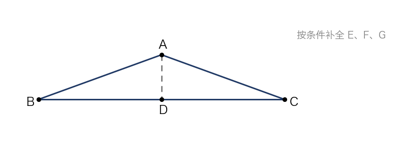

1. ① 根据原题补全图形，并用 α 表示 ∠EDC。
2. ② 在 DC 上取 G，使 DG = AD。求证：AF = EG + (√2/2)·CF。
3. 原题及官方参考解答见后附来源链接；该题不是本册自编。

【答案】

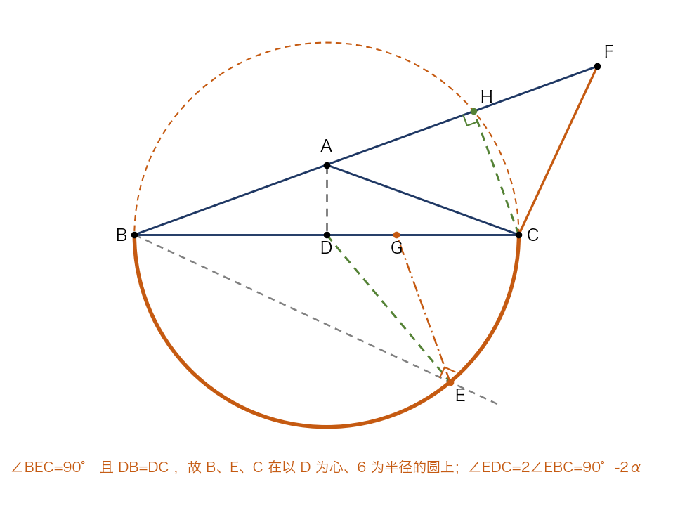

① ∠EDC = 90° − 2α。理由：BD = DC，∠BEC = 90° ⇒ DE = BD = DC ⇒ B、E、C 在以 D 为心的圆上；∠EBC = 45° − α，圆心角 ∠EDC = 2∠EBC = 90° − 2α。

② 证明思路：过 C 作 CH⊥BA 于 H，则 Rt△BHC 中 DH = BC 的一半 = DE（H 也在圆 D 上）；∠ADH = (180° − 2α) − 90° = 90° − 2α = ∠GDE，又 AD = GD、DH = DE，故 △ADH ≌ △GDE（SAS）⇒ AH = EG；Rt△FHC 中 ∠HFC = 45°（BM⊥CF 且 BM 与 BA 夹角 45°）⇒ FH = (√2/2)·CF；由图 H 在 A、F 之间，AF = AH + HF = EG + (√2/2)·CF。

③ 本题为 2025 北京市海淀区初三一模数学第 27 题（原卷第 6 页、参考解答第 12—13 页左右），完整表述与官方解答以原卷为准。
