# 隐圆模型 · 如何识别隐圆 + 逐题详解（解析册补充讲解版）

配套《海淀初三_隐圆第二三层_教师解析册.pdf》与《海淀初三_隐圆第二三层_学生训练册.pdf》，题号与两册一一对应（第 1—12 题为原创题，第 13 题为 2025 海淀一模第 27 题）。

原解析册每题只给了两三步"答案流"，跳过了最关键的一环：**当初是怎么想到要画这个圆的？** 本文补的就是这一环：第一章教四个识别信号，第二章给固定三步流程，第三章把每题展开成完整详解（配图里橙色粗弧 = 动点实际走的范围，橙色细虚线 = 完整隐圆），第四章把整套题的易错点汇总成清单。

## 第一章 先会识别：隐圆的四个信号

隐圆是什么：题目里根本没有画圆，但动点实际上是在某个圆（或一段弧）上跑。一旦把它找出来，"动点能去哪儿"就从模糊变清楚，最值、交点个数、轨迹范围就都有工具可用了。

读题时只找两样东西：**哪个点（哪条线段）是固定不动的**，以及**哪个距离或哪个角是永远不变的**。下面四个信号，每个对应一类圆：

### 信号 1：固定直角 → 以定线段为直径的圆

长相：动点（或垂足）E 对着两个定点 A、C 张成的角永远是 90°。直角很少直接写出来，通常藏在两种说法里：

- "AE⊥CP，垂足为 E"：直线 CP 在转，但不变的是"垂足 E 看两个定点 A、C 成直角"（第 1、2、13 题）；
- "两条直线互相垂直，交点为 P"：两条线都在转，但永远互相垂直，于是交点 P 对着线上的两个定点张直角（第 5 题；第 10 题是同时出现两个这样的直角）。

结论：动点在以这条定线段为直径的圆上，圆心 = 定线段的中点，半径 = 定线段的一半。

依据：直角三角形斜边上的中线等于斜边的一半。取 AC 中点 O，则不管 E 在哪儿，OE 都等于 AC 的一半——到定点的距离是定长，这正是圆的定义。

口诀：**见直角，找斜边；斜边中点就是圆心。**

### 信号 2：折叠、对称、旋转 → 以"定点为圆心、不变长度为半径"的圆

长相：题里有"折叠""对称点""旋转"字样。折叠和旋转都不改变线段长度，这是这类题里唯一的"免费午餐"。

结论：把 A 折到 P，折痕过定点 B，则 BP = BA 永远成立，P 在以 B 为圆心、BA 为半径的圆上。圆能走多大一圈，看折痕的活动范围：折痕任意旋转就是整圆（第 3、7、12 题），折痕受限就只是一段弧。

口诀：**折叠不改长度；定点作圆心，原长作半径。**

### 信号 3：定线段 + 定角（不一定是 90°）→ 一段定弧

长相：动点 P 对着定线段 AB 张成的角固定，比如 ∠APB 恒等于 60°（第 6、11 题）。

结论：P 在以 AB 为弦的一段弧上。依据是圆周角定理：同弧所对的圆周角相等；反过来，在 AB 同一侧、对着 AB 张等角的点在同一段弧上。

圆心和半径怎么求：圆心角是同弧圆周角的 2 倍。∠APB = 60° 时圆心角 ∠ATB = 120°；等腰三角形 TAB（TA = TB = R）里作 TM⊥AB 于 M，则 M 是 AB 中点，AM = 3，∠ATM = 60°，于是 R = AM ÷ sin60° = 2√3，TM = AM ÷ tan60° = √3。（初三不用背 AB = 2R·sin∠APB 这种公式，画出圆心角、解一个直角三角形就够了。）

两个坑：

- 圆心**不再是弦的中点**：它在 AB 的垂直平分线上、靠 P 那一侧（张角小于 90° 时 P 在优弧上，圆心与 P 同侧）；
- P 只走**一段弧**，不是整圆：AB 另一侧的点对着 AB 张的是 180° − 60° = 120°，不满足条件。

口诀：**定弦定角定弧；角翻倍找圆心；别忘只是一段弧。**

### 信号 4：圆上动点再取中点 → "缩小一半"的圆

长相：P 自己已经在某个圆（或半圆）上跑，题目问的是 P 与定点连线的中点 M（第 4 题）。

结论：连中点、用中位线。△APB 中 M、O 分别是 AP、AB 的中点，则 MO ∥ PB 且 MO = PB 的一半；再结合 AP ⊥ PB 得到 AM ⊥ MO，即 M 对着定线段 AO 张直角——回到信号 1，M 在以 AO 为直径的圆上，半径是原来的一半。

口诀：**中点动，找中位线；新圆半径砍一半。**

## 第二章 识别之后，按固定三步走

1. **画整圆**：先按信号把完整的圆画出来，写下圆心和半径。别急着只画一段弧，会漏。
2. **套工具**：
   - 最值：圆外定点到圆上点，最小 = 圆心距 − 半径，最大 = 圆心距 + 半径；圆上两点之间（弦），最大 = 直径；两圆有公共点 ⇔ 圆心距 d 满足 |r1 − r2| ≤ d ≤ r1 + r2。
   - 交点个数：把直线方程代入圆方程看解的个数，或比较圆心到直线的距离与半径。
3. **裁剪**：回到题目的限制，检查动点实际能到圆上的哪一部分：只有上半？只有 y≥3 的那段？端点取不取得到？**本册多数丢分点在这一步**（第 1、6、8、9、12 题都在考它）。

## 第三章 逐题详解

### 第 1 题｜矩形 + 垂足：一个"消失"的直角（第二层 · 中档）

**题目**：矩形 ABCD 中，AB = 8，BC = 6。点 P 在对角线 BD 上运动；过 A 作 AE⊥直线 CP，垂足为 E。O 是 AC 的中点。① 证明 E 在一个固定的圆上，写出圆心与半径；② 分别判断 P = B、P = D、P 为 BD 中点时，E 在哪里；③ 说明 E 实际走的是哪一段圆弧。

**隐圆是怎么看出来的**：直线 CP 绕着 C 转（P 在跑），垂足 E 的位置时刻在变。但盯住两个定点 A、C 看：AE⊥CP 意味着 ∠AEC 永远等于 90°（E 是垂足，C、E、P 在同一条直线上）。这就是信号 1：垂足对着定线段 AC 张直角。

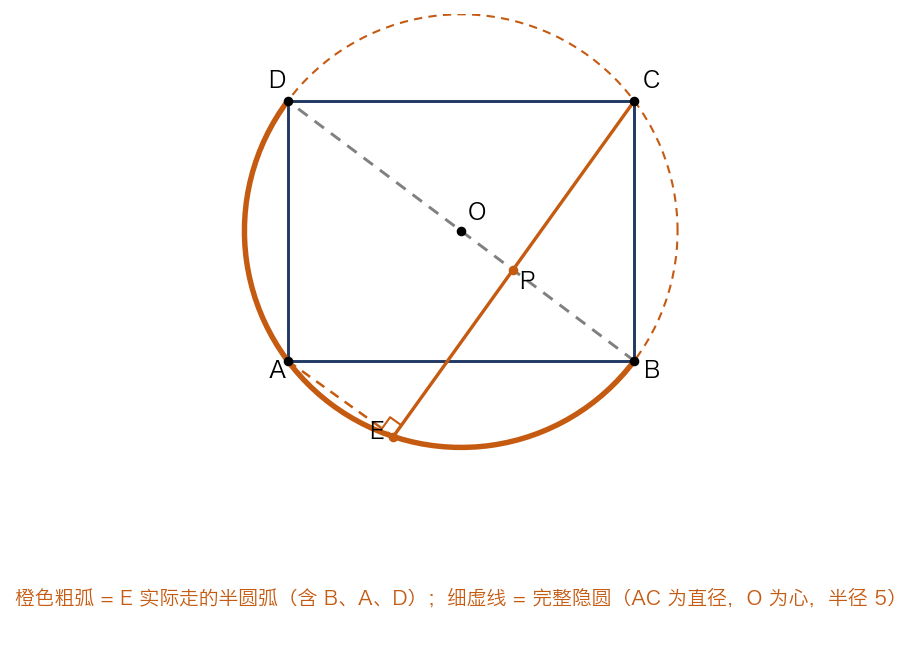

**详解**：

① 因为 C、E、P 共线且 AE⊥CP，所以 ∠AEC = 90°（E = A 等特殊位置按圆上的点理解）。矩形中 AC = √(8² + 6²) = 10。O 是 AC 中点，Rt△AEC 中斜边上的中线 OE = AC 的一半 = 5，与 P 的位置无关。所以 E 在以 O 为圆心、5 为半径的固定圆上。（这个圆恰好还过 B 和 D：因为 ∠ABC = ∠ADC = 90°。）

② P = B：直线 CP 就是直线 CB，而 AB⊥BC，所以 A 到直线 CB 的垂足就是 B，E = B。P = D：直线 CP 就是直线 CD，而 AD⊥DC，所以 E = D。P 为 BD 中点：矩形对角线相等且互相平分，BD 的中点就是 O，直线 CP 就是直线 CA，A 到直线 CA 的垂足是 A 自己，E = A。

③ P 从 B 沿 BD 连续移动到 D，E 也跟着连续移动：B → A → D。B、A、D 都在圆 O 上，而 BD 恰好也是直径（矩形两条对角线相等且互相平分），所以从 B 经过 A 到 D 的这段弧正好是**半圆弧**。E 实际走的就是这段半圆弧（含端点 B、D，中途经过 A）。

**易错点**：半径写成 10（忘记直径要减半）；② 里想不到"垂足可以和顶点重合"，以为特殊位置 E 不存在；③ 答成"整个圆"。

### 第 2 题｜等腰 + 45° 旋转：海淀一模同源变式（第二层 · 中高）

**题目**：AB = AC，BC = 12，∠ABC = 15°，D 是 BC 的中点。将射线 BA 绕 B 顺时针旋转 45° 得射线 BM，过 C 作 CE⊥BM，垂足为 E。① 不画圆，证明 DE 的长度固定，并求其值；② 求 ∠EDC 的度数；③ 求 CE 的长度。

**隐圆是怎么看出来的**：旋转角固定 45°、∠ABC = 15° 也固定，所以 BM 的方向其实是固定的、E 是一个确定的点——但题目的结构和第 1 题一模一样：垂足 E 对着定线段 BC 张直角（信号 1）。① 故意要求"不画圆"，是想让你用斜边中线定理；② 开始把圆请出来最快。

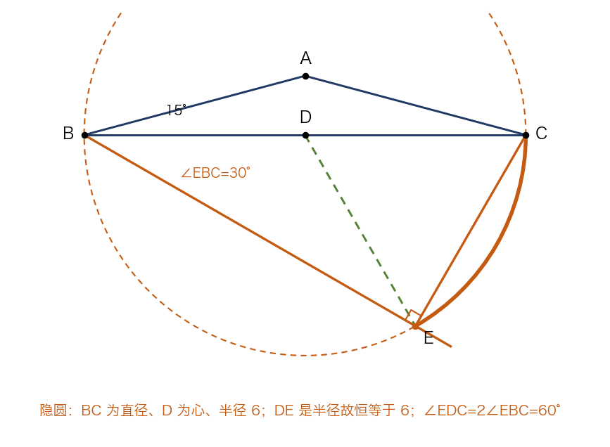

**详解**：

① Rt△BEC 中 ∠BEC = 90°，D 是斜边 BC 的中点，所以 DE = BC 的一半 = 6（直角三角形斜边上的中线等于斜边的一半）。它与旋转角无关，是定值。

② 请出隐圆：E 在以 D 为圆心、6 为半径的圆上（BC 为直径），B、C 也在这个圆上。射线 BA 在 BC 上方 15°，绕 B 顺时针转 45° 后 BM 落到 BC 下方 45° − 15° = 30° 处，即 ∠EBC = 30°。∠EBC 是弧 EC 所对的圆周角，∠EDC 是同弧所对的圆心角，所以 ∠EDC = 2∠EBC = 60°。

③ △DEC 中 DE = DC = 6（都是半径），夹角 ∠EDC = 60°，所以 △DEC 是等边三角形，CE = 6。

**易错点**：旋转方向搞反，把 ∠EBC 算成 45° + 15° = 60°（顺时针是往下转，应该相减）；② 忘记"同弧圆心角 = 2 倍圆周角"，把 ∠EDC 当成 30°。

### 第 3 题｜折叠：变化的折痕、不变的距离（第二层 · 中档）

**题目**：直角三角形 ABC 中，∠ABC = 90°，AB = 6，BC = 8。一条经过 B 的直线 ℓ 是折痕，将点 A 折叠到点 P；折痕允许任意旋转。① P 的轨迹是什么？写出圆心、半径；② AP 的最大值是多少？何时取得？③ 为什么不能只看原三角形内部来找 P？

**隐圆是怎么看出来的**：看到"折叠"就是信号 2。折痕过定点 B，折后 BP = BA = 6 永远成立：到定点 B 的距离是定长 6。

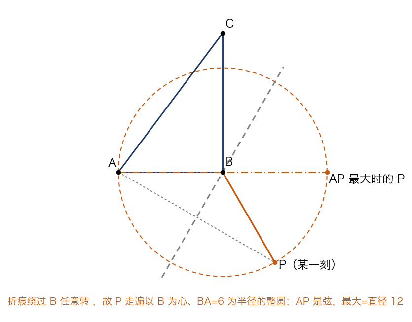

**详解**：

① 折叠是轴对称，轴对称不改变距离：BP = BA = 6。折痕绕过 B 任意旋转，P 各个方向都能到，所以 P 的轨迹是以 B 为圆心、6 为半径的**整圆**。

② A 自己也在这个圆上（BA = 6），AP 是圆的一条弦。弦最长是直径：AP 最大值 = 12，当 AP 经过圆心 B 时取得，即 A、B、P 三点共线、B 是 AP 的中点（P 在 A 关于 B 的对称位置）。

③ 折痕是"过 B 的任意直线"，折出来的 P 可以落在三角形外面的任何方向（比如 AP 取最大值时，P 在 AB 的延长线上，完全在三角形外）。只看三角形内部，最多看到一小段弧，轨迹和最值都会判错。

**易错点**：轨迹写成一段弧（折痕并没受限）；② 只写 12 不说明取得的位置。

### 第 4 题｜中点轨迹：圆上还有一个"更小的圆"（第二层 · 中高）

**题目**：AB = 12，动点 P 在 AB 上方运动，始终满足 ∠APB = 90°。O 是 AB 中点，M 是 AP 中点。① 不使用坐标，证明 AM⊥MO；② 证明 M 在一个固定的圆弧上，找出该圆的直径；③ 求新圆的半径。

**隐圆是怎么看出来的**：两层。第一层：P 对着定线段 AB 张直角 → P 在以 AB 为直径的圆上（信号 1；P 在 AB 上方，所以是上半圆）。第二层：M 是动点 P 与定点 A 连线的中点 → 信号 4。

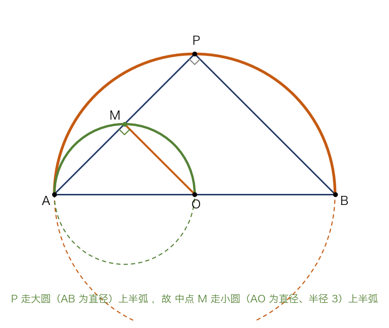

**详解**：

① △APB 中，M、O 分别是 AP、AB 的中点，所以 MO 是中位线，MO ∥ PB。又 ∠APB = 90° 即 AP⊥PB，一条直线垂直于两平行线中的一条就垂直于另一条，所以 AP⊥MO，即 AM⊥MO。

② 由 ① 知 ∠AMO 永远等于 90°，而 A、O 是两个定点：M 对着定线段 AO 张直角（又是信号 1），所以 M 在以 AO 为直径的圆上，直径 = AO = AB 的一半 = 6。

③ 新圆半径 = 6 ÷ 2 = 3。

补充（范围）：P 只走大圆的上半圆（端点 A、B 取不到），M 相应地只走小圆的上半圆弧（端点 A、O 取不到）。

**易错点**：② 直接说"M 的轨迹是缩小一半的圆"而不证明（本题要求用中位线 + 直角推出来）；忘记讨论范围。

### 第 5 题｜两条直线转动：直角藏在交点处（第二层 · 中档）

**题目**：固定线段 AB = 10。过 A 作一条可转动的直线 ℓ；过 B 作直线 m⊥ℓ，两线交于 P，规定 P 位于 AB 上方。① 判断 P 的轨迹，求圆心与半径；② 若 ∠PAB = 30°，求 PB；③ 为什么此题即使没给"圆"也应想到直径？

**隐圆是怎么看出来的**：ℓ 和 m 都在转，但"m⊥ℓ"永远不变 → 交点 P 对着线上两个定点 A、B 张成的角永远是 90° → 信号 1。

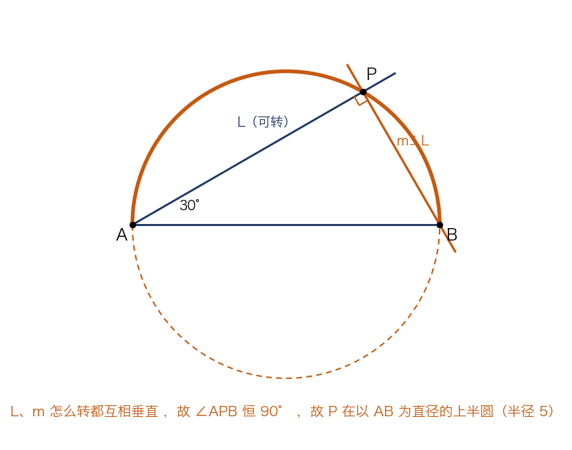

**详解**：

① AP 在 ℓ 上、BP 在 m 上，m⊥ℓ，所以 ∠APB = 90°。P 在以 AB 为直径的圆上；又规定 P 在 AB 上方，轨迹是上半圆弧（端点 A、B 取不到）。圆心 = AB 中点，半径 = 5。

② Rt△APB 中斜边 AB = 10，∠PAB = 30°，30° 角所对的直角边等于斜边的一半：PB = AB 的一半 = 5。

③ 因为"定线段 AB + 永远不变的直角 ∠APB"这两个条件已经齐了：对着定线段张直角的点，到定线段中点的距离永远等于定线段的一半，所以在以它为直径的圆上（直角三角形斜边中线定理的反过来用）。圆不用题目画，条件凑齐它自己就出现了——这正是"隐圆"两个字的意思。

**易错点**：轨迹写成整圆（题目规定了 P 在 AB 上方）；② 把 30° 对的边搞错（求的是 PB，它是 ∠PAB 的对边）。

### 第 6 题｜60° 固定角：圆心不再是弦中点（第二层 · 较难）

**题目**：AB = 6，动点 P 位于直线 AB 上方，始终满足 ∠APB = 60°。M 是 AB 中点，T 为对应隐圆圆心。① 求隐圆的半径 R；② 求 TM 的长度，并判断 T 位于 AB 哪一侧；③ 说明 P 为什么只在这个圆的一段弧上，而不是整圆。

**隐圆是怎么看出来的**：定线段 AB + 定角 60°（不是直角）→ 信号 3。

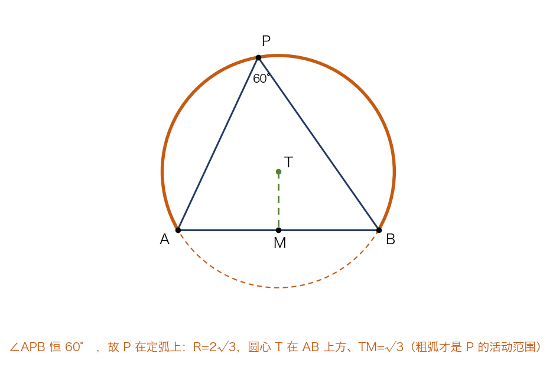

**详解**：

① 连 TA、TB。圆心角 ∠ATB = 2∠APB = 120°。等腰 △TAB（TA = TB = R）中作 TM⊥AB 于 M，则 M 是 AB 中点（三线合一），AM = 3，∠ATM = 60°。Rt△ATM 中：R = TA = AM ÷ sin60° = 3 ÷ (√3/2) = 2√3。

② TM = AM ÷ tan60° = 3 ÷ √3 = √3（或用勾股定理 TM = √(R² − 3²) = √(12 − 9) = √3）。T 在 AB **上方**（与 P 同侧）：P 走的是优弧（张 60° 角的那段弧），优弧的圆心与弧在同一侧。

③ 条件是"P 在 AB 上方且 ∠APB = 60°"。圆被 AB 分成两段弧：上方弧上的点对着 AB 张 60°，下方弧上的点对着 AB 张 180° − 60° = 120°（圆内接四边形对角互补）。所以满足条件的 P 只能走在上方那段弧上。

**易错点**：把 T 当成 AB 中点 M（只有定角 90° 时圆心才是弦中点）；T 画到 AB 下方；③ 答整圆。

### 第 7 题｜折叠最值：先把动点变成整圆（第三层 · 中高）

**题目**：直角三角形 ABC 中，∠ABC = 90°，AB = 6，BC = 8。将 A 沿经过 B 的任意折痕翻折到 P。① 用一句话证明 P 的轨迹是圆；② 求 CP 的最小值、最大值；③ 分别说明取得两个最值时 B、C、P 的位置关系。

**隐圆是怎么看出来的**：与第 3 题同款，信号 2：BP = BA = 6 不变、B 固定 → 以 B 为圆心 6 为半径的整圆。于是"CP 最值"就是圆外定点 C 到圆上点的距离问题。

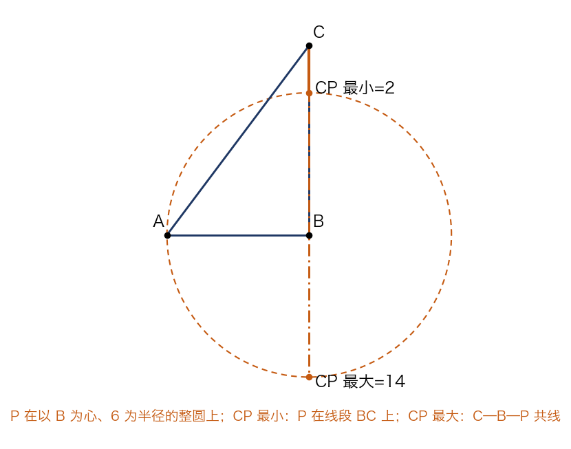

**详解**：

① 翻折保持长度不变，BP = BA = 6 永远成立，折痕又能任意旋转，所以 P 在以 B 为圆心、6 为半径的整圆上。

② C 在圆外（BC = 8 > 6）。看 B、P、C 三点：两边之差 ≤ 第三边 ≤ 两边之和，即 |BC − BP| ≤ CP ≤ BC + BP（三点共线时取等号），也就是 8 − 6 ≤ CP ≤ 8 + 6。CP 最小值 = 2，最大值 = 14。

③ 最小值：P 在线段 BC 上（顺序 B—P—C；因为 BP = 6 < 8 = BC，P 确实落在线段内）。最大值：C—B—P 三点共线、B 夹在中间，即 P 在 CB 的反向延长线上。

**易错点**：最小值写了 2 却不验证 P 真能站在线段 BC 上；最大值的共线顺序写反（写成 P 在 B、C 之间）。

### 第 8 题｜限定圆弧：不能直接套"圆心距 ± 半径"（第三层 · 难）

**题目**：坐标系中 A(0,0)，B(8,0)，O 为 AB 中点。P 满足 ∠APB = 90°，P 在 AB 上方且纵坐标 y≥3。另有 Q(4,−3)。① 先找出 P 所在圆的方程（或圆心、半径）；② 求 QP 的最小值和最大值（须证明都能取到）；③ 解释为什么不能把整个圆的最小值 1 作为本题答案。

**隐圆是怎么看出来的**：信号 1：∠APB = 90° → 以 AB 为直径的圆，圆心 O(4,0)、半径 4。但本题把 P **限制在一段弧上**（y≥3），所以第三步"裁剪"才是考点：公式要在弧上用，不能在整圆上用。

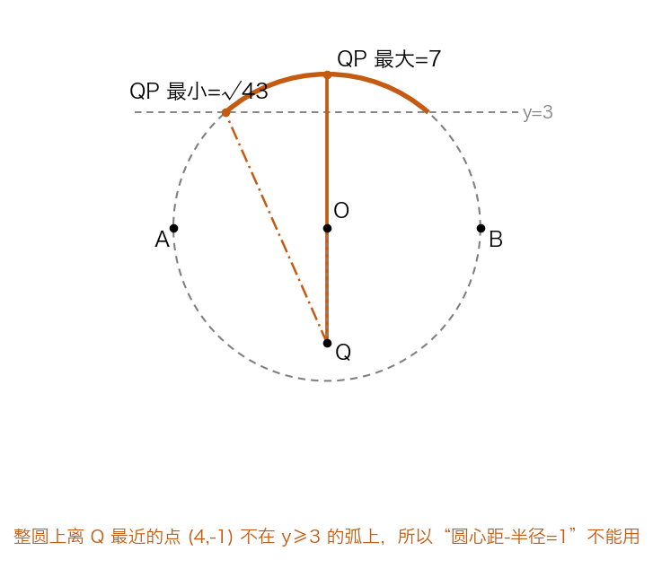

**详解**：

① 圆心 O(4,0)，半径 4，方程 (x−4)² + y² = 16。

② 设 P = (x,y)。QP² = (x−4)² + (y+3)²。P 在圆上，所以 (x−4)² = 16 − y²，代入得 QP² = 16 − y² + y² + 6y + 9 = 25 + 6y。限制条件是 3 ≤ y ≤ 4（y = 4 是圆的最高点），所以 QP² 在 25 + 18 = 43 与 25 + 24 = 49 之间，即 √43 ≤ QP ≤ 7。
能取到的证明：y = 3 时 x = 4 ± √7，P = (4 ± √7, 3) 在允许弧上，此时 QP = √43；y = 4 时 P = (4,4)，此时 QP = 7。两个值都取得到。

③ 整圆上离 Q 最近的点是线段 QO 与圆的交点 (4,−1)，那里 QP = QO − 半径 = 5 − 4 = 1；但 (4,−1) 的纵坐标是 −1 < 3，不在允许的弧上，P 站不到那里去，所以 1 取不到。**"最小 = 圆心距 − 半径"只有当最近点落在允许范围内时才好用。**

**易错点**：直接答 QP 最小 = 1；② 不写"能取到"的验证（题目明确要求）。

### 第 9 题｜直线与隐圆交点数：分类讨论（第三层 · 难）

**题目**：A(0,0)，B(8,0)。P 在第一象限，且 ∠APB = 90°。另要求 P 在直线 y = k 上。① 写出 P 所在隐圆的圆心和半径；② 当 k 取何值时，合格的 P 有两个、一个、零个？③ 在题图上标出"一点相切"的极限位置。

**隐圆是怎么看出来的**：信号 1 + "第一象限"这个限制：隐圆是以 AB 为直径的整圆，但 P 实际能用的只有第一象限里的那段弧——去掉端点 A、B 的上半圆（A、B 处 y = 0，不算第一象限）。

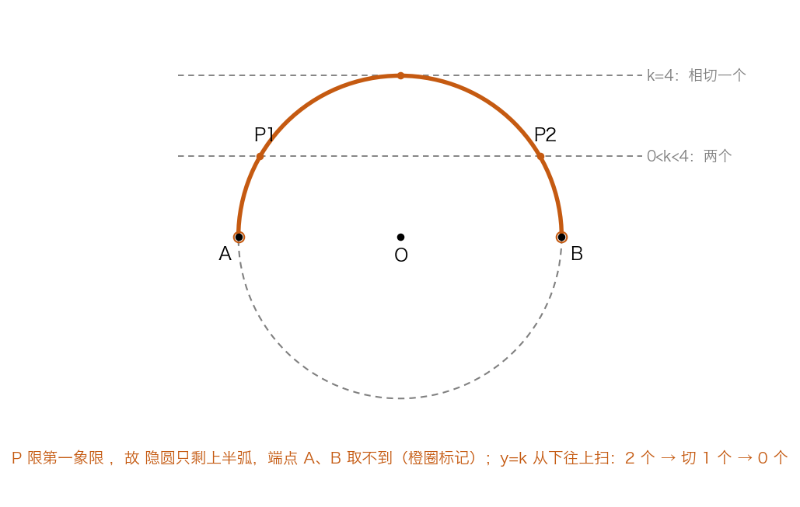

**详解**：

① 圆心 (4,0)，半径 4。

② 把 y = k 代入 (x−4)² + y² = 16，得 (x−4)² = 16 − k²。

- k ≤ 0：直线不进入第一象限（或贴着 x 轴），零个；
- 0 < k < 4：16 − k² > 0，x = 4 ± √(16 − k²)，且 √(16 − k²) < 4，两个解都满足 x > 0，都在第一象限，**两个**；
- k = 4：x = 4，只有 P = (4,4)，**一个**（直线 y = 4 与圆相切，切点恰是圆的最高点）；
- k > 4：16 − k² < 0，无解，**零个**。

③ 极限位置是圆的最高点 (4,4)：水平线从下往上升到 y = 4 时与圆相切于这一点（见图）。

**易错点**：分类时忘记检查 x > 0（本题两根恰好都为正，但必须验一句）；漏掉 k = 4 这个"相切一个"；把端点 A、B 算进弧里。

### 第 10 题｜双隐圆交点：两个直角同时出现（第三层 · 难）

**题目**：A(0,0)，B(8,0)，C(8,6)。点 P 不与 A、B、C 重合，并满足 ∠APB = ∠BPC = 90°。① 解释 P 为什么同时属于两个以固定线段为直径的圆；② 证明 A、P、C 三点共线，BP⊥AC；③ 求 BP 的长和 P 的坐标。

**隐圆是怎么看出来的**：两个直角 = 两个隐圆：∠APB = 90° → 以 AB 为直径的圆（圆心 (4,0)、半径 4）；∠BPC = 90° → 以 BC 为直径的圆（圆心 (8,3)、半径 3）。P 是两圆的公共点（另一个公共点是 B）。

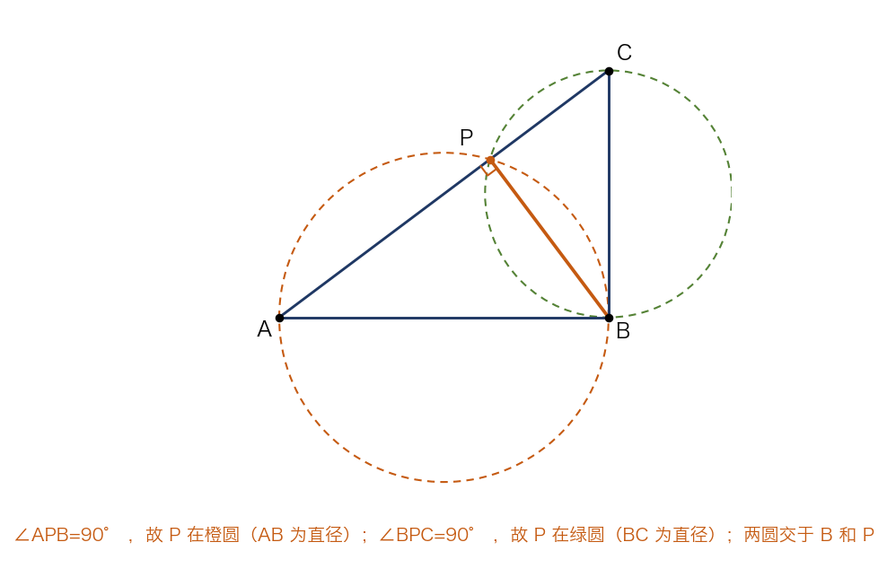

**详解**：

① 取 AB 中点 O1，Rt△APB 中斜边中线 O1P = AB 的一半 = 4，与 P 的位置无关，所以 P 在圆 O1 上；取 BC 中点 O2，Rt△BPC 中 O2P = BC 的一半 = 3，所以 P 在圆 O2 上。

② 在同一点 P 处，PA⊥PB 且 PC⊥PB。过一点 P 作 PB 的垂线，在平面内只有一条，所以 PA 与 PC 是同一条直线，即 A、P、C 三点共线。于是 BP⊥AC（BP 垂直于 PA，而 PA 所在直线就是 AC）。

③ P 是 Rt△ABC 中 B 到斜边 AC 的垂足。AC = √(8² + 6²) = 10。面积两种算法：(1/2)·AB·BC = (1/2)·AC·BP，得 BP = 8×6÷10 = 24/5。
坐标：Rt△APB 与 Rt△ABC 中，∠A 公共、∠APB = ∠ABC = 90°，所以 △APB ∽ △ABC，AP ÷ AB = AB ÷ AC，AP = AB²÷AC = 64÷10 = 32/5。P 在线段 AC 上，AP ÷ AC = (32/5)÷10 = 16/25，所以 P = (16/25)·(8,6) = (128/25, 96/25)。

**易错点**：② 想不到"过一点只有一条垂线"；③ 相似比写反（AP 对应 AB，AB 对应 AC）。

### 第 11 题｜固定 60° + 线段最值：非直径圆（第三层 · 难）

**题目**：AB = 6，P 在 AB 上方，∠APB = 60°。O 是 AB 中点。① 求对应隐圆的半径及圆心 T 到 AB 的距离；② 求 OP 的最大值；③ 最大值取得时，△APB 是什么特殊三角形？

**隐圆是怎么看出来的**：与第 6 题同款，信号 3：R = 2√3，圆心 T 在 AB 上方、到 AB 的距离 √3（垂足恰是 AB 中点 O）。

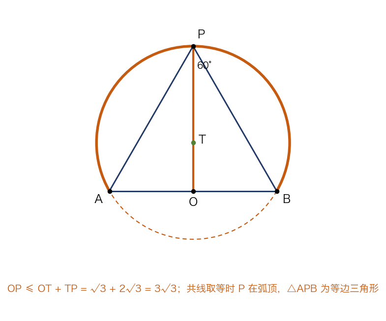

**详解**：

① 同第 6 题：圆心角 120°，R = 3 ÷ sin60° = 2√3；T 到 AB 的距离 = √(R² − 3²) = √3，且 T 在 O 的正上方（圆心到弦的垂线过弦的中点）。

② 对圆上任何 P，OP ≤ OT + TP = √3 + 2√3 = 3√3（三角形两边之和 ≥ 第三边，等号当 O、T、P 三点共线、P 在 T 上方时成立）。这时 P 是 OT 延长线与圆的交点，即弧的最高点，它确实在允许的弧上，等号能取。OP 最大值 = 3√3。

③ 此时 P 在 AB 的垂直平分线上，PA = PB；又 ∠APB = 60°，有一个角是 60° 的等腰三角形是等边三角形。

**易错点**：OP 最大值写成半径 2√3（忘记 O 不是圆心，要加上 OT 那段）；② 不验证取等时 P 在允许弧上。

### 第 12 题｜新定义型：折叠轨迹圆与另一个圆相交（第三层 · 压轴）

**题目**：A(−4,0)，B(4,0)，O(0,0)。点 A 关于过 O 的任意折痕的对称点为 P。Q(0,t)，且 t≥0。① 写出 P 的完整运动轨迹；② 若要求 QP = 6，求 t 的所有可能值；③ 在什么 t 值下恰有一个 P？什么时候有两个 P？

**隐圆是怎么看出来的**："关于折痕的对称点" = 折叠 = 信号 2：OP = OA = 4 永远成立，折痕任意旋转 → P 走遍以 O 为圆心、4 为半径的**整圆**。"QP = 6"再翻译一次：以 Q 为圆心、6 为半径的圆与 ⊙O 有公共点 → 用圆心距与半径和差比较。

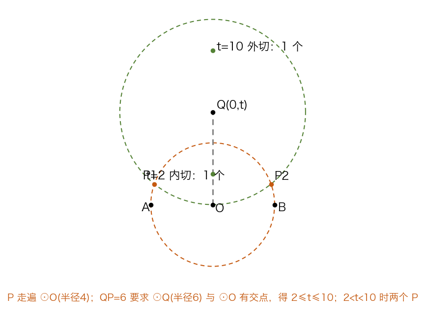

**详解**：

① 对称不改变距离：OP = OA = 4；折痕可以是过 O 的任意直线，P 各个方向都能到，所以轨迹是以 O 为圆心、4 为半径的整圆。

② QP = 6 说明 P 还在以 Q 为圆心、6 为半径的圆上。两圆有公共点 ⇔ |6 − 4| ≤ OQ ≤ 6 + 4，即 2 ≤ OQ ≤ 10。而 OQ = t（t≥0），所以 2 ≤ t ≤ 10。

③ t = 2：OQ = 6 − 4，两圆内切，一个公共点，恰一个 P；t = 10：OQ = 6 + 4，两圆外切，恰一个 P；2 < t < 10：两圆相交，两个公共点，两个 P；其余 t≥0（即 0 ≤ t < 2）：无公共点，没有 P。

**易错点**：内切、外切两种"恰一个"漏掉一种；忘记 t≥0 的前提；轨迹写成半圆。

### 第 13 题｜2025 海淀初三一模第 27 题（真题）

**题目**：在等腰三角形 ABC 中，底角为 α（0° < α < 45°），AD⊥BC 于 D。将射线 BA 顺时针旋转 45° 得射线 BM；C 到 BM 的垂足是 E，直线 CE 交射线 BA 于 F。① 根据原题补全图形，并用 α 表示 ∠EDC；② 在 DC 上取 G，使 DG = AD。求证：AF = EG + (√2/2)·CF。

**隐圆是怎么看出来的**：与第 2 题同结构：垂足 E 对着定线段 BC 张直角，而 D 恰是 BC 中点（等腰三角形三线合一）→ B、E、C 在以 D 为圆心、BD 为半径的圆上。本题所有角度关系都从这个圆里长出来。

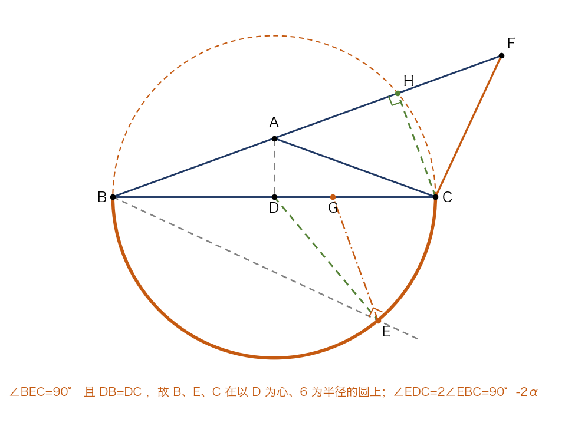

**详解**：

① AB = AC 且 AD⊥BC ⇒ BD = DC。∠BEC = 90°，DE 是 Rt△BEC 斜边上的中线 ⇒ DE = BD = DC ⇒ B、E、C 在以 D 为圆心、BD 为半径的圆上。∠ABC = α，射线 BA 顺时针转 45° 后落到 BC 下方，∠EBC = 45° − α。圆周角 ∠EBC 与圆心角 ∠EDC 对着同一段弧 EC ⇒ ∠EDC = 2∠EBC = 90° − 2α。

② 证明思路（与原卷参考解法一致）：

- 过 C 作 CH⊥BA，垂足 H。Rt△BHC 中 D 是斜边 BC 的中点 ⇒ DH = BC 的一半 = DE，即 H 也在圆 D 上。
- 证 △ADH ≌ △GDE：AD = GD（作图给的），DH = DE（刚证），夹角 ∠ADH = ∠GDE。夹角为什么相等：∠HDC 是弧 HC 的圆心角 = 2∠HBC = 2α，所以 ∠ADH = ∠HDB − ∠ADB = (180° − 2α) − 90° = 90° − 2α；而 ∠GDE = ∠CDE = 90° − 2α（① 的结论，G 在射线 DC 上）。两边夹角对应相等（SAS）⇒ AH = EG。
- 再看 Rt△FHC：∠FHC = 90°；因为 BM⊥CF（CE⊥BM，F 在直线 CE 上），而 BM 与 BA 的夹角是旋转角 45°，所以直线 CF 与 BA 的夹角 ∠HFC = 45°。Rt△FHC 中 FH = CF·cos45° = (√2/2)·CF。
- 由图，H 在 A、F 之间，所以 AF = AH + HF = EG + (√2/2)·CF。证毕。

说明：本题为 2025 年海淀区初三一模数学第 27 题（原卷第 6 页、参考解答第 12—13 页左右），训练册给的是条件概述，具体表述与官方参考解答以原卷为准。

**易错点**：① 看不出 D 是圆心（"中点 + 直角"与第 2 题完全同款）；② 想不到辅助线 CH⊥BA，或证全等时夹角相等说不清理由。

## 第四章 本册易错点总清单

1. **只画弧、不先画整圆**：识别时先按信号画完整的圆，再裁剪；直接画弧容易漏位置（第 1、3、7、12 题）。
2. **画了整圆、忘了裁剪**：动点实际能到的往往只是圆的一部分——上半圆（第 4、5 题）、一段弧（第 6、11 题）、y≥3 的弧（第 8 题）、第一象限的弧（第 9 题）。算完永远多问一句：这个位置真能站到吗？
3. **定角不是 90° 时把圆心当弦中点**：圆心在弦的垂直平分线上，到弦的距离要靠圆心角算（第 6、11 题）。
4. **最值题不验等号条件**："圆心距 ± 半径""三角形两边和差"都有取等条件，必须确认动点能站到那个位置（第 7、8、11 题）。
5. **交点个数漏相切**：相切 = 恰好一个公共点，第 9 题的 k = 4、第 12 题的 t = 2 与 t = 10 都别漏。
6. **折叠题忘记折点能跑到图形外**：折痕任意旋转 ⇒ 整圆，别把自己限制在三角形内部（第 3、7 题）。
7. **旋转方向判错**：第 2、13 题"顺时针旋转 45°"是把射线 BA 转到 BC 下方，∠EBC = 45° − α，写成加就全错。
8. **垂足的直角对着哪条线段搞错**：直角的两端是两个**定点**（A、C 或 B、C），不是动点 P；斜边找错，圆心就错（第 1、2、13 题）。

收尾：做完这 13 题，再回第一章看一遍四个信号。以后见到"垂足""折叠""定角""中点"这些词，先问自己两句：哪个点固定？哪个长度或角度不变？答案出来，圆就出来了。
